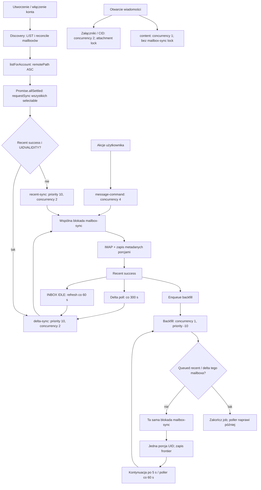

# Maildock — Sync Engine v1: Runtime & Scheduling Audit

Data: 2026-10-17, Europe/Warsaw. Audyt kodu i odczytowych metadanych lokalnej instancji. Nie zmieniono kodu aplikacji, konfiguracji, kolejek ani danych pocztowych. Nie uruchamiano testów, synchronizacji, migracji, usług ani operacji IMAP/SMTP. Kontenery włączył użytkownik w trakcie audytu. Jedyny dodany plik to ten raport; bez commita i PR.

## 1. Wersja i wiarygodność ustaleń

- Analizowana gałąź: `main`; HEAD: `ba074880768645473af070ecc846e420ced990d5` (`2026-10-08T18:40:22+02:00`, `docs: add direct Docker owner recovery command`). Początkowo czysty working tree.
- **CONFIRMED BY RUNTIME:** początkowo oba lokalne kontenery były zatrzymane. Po informacji użytkownika o uruchomieniu: `maildock-app-1` i `maildock-postgres-1` działały i były healthy. Aplikacja wystartowała `2026-10-17 17:05:30.452 +02:00`.
- Obraz: `sha256:7850d8e23a764173073af0b31e51d138c27bf87e2ae7913fdd851aceaeff04a9`, zbudowany `2026-10-17 10:34:40.134 +02:00`. Brak etykiety Git SHA. Etykiety Compose wskazują bieżące repozytorium i pliki Compose, ale same nie dowodzą tożsamości kodu.
- **CONFIRMED BY RUNTIME:** uruchomiony worker używa kolejek v1; wykryto jeden proces `dist-worker/composition/worker-process.js`. Porównano w pamięci skompilowane moduły obrazu z transpilacją bieżącego źródła: composition worker i worker-process, wszystkie siedem rejestracji kolejek, mailbox-lock, coalesced-sync-job, message-service, delta/backfill/content/command/attachment services, idle-watchers, provider IMAP i config. Zgodność po normalizacji rozszerzeń importów i formatowania; backfill dodatkowo sprawdzony drukarką AST z `verbatimModuleSyntax`, ponieważ kompilacja zachowuje import używany tylko w typach.
- **NOT VERIFIED:** formalna tożsamość całego obrazu z commitem, wszystkich modułów web i wszystkich zależności. Nie należy przedstawiać obrazu jako kryptograficznie przypisanego do HEAD. Sprawdzony zakres runtime odpowiada mechanizmom v1 analizowanym poniżej.
- pg-boss `12.33.7`; obraz zawiera lokalną poprawkę `stately` sprawdzającą aktywnego poprzednika w SQL. W analizie uwzględniono `patches/pg-boss@12.33.7.patch` oraz zainstalowany kod biblioteki, nie tylko API upstream. Nie analizowano v2 jako wzorca.

Znaczenie oznaczeń:

- **CONFIRMED BY CODE** — zachowanie wynika ze wskazanej ścieżki kodu, nie dowodzi częstości w produkcji.
- **CONFIRMED BY RUNTIME** — obserwacja w ograniczonej próbce metadanych lub istniejących logów.
- **HYPOTHESIS** — możliwy wpływ, bez dowodu związku przyczynowego w tej instancji.
- **NOT VERIFIED** — brak pomiaru lub wystarczających danych.

## 2. Aktualny przepływ

Wartości na diagramie to domyślne ustawienia, również obowiązujące w odczytanej konfiguracji badanego workera. Workery biznesowe ruszają dopiero po gotowości instancji/MFA (`src/composition/worker-process.ts`). Kolejność rejestracji workerów nie jest polityką priorytetów.

**CONFIRMED BY CODE:** `AccountsService.create`/włączenie konta wywołuje `scheduleDiscovery`. `MailboxDiscoveryService.run` wykonuje discovery, reconcile i równoległe `MessageService.requestSync` dla selectable mailboxów. Pierwsze discovery nowego konta kieruje je do recent; kolejne discovery może kierować już zsynchronizowane mailboxy do delta. Discovery zapisuje sukces przed planowaniem; wyniki `Promise.allSettled` nie są analizowane, więc sukces discovery nie gwarantuje skutecznego enqueue każdego folderu.

Recent obejmuje domyślnie 30 dni. `synchronizeRecentMailbox` pobiera listę UID od cutoff i obsługuje wszystkie partie w jednym jobie/locku. Batch 150 ogranicza pojedynczy FETCH/zapis, a nie całkowity czas joba. `persistBatch` publikuje dane przed zakończeniem całego folderu. Nie ma jawnego sortowania recent UID malejąco, więc kod nie gwarantuje, że najnowsza partia pojawi się jako pierwsza.

Po recent success `runRecentSync` planuje bezpośrednio backfill, nie delta. Delta uruchamia się przez poller, IDLE, żądanie ręczne lub reconcile po komendzie. IDLE dotyczy INBOX z capability IDLE i wymaga recent success; zdarzenia mają debounce 500 ms. Pierwsze wykrycie nowego INBOX przez manager może czekać na refresh 60 s; pozostałe foldery korzystają z pollera (domyślnie 300 s).

## 3. Kolejki, concurrency, retry i rzeczywista kolejność

**CONFIRMED BY CODE; policy/retry/expiry dodatkowo CONFIRMED BY RUNTIME** z `pgboss.queue`:

| Kolejka | localConcurrency / proces | Priority send | Policy; singletonKey | Retry limit / delay / backoff / max [s] | Expire [s] |
|---|---:|---:|---|---|---:|
| `mailbox-discovery-v1` | workerConcurrency = 5 | 0 | stately; accountId | 4 / 15 / tak / 900 | 120 |
| `mailbox-recent-sync-v1` | messageSyncConcurrency = 2 | 10 | stately; mailboxId | 4 / 30 / tak / 900 | 900 |
| `mailbox-delta-sync-v1` | messageSyncConcurrency = 2 | 10 | stately; mailboxId | 4 / 30 / tak / 900 | 900 |
| `mailbox-backfill-sync-v1` | 1 | -10 | stately; mailboxId:frontier lub :initial | 4 / 30 / tak / 900 | 900 |
| `message-command-v1` | 4 | 0 | standard; brak singletonKey | 4 / 15 / tak / brak jawnego limitu | 900 |
| `message-content-fetch-v1` | 1 | 0 | stately; mailboxId:messageId | 4 / 30 / tak / 900 | 900 |
| `attachment-fetch-v1` | 2 | 0 | standard; attachmentId przekazany do send | 0 / 0 / nie / — | 900 |

Źródła: `src/modules/mail/infrastructure/{mailbox-discovery,recent-sync,delta-sync,backfill-sync,message-command,content,attachment}-jobs.ts`; parametry rejestracji w `src/composition/worker-process.ts`. Brak sześciu jawnych override środowiskowych dla concurrency/pool/chunk/batch/poll; porównany config daje: pool 10, workerConcurrency 5, recent i delta po 2, chunk 500, batch 150, poll 300 s.

Ważne ograniczenia interpretacji:

1. Każde `boss.work(queue, ...)` obsługuje własną kolejkę. `priority DESC, created_on` w pg-boss porządkuje kandydatów **w tej samej kolejce**, z uwzględnieniem gotowości `start_after`, retry i blokad SQL `SKIP LOCKED`. Nie porównuje delta +10 z backfill -10 ani command 0. Zwiększenie priority komend samo nie wyprze backfillu.
2. `localConcurrency` nie jest globalnym ani per-account limitem IMAP. Recent 2 + delta 2 + backfill 1 mogą pracować równolegle; dochodzą content, commands, attachments, discovery, IDLE oraz osobne outgoing/sent-copy. Drugi proces zwiększyłby limity lokalne.
3. `stately` izoluje key w obrębie kolejki/stanu; poprawka fetch nie obejmuje innych kolejek. Dopiero advisory lock łączy recent/delta/backfill/command. Backfill ma różne klucze dla różnych frontier, więc nie jest deduplikowany jednym mailboxId we wszystkich stanach.
4. `enqueueCoalescedSync` używa transakcyjnego producer-locka i szuka istniejącego queued joba tego samego key; nie jest to blokada wykonania ani gwarancja pierwszeństwa. `queued: true` oznacza `state < active`, również retry odroczone w przyszłość; nie obejmuje active.
5. Attachment przekazuje singletonKey, ale przy policy standard sam key nie zapewnia takiej wyłączności jak stately; faktyczną ochroną wykonania jest osobny advisory lock attachmentId.
6. Aplikacja nie ustawia `pollingIntervalSeconds`: zainstalowana biblioteka ma bazowy polling 2 s; runtime `notify=false` dla wszystkich siedmiu kolejek. To nie jest gwarancja startu w 2 s: dochodzi zajętość workerów, startAfter, retry i zasoby DB. Biblioteka odejmuje czas obsługi od cyklu, więc długi job nie oznacza obowiązkowo dodatkowych 2 s przerwy.
7. Retry jest wykładnicze z losowością; delay 15/30 nie oznacza ścisłego stałego czasu. Limit 4 oznacza maksymalnie cztery ponowienia pg-boss danego joba. CommandPoller może utworzyć kolejne joby dla nadal pending/executing komendy; nie jest to globalny limit prób operacji.
8. Pollery aplikacji: delta 300 s, backfill 60 s, command i attachment 30 s. Recent nie ma odpowiednika BackfillPoller naprawiającego każdy nieskutecznie zaplanowany recent. Expiry joba nie jest kontrolowanym limitem czasu porcji IMAP ani mechanizmem bezpiecznej preempcji callbacka.

## 4. Dlaczego nie ma INBOX-first

**CONFIRMED BY CODE:** `MailboxService.listForAccount` (`src/modules/mail/application/mailbox-service.ts:145`) sortuje po `remotePath ASC`, nie po roli INBOX. `MailboxDiscoveryService.run` (`mailbox-discovery-service.ts:63`) uruchamia żądania przez `Promise.allSettled`. Każde żądanie wykonuje odczyty DB przed send, więc nawet początkowa kolejność tablicy nie gwarantuje kolejności utworzenia jobów. Wszystkie recent mają priority 10.

Wcześniej utworzony job może ponadto czekać na zajęte workery recent, ready/startAfter po retry, nieuzyskany mailbox lock lub DB. Priority nie przerywa joba już aktywnego. Po rozpoczęciu INBOX inne foldery nadal konkurują o DB, CPU/event loop i serwer IMAP; czas pierwszego zapisu metadanych oraz później pobrania treści może na tym ucierpieć (**HYPOTHESIS** co do skali).

**CONFIRMED BY RUNTIME:** najwcześniejszy OTHER recent utworzono `10:36:59.425757 +02:00`, rozpoczęto `10:36:59.863322`; INBOX utworzono `10:36:59.431882`, rozpoczęto `10:37:02.238705`. INBOX utworzono około 6 ms później i uruchomiono około 2,375 s później. To dowód braku INBOX-first w tej historii, nie pomiar czasu wyświetlenia UI. INBOX recent trwał około 2,756 s; nie mierzono chwili pierwszej widocznej wiadomości.

## 5. Fresh-first i postęp historii

### Blokada i utrata okazji do szybkiego delta

**CONFIRMED BY CODE:** `createMailboxLock` (`src/modules/mail/infrastructure/mailbox-lock.ts`) rezerwuje sesję DB, próbuje `pg_try_advisory_lock(hashtextextended('mailbox-sync:'+mailboxId,0))` i trzyma ją przez całe callback/work, łącznie z IMAP i zapisami. Nieuzyskanie blokady natychmiast rzuca błąd. Sesja jest zwalniana w finally. To nie jest oczekiwanie FIFO, nie ma priorytetu ani sprawiedliwości między kolejkami.

Delta podczas aktywnego backfillu tego samego mailboxa może zostać odebrane przez worker, nie uzyskać locka i przejść w retry z delay 30 s/backoff zamiast ruszyć tuż po zwolnieniu blokady. Backfill nadal kończy porcję. **HYPOTHESIS:** taka kolizja tłumaczy część rzeczywistych opóźnień; same retry nie dowodzą tego powodu.

### Granice ustępowania backfillu

**CONFIRMED BY CODE:** `registerBackfillWorker` sprawdza queued recent/delta dla tego samego mailboxId przed lockiem i ponownie po locku. Nie sprawdza komend, content, attachments ani ważnych zadań innych folderów/konta. Nie przerywa już rozpoczętej porcji, gdy później pojawi się delta/command. Active delta/recent nie jest widoczne przez queued, ale blokuje współdzielony lock.

Przy queued recent/delta callback wraca bez kontynuacji — job jest completed mimo niewykonania porcji. BackfillPoller przywraca pracę najpóźniej przy kolejnym skutecznym przebiegu (interwał 60 s, bez gwarancji SLA). Odroczone retry delta też powoduje ustępowanie, choć chwilowo nie jest gotowe do wykonania. Istnieje okno wyścigu po drugim sprawdzeniu. Nie ma gwarancji maksymalnego oczekiwania historii przy nieustannym napływie ważniejszej pracy.

### Ile trwa porcja

**CONFIRMED BY CODE:** `synchronizeBackfillMailbox` (`imap-smtp-mail-provider.ts:942`) obsługuje jeden malejący **zakres UID**, domyślnie szerokości 500, dopuszczalnie do 5000; nie 500 gwarantowanych wiadomości. Wykonuje connect/select/search/fetch, ewentualną weryfikację brakujących UID, jeden `sink.chunk`, teardown. Zapis frontier jest transakcyjny razem z danymi. Kontynuacja ma startAfter 5 s, a crash między zapisem i enqueue naprawia poller.

Nie ma budżetu czasu porcji. Connect/greeting timeout 10 s i socket timeout 15 s nie ograniczają całkowitego czasu aktywnego transferu ani oczekiwania SQL. Batch DB robi wiele operacji w transakcji pod row lockiem mailboxa (`MessageService.persistBatch:384`); większy chunk zwiększa czas możliwej konkurencji. Backfill początkowo startuje od UIDNEXT-1 i może ponownie przejść również zakres recent — nie zaczyna automatycznie poniżej daty recent cutoff.

**CONFIRMED BY RUNTIME:** zaobserwowano historyczne porcje backfill do 27,497 s, a po uruchomieniu postęp aktywnej historii równolegle z niedawno zakończonym delta. **NOT VERIFIED:** maksymalny czas porcji w trudnych warunkach, gwarancja fairness, czas detekcji rzeczywiście nowej wiadomości podczas konkretnej porcji.

Delta pobiera nowe UID przed uzgadnianiem flag/usunięć, ale cały job nadal obejmuje te dalsze fazy. `DeltaSyncService.run` odczytuje wszystkie lokalne UID; bez baseline MODSEQ provider uzgadnia flagi lokalnych UID partiami, a również z CONDSTORE sprawdza obecność lokalnych UID. Koszt delta rośnie wraz z historią; batch size nie stanowi limitu całego delta. **HYPOTHESIS:** wraz z backfillem wydłuża się blokowanie komend przez sam delta.

## 6. User-actions-first

| Ścieżka | Wykonanie i bezpośrednie oczekiwanie | Ustalenie |
|---|---|---|
| Otwarcie / treść | Detail i POST content → pending → kolejka content → nowy klient IMAP → zapis/sanitizacja → polling UI | **CONFIRMED BY CODE:** brak mailbox-sync lock; jedna lokalna instancja content workera może blokować wszystkie kolejne pobrania treści w swojej kolejce |
| Załącznik | request → attachment-fetch → lock attachmentId → nowy IMAP → blob → ready | **CONFIRMED BY CODE:** brak mailbox-sync lock, concurrency 2; repair pending/fetching co 30 s, max 100 rekordów/przebieg |
| CID | `EmailRenderingService` request attachment, status/pending; gotowe `inlineResource` czyta blob | **CONFIRMED BY CODE:** CID dzieli kolejkę i dwa sloty z normalnymi załącznikami; HTML może wymagać kolejnych odpytań render |
| Read/unread, flag/unflag | `MessageCommandService.create` zapisuje trwałą komendę i optymistyczne flagi lokalne; command worker próbuje mailbox lock; potem mutateMessage | **CONFIRMED BY CODE:** czeka logicznie przez retry na recent/delta/backfill tego mailboxa; UI może już pokazywać lokalną zmianę |
| Archive/trash | create ustawia actionHidden, zapisuje destination; po locku provider MOVE, potem reconcile source/destination przez delta | **CONFIRMED BY CODE:** ta sama konkurencja; niepewny wynik MOVE jest celowo traktowany odmiennie od bezpiecznego retry flag |

W badanym `message-command` obsługiwane przeniesienia to archive/trash, nie ogólny dowolny destination. Niepewnego MOVE nie wolno ponawiać automatycznie przez uproszczenie obsługi błędów. Worker blokuje mailbox źródłowy; nie rezerwuje w tej ścieżce tego samego locka mailboxa docelowego.

`src/components/mail-client.tsx:738` może automatycznie planować mark_read po otwarciu zgodnie z ustawieniem. Z tego powodu podczas audytu nie otwierano prywatnych wiadomości w UI ani nie wywoływano endpointów detail/render/content. Sam odczyt plików i SELECT metadanych omija tę ścieżkę.

### Konsekwencje nieuzyskania locka komendy

**CONFIRMED BY CODE:** w `registerMessageCommandWorker` lock jest na zewnątrz `MessageCommandService.run`. Gdy lock zajęty, `run` nie startuje i licznik `messageCommands.attempts` nie rośnie; rośnie stan retry joba pg-boss. Nie ma przekazania locka komendzie ani krótkiego kontrolowanego oczekiwania. Backfill nie wie, że komenda czeka.

CommandPoller co 30 s ponownie enqueue pending/executing bez singletonKey. Może powstać kilka jobów dla tej samej komendy, również gdy wcześniejszy czeka w retry lub wykonuje się. Lock i sprawdzenie statusu chronią wiele przypadków przed powtórzeniem, lecz duplikaty zużywają sloty/próby locka. `pendingIds` bierze 100 najnowszych — pod stałym napływem stara komenda może nie trafić do naprawy. **NOT VERIFIED:** wystąpienie takiego zagłodzenia/duplikatów w badanej instancji.

### Wspólne zasoby mimo osobnych workerów

**CONFIRMED BY CODE:** provider tworzy osobne połączenie IMAP na operację, bez wspólnej puli/semafora/account admission control. Content i attachment nie czekają na zwolnienie klienta IMAP należącego do backfillu. Mogą jednak konkurować na poziomie serwera, sieci i CPU (**HYPOTHESIS**); nie potwierdzono limitowania połączeń przez Gmail.

Pool worker DB (domyślnie 10) jest wspólny dla usług; pg-boss ma własną warstwę połączeń. Mailbox lock rezerwuje jedną sesję, lecz callback usług używa zwykłej bazy i może potrzebować kolejnej. Przy pool=1 istnieje konstrukcyjny problem braku wolnej sesji dla pracy pod lockiem; przy wielu równoległych rezerwacjach również możliwe jest wyczerpanie puli. Attachment dla odmiany wykonuje pracę na zarezerwowanej sesji. **CONFIRMED BY CODE** zależność; **NOT VERIFIED** wystąpienie zakleszczenia puli w runtime. Nie interpretować idle ClientRead jako dowodu wolnych slotów klienta postgres-js.

`persistBatch` blokuje wiersz mailboxa `FOR UPDATE` przez transakcję oraz aktualizuje placements/messages/attachment metadata. Create command aktualizuje placement, detail może zapisywać attachment metadata; te ścieżki mogą czekać na row locks mimo braku advisory lock w web. **HYPOTHESIS:** odczuwalne opóźnienie w tej instancji; brak uchwyconych oczekiwań SQL.

Content request pomija ponowne enqueue przy pending/fetching; nie znaleziono pollera naprawczego content analogicznego do attachment. **CONFIRMED BY CODE:** istnieje ryzyko pozostania tych stanów po przerwanym/utraconym jobie; **NOT VERIFIED:** wystąpienie. To dodatkowy temat odporności, niezależny od kolejności synchronizacji.

## 7. Pomiary środowiska

### Metoda i ograniczenia

Odczyty: `docker ps/inspect/image inspect/logs`, odczyt plików JS i `/proc` wewnątrz kontenera, `psql -X -v ON_ERROR_STOP=1 -c SELECT ...`. Bez importowania composition/config uruchamiającego runtime i bez `boss.start()`, które może wykonywać operacje utrzymaniowe. Zapytania zawierały listy kolumn, agregaty, filtry i LIMIT (7–140 rekordów); nie pobierano message payloadów, tematów, adresów ani output błędów do raportu. Foldery spseudonimizowano w SQL; rozpoznawano wyłącznie klasę INBOX/OTHER.

Pomiar główny: `2026-10-17 17:06:29.762 +02:00`; kolejne snapshoty w następnych minutach. `pgboss.job` obejmuje obserwowane kolejki w `job_common`. Agregaty czasów ograniczono do jobów utworzonych w ostatnich 24 h i posiadających started_on. To zachowana historia, nie kompletne telemetryczne śledzenie wszystkich prób. Restart użytkownika rozdziela ten okres długą przerwą w pracy.

### Liczba jobów w głównym snapshotcie

| Kolejka | Completed | Retry | Inne |
|---|---:|---:|---|
| discovery | 1 | 0 | 0 |
| recent | 14 | 0 | 0 |
| delta | 60 | 0 | 0 |
| backfill | 314 | 1 | 0 |
| command | 2 | 0 | 0 |
| content | 5 | 0 | 0 |
| attachment | 0 | 0 | 0 zachowanych jobów |

Późniejszy snapshot: backfill 3 created + 1 active; brak innych created/retry/active/failed w zapytaniu. To zmienny stan, nie brak backlogu w całym okresie. Najstarszy aktywny job backfill miał około 22440 s od utworzenia: **nie** oznacza to 22440 s ciągłego wykonania.

### Czas od utworzenia do ostatniego startu i czas wykonania

| Typ | N started / completed | Średni wait [s] | Max wait [s] | Średni run [s] | Max run [s] |
|---|---:|---:|---:|---:|---:|
| discovery | 1 / 1 | 0,715 | 0,715 | 1,590 | 1,590 |
| recent | 14 / 14 | 13,141 | 80,415 | 3,199 | 7,525 |
| delta | 60 / 60 | 10,055 | 44,311 | 2,956 | 32,054 |
| backfill | 315 / 314 | 519,627 | 22379,600 | 1,974 | 27,497 |
| command | 2 / 2 | 0,949 | 1,164 | 3,471 | 5,791 |
| content | 5 / 5 | 1,283 | 1,874 | 4,106 | 8,535 |

Wait = `started_on-created_on`; run = `completed_on-started_on` tylko gdy oba istnieją. Wait zawiera planned delay, retry i okres zatrzymania usług. Nie jest to czysty czas oczekiwania na zasób ani suma czasu wszystkich prób. Completed obejmuje także poprawne no-op/ustąpienie backfillu. Małe N command/content nie uzasadnia percentile SLA.

Dodatkowe przybliżenie `started_on-greatest(created_on,start_after)` dla retry_count=0: recent N=13 avg 7,966 / max 18,968 s; delta N=59 avg 9,474 / max 38,027 s; backfill N=309 avg 450,416 / max 22374,552 s. Nawet to przybliżenie obejmuje downtime i nie dowodzi contention. Celowo nie podano go jako „czas blokady”.

Zachowane joby z retry_count>0: backfill 5 completed z 1 retry i 2 z 2 retry; delta 1 completed z 1 retry; recent 1 completed z 1 retry. **CONFIRMED BY RUNTIME:** ponowienia wystąpiły; **NOT VERIFIED:** ich pierwotna przyczyna. `safeJobHandler` zastępuje oryginalny błąd `SafeJobFailure`, więc z samego generic output nie rozróżnimy lock-busy od awarii IMAP/DB. Brak surowego tekstu lock-busy w logu nie wyklucza kolizji.

### Foldery

Snapshot po głównych agregatach; etykiety pozostałych folderów to lokalne pseudonimy uporządkowane według ID, bez nazw ścieżek:

| Folder | Recent | Delta | Backfill | Frontier UID |
|---|---|---|---|---:|
| folder-1 | success | success | complete | 0 |
| folder-2 | not_started | not_started | not_started | — |
| folder-3 | success | success | complete | 0 |
| folder-4 | success | success | complete | 0 |
| INBOX | success | success | pending | 66843 |
| folder-6 | success | success | pending | 185519 |
| folder-7 | success | success | pending | 6870 |
| folder-8 | success | success | complete | 0 |
| folder-9 | success | success | complete | 0 |
| folder-10 | success | success | complete | 0 |
| folder-11 | success | success | complete | 0 |
| folder-12 | success | success | complete | 0 |
| folder-13 | success | success | complete | 0 |
| folder-14 | success | success | pending | 88061 |
| folder-15 | success | success | complete | 0 |

Nie ustalono w tym zestawie, czy folder-2 jest selectable; sam not_started nie jest dowodem błędu. Dla 14 success folderów ostatnie udane delta miały wiek około 40,8–60,7 s; INBOX 41,9 s. Dowodzi to świeżej aktywności delta po starcie obok nieukończonej historii, nie gwarantuje detekcji każdej nowej wiadomości w określonym czasie.

### Logi, PostgreSQL i połączenia

- Istniejący log kontenera przed ponownym uruchomieniem: 63 linie w ograniczonym odczycie; po wydzieleniu JSON 54 zdarzenia. 46 `mail.delta_sync_completed`, 1 `mail.idle_connected`, po 1 jobs.started/stopped i worker.shutdown. Czasy delta z logów: min 844 ms, avg 3023,696 ms, max 32031 ms. To inna próbka niż późniejsze 60 jobów w DB; nie należy ich utożsamiać.
- Nie znaleziono jawnego tekstu `Mailbox sync is already running` w tych 63 liniach. Nie jest to dowód nieobecności kolizji: sanitizacja celowo usuwa przyczynę. Nie analizowano historycznych plików benchmarków jako dowodu prawdziwego Gmail runtime.
- Snapshot `pg_stat_activity`: 12 idle/ClientRead i 1 active (diagnostyczny SELECT); bez widocznego wait_event_type Lock. `pg_locks`: 1 granted advisory ExclusiveLock, 8 granted relation AccessShareLock, brak ungranted w zwróconym zestawie dla tej bazy. Nie ma dowodu ciągłego blokowania DB; krótki snapshot może ominąć kolizje, a try-lock w ogóle nie musi tworzyć długiego wait.
- Odczyt `/proc/net/tcp{,6}` w przestrzeni sieciowej aplikacji: 1 established połączenie do portu 993 w chwili próbki. Nie zbierano adresów IP. To punktowy odczyt TCP, nie historyczna maksymalna liczba połączeń IMAP ani dowód limitu Gmail.
- **NOT VERIFIED:** historyczne percentyle per mailbox, liczba jednoczesnych IMAP podczas onboarding, czasy czekania postgres-js reserve, dokładne przyczyny retry, start-to-first-visible INBOX i click-to-content w UI. Nie wywoływano działań w celu wygenerowania pomiarów.

## 8. Problemy według wpływu na UX

| Wpływ | Problem | Dowód i granica |
|---|---|---|
| Wysoki: akcje użytkownika | Busy mailbox → retry 15 s/backoff komendy; backfill nie ustępuje komendom | **CONFIRMED BY CODE**; opóźnienie z tej konkretnej przyczyny **NOT VERIFIED** |
| Wysoki: pierwsze użycie | Brak INBOX-first przy discovery i jednakowy priority recent | **CONFIRMED BY CODE + CONFIRMED BY RUNTIME**: OTHER wystartował przed INBOX |
| Wysoki: świeżość | Delta nie może przerwać backfill/recent; busy lock → retry 30 s/backoff | **CONFIRMED BY CODE**; max wait delta 44,311 s **CONFIRMED BY RUNTIME**, związek przyczynowy **HYPOTHESIS** |
| Wysoki przy skrajnej konfiguracji | Rezerwacje mailbox locka mogą zużyć pool potrzebny callbackom | **CONFIRMED BY CODE**; pool exhaustion runtime **NOT VERIFIED** |
| Średni: czytanie | Content concurrency 1 i wspólne sloty attachment/CID; brak globalnego user-first admission | **CONFIRMED BY CODE**; stopień contention IMAP **HYPOTHESIS** |
| Średni: dłuższa praca | Delta rośnie z liczbą lokalnych UID; recent trzyma lock przez cały window | **CONFIRMED BY CODE**; wpływ wzrostu historii na latency **HYPOTHESIS** |
| Średni: historia | Ustąpienie kończy job i czeka na poller; brak fairness przy ciągłej wyższej pracy | **CONFIRMED BY CODE**; rzeczywiste zagłodzenie **NOT VERIFIED** |
| Średni: odporność | Powielanie command jobów przez poller; content pending/fetching bez repair; ignorowane wyniki enqueue discovery | **CONFIRMED BY CODE**; trwałe utknięcie w tej instancji **NOT VERIFIED** |
| Diagnostyczny | Brak bezpiecznej kategorii lock_busy i metryk reserve/first-visible | **CONFIRMED BY CODE**; ogranicza przypisanie obserwowanych retry do przyczyn |

## 9. Minimalne zmiany do rozważenia — bez implementacji

Kolejność poniżej ma ograniczyć zakres i ryzyko; żadna propozycja nie wymaga nowego schedulera ani mechanizmów v2.

1. **INBOX priorytet w istniejącej kolejce recent.** `MailboxDiscoveryService.run` oraz `MessageService.requestRecentSync` / `PgBossRecentSyncScheduler.schedule` i scheduler w `src/composition/worker.ts`: jawnie wybrać INBOX po kanonicznej tożsamości, await jego enqueue, nadać mu wyższy recent priority niż innym. Dopiero potem pozostałe enqueue. Sam sort lub samo sequential send nie gwarantują pierwszeństwa przy istniejących aktywnych jobach. Jeśli wymaganiem będzie ścisłe „inne foldery dopiero po pierwszej partii/success INBOX”, potrzebny będzie dodatkowy warunek w obecnej ścieżce i fallback na awarię INBOX — to szersza zmiana, nie automatyczny pierwszy krok.
2. **Backfill ustępuje pending komendom tego mailboxa.** `registerBackfillWorker`: sprawdzać durable `messageCommands` pending/executing przed i pod lockiem, obok recent/delta. Zapytanie po samym singletonKey komendy nie zadziała, bo dziś key nie istnieje. Nie blokować historii globalnie z powodu dowolnego content joba. Ustąpienie i naprawę kontynuacji zachować bez gorącej pętli; zadbać o brak wiecznego zatrzymania przez stale executing komendę.
3. **Oddzielić busy-lock od błędu pracy.** `createMailboxLock`, rejestracje delta/command/backfill i `safeJobHandler`: typed wynik/błąd lock_busy oraz bezpieczne liczniki queue/operation/duration. Przeplanowywać kolizję krótko i z jitterem, zamiast zużywać sieciowy backoff; zachować trwałą informację o pracy do wykonania i producer coalescing. Nie zastępować throw zwykłym return bez naprawy — job byłby uznany za completed, choć operacja nie ruszyła. Nie zmieniać zachowania retry niepewnego MOVE po rozpoczęciu operacji.
4. **Deduplikacja command enqueue.** `enqueueMessageCommand` i `MessageCommandPoller`: spójny klucz commandId i jawna właściwa policy/koalescencja, chroniące pending/retry/active. Zmiana policy istniejącej kolejki wymaga osobnego sprawdzenia zachowania pg-boss i wdrożenia, nie wystarczy dopisać singletonKey w standard. Zachować repair po awarii enqueue; rozważyć najstarsze pending zamiast 100 najnowszych. Wdrożyć oddzielnie od zmian locka.
5. **Zmniejszenie porcji historii dopiero po pomiarze.** `config.MAILDOCK_BACKFILL_CHUNK_SIZE`, `BackfillSyncService.run`, `synchronizeBackfillMailbox`: najpierw ocenić mniejszy istniejący chunk na fixture. Zmniejsza okno nieprzerywalnego locka, ale zwiększa liczbę connect/search/jobów i czas całej historii. Zachować atomowy checkpoint, epoch checks i 5 s kontynuacji. Nie dodawać timeoutu, który pozwoli uruchomić równoległą pracę, gdy poprzedni callback nadal działa.
6. **Ochrona puli DB i odporność enqueue.** `createMailboxLock`/`createWorkerDatabase`/walidacja config: zapewnić, że callback ma dostęp do sesji mimo rezerwacji; minimalna walidacja bardzo małych pooli i diagnostyka reserve przed większą przebudową API. W discovery sprawdzić rejected `allSettled` i bezpiecznie odnotować brak planowania. Stan recent pending po send aktualizować warunkowo — obecnie szybki worker może zapisać running/success przed późniejszym bezwarunkowym pending producenta. Osobno rozważyć ograniczony repair stale content, z deduplikacją i rozróżnieniem aktywnego joba.

Nie rekomenduję ślepego zwiększania concurrency: nie rozwiąże konfliktu jednego mailboxa i może pogorszyć konkurencję o DB/IMAP. Nie rekomenduję zmiany samych liczb priority między osobnymi kolejkami jako rozwiązania user-actions-first. Osobny globalny limiter IMAP dopiero po potwierdzeniu problemu połączeń; obecny pomiar go nie uzasadnia.

## 10. Ryzyka regresji i późniejsza weryfikacja

**PROPOSED TEST — REQUIRES APPROVAL** — poniższych prób nie wykonywano. Środowisko z fixture/fake providerem i osobną testową bazą, bez prawdziwego Gmaila; każda ingerencja w obecną instancję wymaga osobnej zgody.

- Onboarding: fixture z INBOX i wieloma folderami w niekorzystnej kolejności; mierzyć enqueue/start/first persisted INBOX. Sprawdzić zajęty recent worker, wolny/błędny INBOX, retry, konta disabled i mailbox nonselectable. Kryterium pierwszeństwa ustalić jako enqueue/start/first-visible — to różne gwarancje. Ryzyko: zatrzymanie innych folderów za wadliwym INBOX.
- Fresh-first: kontrolowana wolna porcja backfill, w jej trakcie enqueue delta; pomiar busy/requeue/do-start oraz frontier. Sprawdzić brak utraty delta przy active/queued/retry, brak resetu checkpointu i zachowanie UIDVALIDITY. Ryzyko: zalew krótkich retry lub historia bez postępu.
- User-actions: fake provider flag/MOVE z opóźnieniem pod lockiem i awarią po pozytywnym remote ack; sprawdzić pojedynczą operację, trwałość komendy, zgodność UI po reconcile. Ryzyko: duplikat MOVE/zmiana obsługi niepewnego wyniku. Nie wykonywać na prywatnym koncie.
- Fairness/recovery: stale pending/executing, crash między commit frontier i enqueue, restart workera w testowym środowisku, powtarzające się pollery. Kryterium: historia posuwa frontier przy okresach bez ważniejszej pracy, nie giną żądania, brak lawiny duplikatów.
- DB pool: odizolowane pool=1/2/10 i zapełnione rezerwacje, kontrolowany row lock; mierzyć reserve i czas callbacka. Ryzyko: zakleszczenie puli, zbyt szeroka walidacja ustawień, niepoprawne zwalnianie sesyjnego advisory locka.
- Content/CID: kolejka z wolnym pobraniem i wieloma obrazkami, crash w pending/fetching; mierzyć click-to-ready na danych sztucznych, sprawdzić cache, limity rozmiaru, sanitizację i naprawę. Ryzyko: powtórne pobrania lub zagłodzenie załączników.

Po osobnej implementacji: uruchomić adekwatne istniejące testy izolowane, typecheck i lint; żadnych testów integracyjnych ani browser flows wobec realnego konta bez wyraźnej zgody. W działającej instancji bez ingerencji można później porównywać ograniczone SELECT agregatów oraz bezpieczne logi, rozdzielając downtime, scheduled delay, retry i czas wykonania. Nie generować backlogu ani resetu w celu pomiaru.

Audyt zakończono na raporcie. Rekomendacji nie wdrożono.
