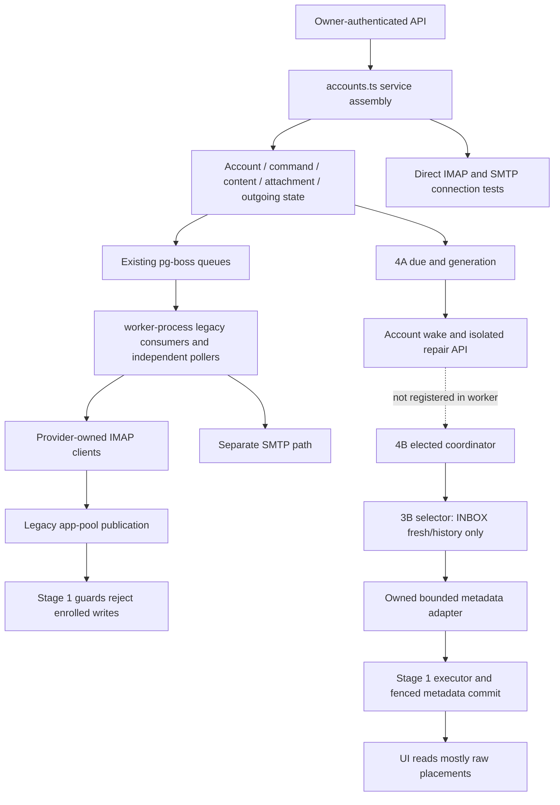
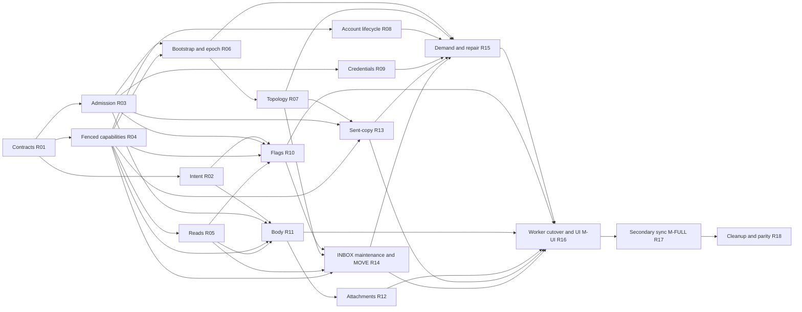

# Revised receiving implementation plan: Stage 4C–6 dependencies

2026-10-14. **Analysis only; proposed sequence awaiting explicit approval.**
Inspected base: `df9de0717c89f340c0d1ec564343ee4df7c02ac1`, branch
`feature/imap-sync-stage-4c-worker`. Stages 1–3C and 4A/4B are accepted in their
documented scopes; Stage 4C is BLOCKED. No source, SQL, tests, fixtures, patches
or runtime configuration changed, and no Docker or application tests ran for
this analysis. The original [implementation plan](IMPLEMENTATION_PLAN.md) stays
the historical approved baseline. This proposal does not authorize activation.

## 1. Executive summary

Move small prerequisites from Stage 5/6 **ahead of** the active Stage 4C worker
cutover. Implement and validate them in isolated fixtures while the new engine
remains absent from the application worker. Change web producers, worker
registrations and admission together only after those capabilities pass.

The dependency is not simply that old consumers need a different queue. Stage 1
protects remote facts but has no capability for current business intent/cache
writes, multi-mailbox publication or account removal. The elected selector has
no admission API for commands, content, attachments, LIST or APPEND. Read paths
also need active-epoch filtering. A direct cutover before these changes creates
visible messages that users cannot reliably open or act on.

The earliest recommended **development Docker/UI milestone M-UI** is after
R01–R16 below. It includes useful INBOX receiving and the existing business
actions, body/attachment retrieval, reply/forward, SMTP and both sent-copy
policies through one owner. Secondary continuous synchronization is explicitly
deferred at this milestone; targeted MOVE/APPEND result publication is required.
This is a limited development smoke milestone, not full baseline parity or a
provider release. **M-FULL**, after R17, adds ordinary secondary-folder
synchronization and closes that compatibility exclusion. No flag selects these
modes: they describe successive code milestones with globally stated supported
capabilities, never routing to another engine. Approval must explicitly accept
the limited M-UI scope or require M-FULL before any manual test.

### Confirmed blockers and evidence strength

**T** means reproduced by the existing Stage 4C PostgreSQL tests; **S** means a
confirmed source contract/incompatibility, without a new runtime reproduction.
**R** denotes a risk whose operational impact still requires integration tests.

| ID    | Finding                                                                                                         | Evidence and consequence                                                                                                                                                             | Required task          |
| ----- | --------------------------------------------------------------------------------------------------------------- | ------------------------------------------------------------------------------------------------------------------------------------------------------------------------------------ | ---------------------- |
| B1 T  | Commands depend on retired recent-sync readiness and write guarded placements in the same transaction as intent | S04 `create`: new INBOX lacks `recentSyncUidValidity`; supplying it still fails the placement UPDATE, rolling back the command                                                       | R02, R10               |
| B2 T  | Content request/publication capability is disabled for enrolled accounts                                        | S03 `maildock_receiving_write_guard`, `message_contents` branch: unconditional `Receiving content capability disabled`; S05 `request` fails before enqueue                           | R02, R11               |
| B3 T  | Attachment request cannot become pending                                                                        | S06 `request`: guarded `message_attachments` UPDATE lacks owner/revision context                                                                                                     | R02, R12               |
| B4 T  | Legacy LIST reconciliation cannot update enrolled INBOX                                                         | S07 `reconcile`: unfenced mailbox metadata/lifecycle UPDATE; transaction rolls back, including secondary changes                                                                     | R06, R07               |
| B5 T  | Keeping secondary legacy receiving is unsafe                                                                    | S08 metadata insertion writes account-wide `messages`; S03 guard binds it to an enrolled mailbox even when the target folder is unenrolled                                           | R07, R16, R17          |
| B6 S  | Other IMAP clients bypass deployment owner and capacity                                                         | S01 registrations and S09 provider methods: commands/content/attachments/sent-copy/LIST have their own clients and concurrency; old mailbox locks do not establish elected ownership | R03, R10–R12, R14, R16 |
| B7 S  | Current reads do not consistently understand active epochs                                                      | S13 lists/search/conversations/content lookup/counts use raw placements; S03 current-placement view is not used by these services                                                    | R05                    |
| B8 S  | Epoch replacement exists in persistence, not in the current INBOX turn                                          | S09 metadata adapter rejects SELECT mismatch; S10 turn never invokes `ReceivingPersistence.persist(kind: 'epoch')`                                                                   | R06                    |
| B9 S  | Single-mailbox authority cannot implement cross-folder outcomes and shared-cache writes                         | S03 `maildock_receiving_lock` rejects a second scope; message UPDATE guard rejects another enrolled placement; search-body trigger also UPDATEs `messages`                           | R01, R04, R11, R14     |
| B10 S | Account DELETE is not compatible with retained receiving authority                                              | S11 `AccountsService.delete` cascades to guarded mailbox/message rows; S03 receiving FK is RESTRICT and revision guard forbids DELETE                                                | R01, R08               |
| B11 S | Credential resolution cannot be used unchanged inside the 4B DB loader                                          | S12 Google/Microsoft refresh uses ordinary transactions, account locks and network I/O; S10 loader is explicitly DB-only and bounded                                                 | R09                    |
| B12 S | Existing connection-test API is an additional IMAP admission path                                               | S11 `testUnsaved`/`testSaved` call S09 `testConnection` directly in web process                                                                                                      | R01, R03, R09          |
| B13 R | Due settlement, live membership and control headroom remain missing                                             | S10 fixed acquisition candidate list; S14 no due-clearing API; scheduler admits up to `min(W, 2D)` while renewal uses the same executor                                              | R03, R09, R15          |

B1–B5 are direct counterexamples in
[the Stage 4C boundary test](../../../tests/receiving-cutover-boundary.integration.test.ts).
The previous [Stage 4C report](../../implementation/imap-sync-engine/STAGE_4C_RESULTS.md)
records 7/7 boundary tests and 237/237 selected regressions. Those were run in
the previous task, not this analysis. Baseline business tests without enrollment
do not establish compatibility after enrollment.

## 2. Source references and actual dependency graph

These references identify actual entry points and writes, rather than proposed
APIs. Proposed capabilities in later sections are not implemented today.

| Ref | Source and functions inspected                                                                                                                                                                                                                                                                                                                                                                                                                                                                |
| --- | --------------------------------------------------------------------------------------------------------------------------------------------------------------------------------------------------------------------------------------------------------------------------------------------------------------------------------------------------------------------------------------------------------------------------------------------------------------------------------------------- |
| S01 | [worker composition](../../../src/composition/worker.ts) `createWorkerComposition`; [worker process](../../../src/composition/worker-process.ts) `startBusinessWorkers`, `stopBusinessWorkers`, readiness supervisor; [JobRuntime](../../../src/modules/jobs/infrastructure/job-runtime.ts)                                                                                                                                                                                                   |
| S02 | [web service assembly](../../../src/modules/accounts/infrastructure/accounts.ts): actual exported account/mail/draft/attachment/content/command/SMTP services used by routes; `composition/web.ts` itself only exposes config/logger                                                                                                                                                                                                                                                          |
| S03 | [Stage 1 authority migration](../../../db/migrations/0035_receiving_authority.sql) `lock`, `claim`, `initialize`, revision/write/commit guards, current-placement view; [demand migration](../../../db/migrations/0036_receiving_demand.sql); [election migration](../../../db/migrations/0037_receiving_election.sql)                                                                                                                                                                        |
| S04 | [MessageCommandService](../../../src/modules/mail/application/message-command-service.ts) `create`, `run`, `fail`; [actions route](../../../src/app/api/accounts/[id]/mailboxes/[mailboxId]/messages/[messageId]/actions/route.ts)                                                                                                                                                                                                                                                            |
| S05 | [MessageContentService](../../../src/modules/mail/application/message-content-service.ts) `placement`, `detail`, `request`, `run`; [content route](../../../src/app/api/accounts/[id]/mailboxes/[mailboxId]/messages/[messageId]/content/route.ts)                                                                                                                                                                                                                                            |
| S06 | [AttachmentService](../../../src/modules/mail/application/attachment-service.ts) `lookup`, `request`, `run`, `download`, `inlineResource`, `upload`; [attachment metadata](../../../src/modules/mail/application/attachment-metadata.ts)                                                                                                                                                                                                                                                      |
| S07 | [MailboxDiscoveryService](../../../src/modules/mail/application/mailbox-discovery-service.ts) `run`; [MailboxService](../../../src/modules/mail/application/mailbox-service.ts) `reconcile`, `listForAccount`; [MailboxRoleService](../../../src/modules/mail/application/mailbox-role-service.ts) `resolveMappedMailbox`, manual mapping/autodetect                                                                                                                                          |
| S08 | [MessageService](../../../src/modules/mail/application/message-service.ts) request/recent execution/persist/list/all-INBOX; [DeltaSyncService](../../../src/modules/mail/application/delta-sync-service.ts); [BackfillSyncService](../../../src/modules/mail/application/backfill-sync-service.ts); [metadata persistence](../../../src/modules/mail/application/message-metadata-persistence.ts)                                                                                             |
| S09 | [ImapSmtpMailProvider](../../../src/modules/accounts/infrastructure/imap-smtp-mail-provider.ts) test/LIST/recent/delta/backfill/STORE/MOVE/body/attachment/APPEND/lookup/SMTP; [bounded INBOX adapter](../../../src/modules/accounts/infrastructure/imap-metadata-window.ts)                                                                                                                                                                                                                  |
| S10 | [elected coordinator](../../../src/modules/mail/application/receiving-election.ts); [scheduler](../../../src/modules/mail/application/receiving-scheduler.ts); [INBOX turn](../../../src/modules/mail/application/receiving-inbox-turn.ts); [persistence](../../../src/modules/mail/application/receiving-persistence.ts); [authority API](../../../src/shared/infrastructure/database/receiving-authority.ts); [executor](../../../src/shared/infrastructure/database/receiving-executor.ts) |
| S11 | [AccountsService](../../../src/modules/accounts/application/accounts-service.ts) create/update/enable/delete/test/discovery/provider-credentials; [account DELETE/PUT route](../../../src/app/api/accounts/[id]/route.ts)                                                                                                                                                                                                                                                                     |
| S12 | [Google OAuth](../../../src/modules/accounts/infrastructure/google-oauth.ts) complete/accessToken; [Microsoft OAuth](../../../src/modules/accounts/infrastructure/microsoft-oauth.ts) complete/accessToken; [registry interface](../../../src/modules/accounts/domain/oauth-mail-provider.ts); OAuth callback routes request discovery after completion                                                                                                                                       |
| S13 | [SearchService](../../../src/modules/mail/application/search-service.ts); [ConversationService](../../../src/modules/mail/application/conversation-service.ts); S05/S06/S07/S08 read functions; [NotificationService](../../../src/modules/mail/application/notification-service.ts); [conversation trigger](../../../db/migrations/0017_conversations.sql); [search-body trigger](../../../db/migrations/0019_global_search.sql)                                                             |
| S14 | [ReceivingDemand/ReceivingDueRepair](../../../src/modules/mail/application/receiving-demand.ts); [wake delivery](../../../src/modules/mail/infrastructure/receiving-wake-jobs.ts); [coalesced producer](../../../src/modules/mail/infrastructure/coalesced-sync-job.ts); [old IDLE manager](../../../src/modules/mail/infrastructure/idle-watchers.ts)                                                                                                                                        |
| S15 | [OutgoingMessageService](../../../src/modules/mail/application/outgoing-message-service.ts) create/run/repair; [SentCopyService](../../../src/modules/mail/application/sent-copy-service.ts) run/saved/requestSync/attemptedDestination; [outgoing lock](../../../src/modules/mail/infrastructure/outgoing-lock.ts); [attachment lock](../../../src/modules/mail/infrastructure/attachment-lock.ts)                                                                                           |
| S16 | [DraftService](../../../src/modules/mail/application/draft-service.ts); [ComposePreparationService](../../../src/modules/mail/application/compose-preparation-service.ts); [EmailRenderingService](../../../src/modules/mail/application/email-rendering-service.ts); signature/local preference services                                                                                                                                                                                     |
| S17 | [mail client](../../../src/components/mail-client.tsx), message-list/reader/toolbar, account-list/mailbox-tree; [Docker compose](../../../docker-compose.yml), [Dockerfile](../../../Dockerfile), config parser and `.env.example`                                                                                                                                                                                                                                                            |

### Current call graph

The graph has two development components, but no new authoritative engine is
registered in the current application worker. This proposal never enables both.

### Path-by-path compatibility matrix

`Guarded` below refers to S03 remote-fact guards, including ancillary trigger
writes. Tables outside that set can still contain important business state;
absence of a trigger is not permission to bypass receiving ownership.

| Entry point/caller                                                   | Durable intent/state                                                                                   | Execution and registration                                                              | Socket/concurrency now                                                                             | Writes and guards                                                                                                                     | Enrolled compatibility                                                                                                          | Change/prerequisite                                                                        |
| -------------------------------------------------------------------- | ------------------------------------------------------------------------------------------------------ | --------------------------------------------------------------------------------------- | -------------------------------------------------------------------------------------------------- | ------------------------------------------------------------------------------------------------------------------------------------- | ------------------------------------------------------------------------------------------------------------------------------- | ------------------------------------------------------------------------------------------ |
| Account API create/update/enable; OAuth callback (S02/S11/S12)       | `mail_accounts`, encrypted credentials/cache, discovery status; 4A account due                         | API writes; callback/AccountsService enqueue discovery                                  | OAuth HTTPS independent; no IMAP for ordinary create/edit itself                                   | Account rows not remote-fact guarded; account trigger records selected changes                                                        | Writes generally compatible; receiving membership/config refresh is missing                                                     | R08/R09/R15; discovery R06/R07                                                             |
| Saved/unsaved test API (S11)                                         | Saved diagnostic status; unsaved result is ephemeral                                                   | `testSaved`/`testUnsaved` directly call provider                                        | Web opens IMAP then SMTP, no elected budget                                                        | Saved account diagnostic fields only                                                                                                  | No confirmed Stage 1 SQL conflict; confirmed owner/socket bypass                                                                | R01/R03/R09; preserve SMTP independence, resolve transient owner-request contract          |
| Discovery API and account callbacks (S07)                            | Account discovery pending/running/success/error; original queue job                                    | `mailbox-discovery-v1` worker to LIST then reconcile then selectable-folder requestSync | Independent provider LIST client; workerConcurrency                                                | `mailboxes` metadata/missing/epoch fields guarded when enrolled; role rows outside guard                                              | T: INBOX reconciliation rejected; partial LIST publication/resource bounds not established                                      | R06/R07; replace network executor with owner admission                                     |
| System-folder role API (S07)                                         | `mailbox_roles` manual/special-use mappings                                                            | API/local autodetect; no separate IMAP                                                  | None                                                                                               | Roles outside guard, discovery advisory lock                                                                                          | Local mapping works structurally; destination may become stale while operation awaits                                           | R07/R14/R13 validate role/identity before wire and publication; retain manual mapping      |
| Manual refresh and discovery post-refresh (S08/S14)                  | Mailbox due/gen; legacy recent/delta statuses for secondary folders                                    | Web recent/delta facades; worker recent/delta registration                              | Old independent mailbox workers/locks                                                              | Legacy status, placements, messages and events guarded                                                                                | INBOX producer accepts durable wake but no active new consumer; old execution fenced; secondary account metadata also fenced    | R15/R16/R17                                                                                |
| Backfill and continuation/poll (S08/S14)                             | Old frontier/status plus due; new E is separate authority                                              | `mailbox-backfill-sync-v1`, `BackfillPoller`, frontier-key continuation                 | Separate history worker with old mailbox lock                                                      | Mailbox frontier/status and metadata guarded                                                                                          | Old recent-success prerequisites; cannot share new authority                                                                    | R16 removes orchestration; history derives from E in shared selector                       |
| IDLE events/reconnect (S14)                                          | Demand-aware `enqueueDelta` records due                                                                | `IdleWatcherManager.start/refresh/watch`                                                | Independent INBOX client per eligible account and timer                                            | Hints only; no fact publication by watcher                                                                                            | SQL hint path compatible; client admission/lifecycle bypasses owner                                                             | R16 retire; optional later R19                                                             |
| Read/unread/flag/unflag, automatic read, archive/trash API (S04/S17) | `message_commands` frozen source/destination IDs/path/UID/epoch, attempts/status; placement optimism   | `message-command-v1`, command poller, `create/run/fail`                                 | localConcurrency 4, independent provider client plus old mailbox lock                              | Intent row unguarded, optimistic flags/action_hidden, rollback and MOVE source DELETE guarded                                         | T: intent create fails; later outcome/rollback also lacks fence                                                                 | R02/R04/R10; MOVE R07/R13/R14                                                              |
| Detail/render/content/prepare API (S05/S16)                          | `message_contents` pending/fetching/ready/failed and body/search cache                                 | `message-content-fetch-v1`, `request/run`                                               | localConcurrency 1, independent body client                                                        | Content capability disabled; ready/search writes also trigger UPDATE `messages`; detail inserts guarded attachment descriptors        | T request failure; S reader detail can write despite being an apparent read                                                     | R02/R05/R11; descriptors published in fenced metadata path                                 |
| Attachment request/download/CID/forward (S06/S16)                    | `message_attachments` source mailbox/epoch/UID/part, status/blob; `blobs`, draft refs                  | `attachment-fetch-v1`, attachment repair poller, `request/run`                          | localConcurrency 2; reserved app DB connection held across transfer under attachment advisory lock | Attachment status/cache writes guarded; blobs/draft refs local                                                                        | T request failure; S download reads cached bytes without explicit active-epoch check                                            | R02/R05/R12; digest and provenance retention; no network-spanning receiving DB reservation |
| Outgoing create/send and draft send (S15/S16)                        | Immutable outgoing MIME/blob refs, `outgoing_messages`, attempts/SMTP status, consumed draft           | `outgoing-message-v1`, outgoing poller                                                  | SMTP independent; outgoing ID lock uses app-pool autocommit connection                             | Outgoing/draft/staged/blob tables outside receiving guards                                                                            | No demonstrated direct fence conflict; incoming attachment and reply dependencies indirect                                      | Retain SMTP executor/pool; R11/R12 for reply/forward inputs, R13 for post-SMTP copy        |
| Sent-copy APPEND/exact lookup (S15)                                  | Existing outgoing sent-copy status, captured path/UUID/UID/epoch, syncPending                          | `sent-copy-v1`, SentCopyPoller, `run`                                                   | localConcurrency 4, independent IMAP; outgoing lock retains DB reservation across APPEND/lookup    | Outgoing result rows outside guard; destination metadata refresh encounters receiving guards                                          | Not automatically rejected by Stage 1, but owner/C/W bypass confirmed; boolean callback can clear pending refresh on acceptance | R07/R13/R15/R16                                                                            |
| Draft edit/delete, signatures, preferences, local upload (S16)       | Draft revision, attachments/blob refs, staged uploads, signatures/settings                             | API/local storage; no receive worker                                                    | No IMAP for local edit/upload                                                                      | Local tables outside receiving guards                                                                                                 | Local operations compatible; reply/forward/CID preparation invokes guarded remote-related services                              | Preserve local operations; R05/R11/R12 tests ensure dependent flows work                   |
| Lists, all-INBOX, search, conversations, counts (S13)                | Local metadata/index/cache and settings                                                                | Web SQL, no queue required                                                              | No IMAP                                                                                            | Reads raw `mailbox_messages`; conversation counts can include historical membership; caches keyed by message                          | S: no uniform active epoch gate; old rows can be exposed after epoch replacement                                                | R05 before any activation that can replace epoch                                           |
| Metadata notifications and threading (S08/S13)                       | Unique remote notification identity, singleton sequence/checkpoint; conversation membership/references | Fenced persistence calls shared metadata helper; DB triggers; HTTP consumer             | No separate socket                                                                                 | Messages/placements/events in same receiving transaction; conversation tables and sequence ancillary; content trigger writes messages | Stage 1 atomicity evidence exists; multi-folder/cache/read correctness and bounded threading costs still need tests             | R04/R05/R11/R14/R16; preserve suppression/preferences/checkpoint semantics                 |
| Account DELETE (S11)                                                 | Today physical delete cascades account-owned rows                                                      | API `AccountsService.delete`                                                            | No socket; can race an active owner                                                                | Cascade encounters guarded facts, RESTRICT receiving FK, no receiving revision DELETE capability                                      | S: not supported for enrolled account by existing schema/API                                                                    | R01/R08; disable/cancel/retain intent first; approve terminal removal/retention contract   |

The existing action route exposes only `mark_read`, `mark_unread`, `flag`,
`unflag`, `archive`, `trash`. Trash means IMAP MOVE to the mapped Trash folder,
not permanent delete/EXPUNGE. Arbitrary user-selected MOVE and remote Drafts
upload are not current features and must not be invented as prerequisites.

## 3. Contract choices that precede implementation

1. **Intent is not remote fact.** Prefer projecting pending commands in queries/UI
   rather than updating canonical placement flags/action_hidden from web code.
   Command rows already retain action/original flags/source identity. For content
   and attachments, add narrow producer capabilities on existing business rows:
   allow only validated request identity and requestable-to-pending transitions,
   never ready bytes, blob links, arbitrary fetching/result states or remote
   facts. Enforce operation-specific permissions/columns/identity at the database
   boundary. Do not grant a blanket guard exemption to these tables.
2. **Extend capabilities, preserve fencing.** Stage 1 metadata authority is not a
   general business mutation API. Add explicit claim/outcome capabilities for
   content and bounded sets of mailboxes. Retain mandatory deferred L checks,
   old/new identity checks, exact revision increments, generation/expiry and
   revocable SQL scopes. No function may reset revisions or accept arbitrary
   SQL/session context from an API client. Shared-cache/search-trigger writes
   need authority for every affected enrolled scope, not just a convenient one.
3. **Account bootstrap needs authority without an enrolled mailbox.** Election
   today joins existing INBOX rows, so a fresh account with no mailbox cannot
   start. A bounded account-level bootstrap unit may SELECT canonical INBOX,
   establish its durable identity and enroll using complete evidence. Full
   secondary LIST/history need not precede this first SELECT. Subsequent topology
   changes require R07; do not run the old LIST after enrollment. INBOX SELECT
   failure must not create fake synchronized mailbox state.
4. **Remote effect uncertainty survives ownership loss.** PostgreSQL cannot revoke
   an already issued STORE/MOVE/APPEND. Keep existing original intent rows,
   attempted destination and uncertainty behavior. An executing MOVE is not
   replayed blindly; a saving APPEND is resolved only by trustworthy exact lookup.
   Store outcome evidence on the original business row if more information is
   needed; no new execution ledger or receipt store is proposed.
5. **Partial development functionality is explicit.** At M-UI ordinary secondary
   fresh/history/repair requests retain demand and return a visible deferred
   state, not a fake completion. Targeted known MOVE/APPEND outcomes must work.
   This is an explicitly approved temporary compatibility exclusion. If full
   existing secondary synchronization is required for first activation, M-FULL
   becomes the earliest test milestone instead.
6. **Deletion and connection tests require design decisions.** Define safe terminal
   account removal/retention before implementing DELETE for enrolled accounts.
   A disabled/hidden retained account is not automatically equivalent to existing
   physical deletion. Unsaved connection tests have no persisted account intent;
   propose bounded authenticated ephemeral delivery to the elected owner's same
   admission boundary, with no secrets in account wake jobs. Choose/approve its
   transport and cancellation contract before implementation. Do not silently
   exclude those clients from the deployment socket count.

These choices amend component capabilities/ordering, not the accepted logical
commit authority semantics in D15. [DECISIONS.md](DECISIONS.md) and
[architecture §14](SYNC_ENGINE_ARCHITECTURE.md#14-final-revision-phase-3-contracts-and-approved-history-protection)
remain the references for authority, cancellation, fairness and uncertainty.

## 4. Revised tasks and dependencies

All tasks R01–R15 can be implemented with the new application receiving engine
**inactive**: explicit isolated production-component fixtures supply election
and enrollment. That is a test boundary, not a shipping feature flag. Each task
must pass its stated gate before a dependent task proceeds. Source changes and
new tests below are proposed future work, not changes made by this document.
R16 changes active application composition but is first verified in isolated
worker processes; deployment/manual testing is a separate decision. R17–R19 can
also be prepared and verified in isolated fixtures before the first Docker
deployment, if M-FULL is chosen instead of limited M-UI. Their dependencies on
R16 require its accepted composition, not an already running deployment.

### Ordering graph and categories

The graph shows the main chains; the prerequisite list in each task is the
complete proceed gate, including shared identity/auth/read dependencies.

Category **A**: prerequisites for safe owner/fact/resource activation, R01–R09,
R15 and lifecycle parts of R16. Category **B**: business capabilities needed
for the recommended usable UI milestone, R10–R14 and UI/business gates in R16.
**Both A and B must pass before M-UI**; A alone only permits isolated tests.
Category **C**: R17 secondary synchronization and R18 cleanup/parity. R17 is
mandatory for full baseline parity even if approved to follow limited M-UI.
Category **D**: R19 optimizations; never waive correctness/provider gates.

### R01 — Agree exact capability and compatibility contracts (A)

- **Scope/modules:** document operation-specific SQL authority, intent projection,
  cache provenance, bounded multi-mailbox scope/lock order, complete LIST limits,
  account removal and unsaved connection-test transport; S03/S09/S10/S11/S13.
- **Prerequisite/schema:** accepted 1–4B plus this source map. No implementation
  required; identify only additive changes to existing records/capabilities.
- **Acceptance/negative controls:** review each B1–B13 against a concrete planned
  call path. Show where an old callback, forged pending transition, stale epoch,
  expired owner, partial LIST and duplicate uncertain mutation will be rejected.
- **Afterward/proceed:** all capabilities still unsupported in the active new
  engine. Proceed only on explicit approval of these contracts and M-UI's
  exclusion; unresolved DELETE/test/APPEND choices remain named gates.

### R02 — Persist and project business intent independently (A)

- **Scope/modules:** S04 `create/fail`, S05 `request`, S06 `request`, web assemblers
  and action/content/attachment routes. Compute optimistic flags/hiding from
  command intents instead of unfenced canonical placement writes. Preserve
  existing API outcomes and pending repair semantics.
- **Prerequisites/schema:** R01. Narrow DB request functions/guards on existing
  command/content/attachment rows; concurrency constraint/conditional claim for
  duplicate active commands if required. Add source/provenance fields to existing
  intent/cache rows only where wake-loss reconstruction needs them.
- **Acceptance/negative controls:** enrolled requests commit with wake lost or
  ACKed; competing requests coalesce safely; cross-account/old-epoch requests
  fail; web cannot set ready/blob or remote flags. Preserve command rollback UI.
- **Afterward/proceed:** remote execution remains unsupported/unwired. Gate:
  independent PostgreSQL proves valid durable intent without remote-fact writes.

### R03 — Admit all operation types through the existing selector (A)

- **Scope/modules:** S10 scheduler/coordinator/adapter contracts, S09 owned-client
  boundaries; include bootstrap/LIST, flags/MOVE, body slices, attachments,
  APPEND/lookup and connection diagnostics in the same owner lifetime. Add bounded
  user/current rotation; do not create queue-specific autonomous receiving loops.
- **Prerequisites/schema:** R01; existing 4B election. No new ledger. Define one
  bounded control operation and executor headroom rather than assuming W=2D
  leaves space for concurrent renewal plus refresh plus publication.
- **Acceptance/negative controls:** W=1/2/4, D=1/2, C=1, owner-only socket admission,
  fair fresh/user/history opportunities; followers and revoked tokens cannot
  create clients; saturated renewal fails closed without exceeding D/D queue.
- **Afterward/proceed:** operation bodies still unimplemented. Gate: allocations
  remain held through actual socket/SQL retirement and no competing admission.

### R04 — Add fenced publication capabilities in small commits (A)

- **Scope/modules:** S03 guard/functions, S10 authority/persistence/executor, S13
  ancillary trigger audit. Separate commits for cache publication and bounded
  multi-mailbox claim/publication; preserve existing metadata API behavior.
- **Prerequisites/schema:** R01. Extend explicit transaction-local scope and
  per-scope revision validation for affected mailboxes. Retain L, monotonic
  revisions, identity checks and old/new UPDATE guards; no general guard bypass.
- **Acceptance/negative controls:** Stage 1 32-row late-callback oracle, delayed
  COMMIT before/after L, expired owner, same-owner ABA, forged scope/result,
  cross-account destination, shared message/cache trigger UPDATE and atomic
  source/destination failure. Bound scope cardinality and reject overflow.
- **Afterward/proceed:** no API/provider route enabled. Gate: every proposed
  result and ancillary write is fenced, short, revocable and atomic; zero IMAP
  under DB reservation. Multi-scope deadlock tests must pass before R14.

### R05 — Make reads and cached resources respect active identity (A)

- **Scope/modules:** S05/S06 lookups, S07 counts, S08 lists/all-INBOX, S13
  search/conversation list/open/counts, S16 draft/compose/render references.
  Use a shared active-placement predicate for enrolled mailboxes and explicitly
  handled metadata-only/unenrolled secondary records; the existing current view
  alone would hide every unenrolled folder.
- **Prerequisites/schema:** R01/R04. Add cache source mailbox/UID/epoch provenance
  on original rows if needed; attachment provenance already exists. No new store.
- **Acceptance/negative controls:** old rows remain physically present after epoch
  change but cannot appear in lists/search/counts or be used to act/fetch/render;
  ready bytes from the old source cannot silently satisfy new source requests.
  Preserve legitimately shared message/draft blob references and account isolation.
- **Afterward/proceed:** no network execution added. Gate: all public read paths
  use the same active-identity rules, including snippets and conversation members.

### R06 — Fresh account INBOX bootstrap and epoch replacement (A)

- **Scope/modules:** S10 election candidates/recovery/turn, S09 bounded SELECT,
  S03 initialization; account-level admission before a mailbox row exists.
  First SELECT establishes canonical INBOX and epoch; on complete mismatched
  SELECT, perform a fenced epoch replacement rather than perpetual rejection.
- **Prerequisites/schema:** R03/R04/R05. Account bootstrap authority and bounded
  mailbox creation capability; existing F/E/R authority, no v1 cursor conversion.
- **Acceptance/negative controls:** new enabled account with zero mailboxes,
  empty INBOX, absent/failed/trickled SELECT, restart around identity creation,
  delayed old FETCH, epoch switch and old-row invisibility. Enrollment remains
  new-install only; populated legacy data is not secretly converted.
- **Afterward/proceed:** secondary LIST/history still unsupported. Gate: useful
  metadata without old discovery/recent-success prerequisite; failed evidence
  initializes nothing and no old-epoch callback can publish.

### R07 — Bounded elected topology and role publication (A)

- **Scope/modules:** S07 discovery/reconciliation/roles, S09 LIST adapter, S10
  maintenance selector. Separate complete bounded LIST collection from short
  fenced metadata publication; keep manual role mappings and conservative IDs.
  Include bounded SELECT/epoch validation and authority enrollment for a known
  operation destination. R13/R14 require exact secondary path/epoch result
  access before R17; this narrow operation capability does not synchronize that
  folder's inventory or history. Reuse the owned adapter boundary, never call
  the old secondary receiving executor.
- **Prerequisites/schema:** R03/R04/R06. Review whole-account complete-list
  publication before code: cardinality/bytes are bounded; partial publication
  never marks unseen folders missing. Any observation/version field belongs on
  existing account/mailbox rows, not a second execution ledger.
- **Acceptance/negative controls:** partial/failed/oversized LIST makes no missing
  transition, INBOX first, rename/delete/recreate/ambiguous stable-ID, role remap
  during wire wait, mailbox-path/epoch stale publication, overflow diagnostic.
- **Afterward/proceed:** secondary metadata/roles supported; secondary history
  still deferred. Gate: valid Sent/Trash/Archive identities and owner-fenced
  lifecycle updates without holding network-spanning DB locks or exceeding cap.

### R08 — Account configuration, disable and removal lifecycle (A)

- **Scope/modules:** S11 account APIs, S12 reconnect identity, S03 lifecycle guard,
  S10 membership cancellation. Separate credential/config identity from wake
  generation; stop stale configuration turns and block their result publication.
- **Prerequisites/schema:** R01/R04/R05/R06. An additive config/credential identity
  version may be needed on `mail_accounts`; do not treat unrelated updatedAt or
  rotating access-token caches as mailbox identity. Implement removal only after
  R01 approves a terminal retention/deletion capability, including dependent data.
- **Acceptance/negative controls:** edit host/password/reconnect or disable during
  FETCH/SQL; re-enable without restart; DELETE while old transaction is blocked;
  retained intents/unknown effects never become automatic replays or silent loss.
- **Afterward/proceed:** physical old-epoch GC not required yet. Gate: configuration
  changes cannot publish from an obsolete account binding; API removal semantics
  are safe and explicit, with no revision/generation reset or unrestricted cascade.

### R09 — Resolve credentials and diagnostics within cancellable lifetimes (A)

- **Scope/modules:** S11 provider credentials, S12 refresh, S10 loader/admission,
  S09 connection tests. Keep OAuth refresh network I/O outside receiving SQL
  scope, then revalidate configuration and ownership before IMAP. Reconnection
  requests must produce durable demand even when only oauthCache changed.
- **Prerequisites/schema:** R01/R03/R08. Existing credential/cache/account rows;
  no tokens/secrets in account wake payloads. Use the approved ephemeral owner
  request transport for unsaved tests; SMTP diagnostics remain independent.
- **Acceptance/negative controls:** expired/revoked Google/Microsoft tokens,
  refresh/reconnect race, cancellation while refresh stalls, pool-size-one SMTP,
  lost owner before client creation, bounded follower test request. Confirm no
  background refresh can hold receiving D hostage or revive cancelled work.
- **Afterward/proceed:** provider release remains pending. Gate: bounded refresh
  settlement and owner-only diagnostic IMAP; no Promise-only timeout proof.

### R10 — Owner-routed flags with preserved optimistic semantics (B)

- **Scope/modules:** S04 command run/result/fail, S09 conditional STORE, S10
  current selector; retire direct command IMAP execution in isolated route tests.
- **Prerequisites/schema:** R02–R05/R08/R09. Existing command rows hold durable
  identity/status; new result capability validates epoch/revision and updates
  canonical flags plus intent completion atomically.
- **Acceptance/negative controls:** read/unread/flag/unflag and auto-read;
  conditional conflict versus protocol failure, rollback projection, duplicate
  wakes, crash before/after STORE/result/ACK, source disappears, stale owner and
  credentials. Independent reader checks final flags/status and unchanged F/E.
- **Afterward/proceed:** MOVE not yet supported by this task. Gate: one admitted
  command at a time per account; failed/uncertain STORE never masquerades as
  confirmed success, and existing flag-conflict tests remain meaningful.

### R11 — Bounded body/MIME retrieval and fenced cache finalization (B)

- **Scope/modules:** S05 request/run/detail, S09 content adapter, S13 search-body
  trigger, S16 render/compose preparation. Remove descriptor writes from web
  detail; metadata publication already discovers attachment descriptors.
- **Prerequisites/schema:** R02–R05/R08/R09. Original content row stores validated
  request/cache provenance. Use R04 fenced finalization for content/search writes,
  not a blanket exception to `Receiving content capability disabled`.
- **Acceptance/negative controls:** complete BODY.PEEK origin/length/finality,
  continuous Base64/QP/charset decode, zero/malformed/oversized parts, slices
  split at encoding boundaries, interrupted transfer discard, stale epoch,
  sanitization/search indexing, double request and old failure after newer ready.
- **Afterward/proceed:** attachment transfer follows R12. Gate: no partial body
  becomes ready; each bounded slice returns to the same selector, no DB across
  wire I/O, useful plain/HTML reader and reply text with fresh receiving active.

### R12 — Owner-routed attachments, downloads and compose references (B)

- **Scope/modules:** S06 transfer/cache, S16 CID/forward/drafts, blob/storage and
  attachment jobs; retain local upload/signature behavior.
- **Prerequisites/schema:** R02–R05/R08/R09/R11. Existing attachment source
  identity/blob rows; use operation-specific R04 cache result capability.
- **Acceptance/negative controls:** complete stream digest/finality, truncation,
  origin errors, encoding splits, cancellation/discard, duplicate download,
  cached source epoch change, CID raster safety, draft/forward references,
  orphan blobs, one-connection pool and unrelated SMTP transactions.
- **Afterward/proceed:** remote full offline body caching unsupported. Gate:
  request/fetching/ready/failure transitions survive restart and fencing; no
  attachment DB lock spans network transfer and no cached stale source leaks.

### R13 — Owner-routed sent-copy APPEND and exact recovery (B)

- **Scope/modules:** S15 sent-copy run/lookup/result/refresh, S09 APPEND,
  outgoing jobs and S10 current admission. Keep SMTP delivery separate.
- **Prerequisites/schema:** R03/R04/R05/R07–R09; existing outgoing immutable MIME,
  attempted path/UUID/UID/epoch and sentCopy statuses. No new ledger.
- **Acceptance/negative controls:** server-managed copy never APPENDs; Maildock
  policy APPENDs once, captured role/path survives remap, missing/lost APPENDUID
  uses exact lookup or uncertainty; crash after SMTP/APPEND, stale owner,
  oversized/hung upload, no duplicate SMTP delivery, notifications suppressed.
- **Afterward/proceed:** full Sent history remains deferred. Gate: saved/uncertain
  copy and targeted destination metadata are correctly represented; pending
  refresh is not cleared by delivery ACK or deferred demand acceptance. Approve
  a bounded upload compatibility policy before this task, never inflate deadlines.

### R14 — INBOX maintenance, MOVE and bounded outcome repair (B)

- **Scope/modules:** S04 MOVE/outcomes, S09 mutate/known-UID evidence, S10 R repair,
  S07 role validation and S13 notification/threading. Subcommit **14a** adds
  bounded ongoing INBOX known-page membership/FLAGS maintenance and targeted
  source/destination repair; **14b** adds MOVE using that repair capability.
  External quiet-INBOX changes cannot depend on an arrival or a user action.
  This is not a full secondary history implementation.
- **Prerequisites/schema:** R02–R05/R07–R10; R04 multi-mailbox capability. Existing
  command result/destination fields hold uncertainty and recovery demands.
- **Acceptance/negative controls:** MOVE mapped/unknown UID, executing restart
  without blind replay, role/path/epoch change, two-scope lock-order deadlock,
  source missing/confirmed deletion, false absence from partial SEARCH/FETCH,
  R-wrap ABA, quiet INBOX external deletion/flag changes, maintenance under busy
  fresh/user work, destination visible without a duplicate arrival notification.
- **Afterward/proceed:** arbitrary MOVE and permanent delete remain nonexistent
  product features; secondary continuous repair deferred to R17. Gate: source
  projection/completion and destination evidence are atomic or explicitly pending
  repair, never forged synchronized state or remote duplicate mutation.

### R15 — Generation-aware due, bounded repair and live membership (A)

- **Scope/modules:** S14 demand/wakes/repair, S10 elected candidate refresh and
  successful outcome transactions. Capture observed account/mailbox generation
  before work; CAS only represented completed demand, using DB time.
- **Prerequisites/schema:** R03/R04/R06–R09/R10–R14. Existing due/gen and original
  intents; include attachment/sent-copy pending repair, not only command/content
  eligibility. Add only proven query indexes; no ledger or all-account array.
- **Acceptance/negative controls:** request during active turn, ACK/duplicates/lost
  wake, lost COMMIT response, membership/credential change, 129-account fail-closed
  diagnostic, account without INBOX, pages that change mid-sweep, wake on follower.
  Acquire account UPDATE lock up front if settlement writes it; do not upgrade a
  SHARE lock after a producer is waiting on the mailbox. Test that deadlock case.
- **Afterward/proceed:** ordinary secondary demand stays due/deferred. Gate: a fresh
  result cannot clear account topology/business obligations or later generations;
  stale/failed results settle nothing; bounded restart reconstruction reaches work.

### R16 — Direct application cutover and UI compatibility (A+B)

- **Scope/modules:** S01/S02 all consumers/producers, S17 UI sync/capability views,
  Docker worker build/start lifecycle. Remove legacy registrations; register wake
  delivery and owner admission/repair in deterministic MFA-gated order (§5).
- **Prerequisites/schema:** R01–R15 all applicable gates; no schema conversion,
  feature switch or migration of populated v1 mailboxes. New-install Docker data
  only; populated development volumes require an explicit separate decision.
- **Acceptance/negative controls:** all 13 Stage 4C scenarios on actual worker
  processes/pg-boss/PostgreSQL, every B1–B13 counterpart, legacy queues inert,
  single-owner all-client inventory, MFA pause/resume/signal/startup fault barriers,
  business routes plus notification/conversation/read regressions under enrollment.
- **Afterward/proceed:** M-UI supports §6; secondary background execution explicitly
  deferred. This is the first task that activates the new engine in application
  composition. Gate: no old authoritative executor or bypass client is reachable;
  manual UI smoke requires separate user authorization after automated acceptance.

### R17 — Secondary receiving parity, split into independent units (C)

- **Scope/modules:** generalize S09 INBOX-only path and S10 account/folder selector
  using R07 topology. Subtasks: **17a** bounded secondary fresh initialization;
  **17b** per-folder E/history and finite revisit; **17c** ongoing known-page
  membership/FLAGS repair and maintenance opportunities. Reuse R14 exact evidence.
- **Prerequisites/schema:** R16 plus each preceding subtask's evidence. Existing
  per-mailbox authority/demand; preserve 128-account cap and separately bounded
  folder candidate/page sizes. No new account engine or secondary worker fleet.
- **Acceptance/negative controls:** quiet/busy INBOX, secondary arrivals independent
  of E/history, complete finite revisit, 15k deletions/equal-count churn, sparse
  UIDs, folder rename/recreate during FETCH, absence/FLAGS finality and fair R.
- **Afterward/proceed:** M-FULL restores secondary synchronization; provider release
  still pending. Activation already uses one engine; advance each globally
  supported folder capability only after its own gate, without legacy fallback.

### R18 — Cleanup and full compatibility release gate (C)

- **Scope/modules:** split bounded old-epoch/blob/conversation cleanup from removal
  of unreachable legacy services/fields/locks (Stage 4D equivalent). Remove fields
  only after all readers/writers and diagnostic/UI consumers are gone.
- **Prerequisites/schema:** R17, approved retention/removal rules. Dedicated
  fenced cleanup capabilities preserve referenced blobs/drafts/outgoing and
  authority tombstones; no automatic receiving revision/generation reset.
- **Acceptance/negative controls:** cascade/threading cost bounds, cancellation
  during cleanup, no source resurrection, live draft/blob reference survival,
  static import/queue inventory, complete business/provider/security matrix.
- **Afterward/proceed:** optimizations remain optional. Gate: bounded memory/disk
  growth, parity/provider results and explicit release approval. If retention
  grows without a proven bound, cleanup is promoted before sustained deployment;
  M-UI permission is only for short disposable development tests.

### R19 — Optional optimizations (D)

- **Scope/modules:** separate optional tasks for owner-budgeted IDLE (S14/S10),
  CHANGEDSINCE/QRESYNC in S09 repair, and measured reuse/affinity or a second lane
  in S10. Never reinstate the old independent watcher lifecycle.
- **Prerequisites/schema:** R18 and separate evidence/approval for each change;
  no new ledger is anticipated. Validate in isolated fixtures before deployment.
- **Acceptance/negative controls:** watcher socket counted/evicted, lost IDLE and
  hung DONE still recover through polling; missing capability/NOMODSEQ falls back
  correctly; reuse cannot execute an old token or leak across epoch/ownership;
  a second lane must improve measured tails without weakening C/W/P/DB bounds.
- **Afterward/proceed:** unsupported provider extensions remain explicitly so.
  Proceed one optimization at a time only if its correctness regressions pass
  and evidence justifies the complexity. These tasks are not release blockers.

Parser input bounds, cancellation, ordinary FLAGS fallback and cache finality
are mandatory prerequisites, not optimizations. No optional optimization is a
way around a failed capacity or latency gate.

## 5. Minimum direct cutover design

### Producers and stale queues

Replace the producer facades in S02 and S01 together: web recent/delta schedulers,
worker recent facade, `enqueueDelta`, `enqueueBackfill`, discovery requests,
command post-result source/destination refresh, attachment stale-epoch refresh
and sent-copy refresh. Account create/enable/config/OAuth reconnect must commit
account demand independently of delivery. Commands/content/attachments and
sent-copy retain their original business rows as the source of truth.

Retire `registerRecentSyncWorker`, `registerDeltaWorker`,
`registerBackfillWorker`, `DeltaPoller`, `BackfillPoller` and
`IdleWatcherManager` from active composition. Replace the old discovery LIST
consumer with the elected topology unit. Replace command/content/attachment/
sent-copy **IMAP execution callbacks** with delivery-to-owner adapters; merely
retaining their direct callbacks is unsafe. Preserve their job schemas/intents
where useful. Keep outgoing SMTP consumer/poller, auth, drafts, local storage
and diagnostic functionality independent.

For pre-existing recent/delta/backfill/discovery jobs, do not register the old
handler or purge queues. Use a bounded one-purpose compatibility converter that
validates account/folder identity and commits new due/intent before completing
delivery; it never opens IMAP or publishes metadata. For secondary jobs conversion
retains mailbox demand and exposes deferred execution. If validation/conversion
fails, leave failure/retry observable; do not silently ACK a live valid request.
Deleted/obsolete identity can be reported obsolete only after validating the
terminal account/folder lifecycle. Running jobs from the old process must settle
before any new owner can acquire/admit. This converter is not another engine.

For retained business queues, delivery acknowledges discovery of a durable
intent, not the remote outcome. Owner startup/repair must recover pending and
executing records without the job. Do not delete uncertainty records, reenact
executing MOVE or change saving APPEND to a fresh append. Sent-copy refresh
acceptance is distinct from destination synchronized status and cannot erase
`sentCopySyncPending` solely because a wake was acknowledged.

### Startup, readiness, pause and shutdown

1. Deploy one application revision and stop/settle every old worker instance.
   There is no mixed-version rolling deployment. Unknown old process state
   blocks activation rather than permitting two writers. A stopped process and
   settled pg-boss handler are not by themselves proof a backend COMMIT is gone:
   retain Stage 1 conflicting-lock recovery/order.
2. Validate application database authority and construct bounded receiving-only
   resources separately from ordinary DB/SMTP. Install signal handling and a
   single serialized lifecycle supervisor before starting resources.
3. While owner MFA is NOT READY, acquire no receiving lease and open no receiving
   sockets, including diagnostics, LIST or lazy body work. API readiness checks
   and worker readiness must agree; configuration reads alone grant no admission.
4. After READY, start the existing JobRuntime, create consistent queue definitions,
   install bounded delivery adapters and legacy-job converters, then start the
   owner lifetime. Deliveries can be safely ACKed before election only because
   durable demand/intents already exist. SMTP remains a separate business route.
5. Elect one coordinator. The winner reconstructs bounded accounts/bootstrap,
   folders and original pending work from PostgreSQL. Start one bounded due-repair
   loop with an initial tick. Followers retry election at bounded intervals,
   consume/deliver hints without receiving sockets and never retain unbounded
   local demand lists. Observe changes without restarting the worker.
6. On READY → NOT READY, signal shutdown or ownership loss: synchronously stop
   admission, cancel owner turn/client/SQL scopes, stop repair/election timers
   and delivery admission, await in-flight startup and converters, then await
   receiving socket/SQL/decoder/temp-storage retirement before conditional lease
   release. Draining/cancelling receiving delivery handlers must not wait on a
   stopped owner or deadlock with its shutdown. Await JobRuntime/business cleanup
   and only then close receiving executors and ordinary DB pools.
7. Clean resume creates a fresh owner lifetime/actor after previous retirement;
   lost objects never reacquire. Coalesce start/stop requests; startup failure
   uses the same ordered teardown for resources actually started. Queue/table
   state survives any partial startup or crash; a new owner reloads under
   conflicting locks and runs current work before resuming history.

SQL renewal, candidate/config refresh, repair reads, publication and release
consume declared capacity; no extra unbounded control pool. Serialize/coalesce
control work, prove headroom with D=1, and preserve the 128-account fail-closed
cap with a clear diagnostic. Optional watchers remain absent at M-UI. Strict
instant remote-socket revocation during process suspension remains impossible;
disclose temporary old/new remote overlap and preserve stale DB publication
rejection and server-cap backoff, as in accepted Stage 4B.

### Generation settlement rules

Capture demand generations independently from mailbox authority revision and
configuration identity. A valid completed fresh check may reschedule only its
observed mailbox demand, including an empty complete result. Later requests
remain due when CAS fails. History eligibility comes from E>1, not an ACK or
old backfill status. Account demand covers bootstrap/configuration/topology and
possibly pending work: an INBOX fresh result alone does not prove those account
obligations completed. Use explicit represented-work conditions and original
intent states before account settlement. Unsupported secondary due remains due;
avoid generating an endless same-INBOX hot loop from a deferred folder hint.
Failed/stale/unknown results never clear due. Unknown COMMIT is ordered/reloaded
before retry, and no callback claims completion merely from local success.

## 6. Earliest fresh Docker/manual UI milestone

**Today: no new-engine Docker/UI test is justified.** There is no active worker
integration or functioning enrolled business route. The accepted isolated tests
are suitable for implementation verification, not a substitute for UI readiness.

**M-UI: R01–R16 accepted, fresh disposable Docker volume, explicit smoke approval.**
The automated actual-worker gates precede a manual smoke. Do not reuse a populated
v1 volume or assume the new-install enrollment restriction is a migration.

The manual test must be able to perform:

- Owner setup/MFA, NOT READY silence, READY startup, MFA replacement pause/resume.
- Password account creation/test/edit/enable/disable and fresh INBOX bootstrap;
  OAuth connection/refresh/reconnect in separately authorized provider fixtures
  if those providers are part of the smoke claim. Account removal only with the
  approved R08 contract; no silent replacement of deletion by hiding data.
- INBOX list/all-INBOX, independent arrivals, progressive history, refresh,
  quiet FLAGS/membership targeted repair and recovery after worker restart.
- Plain/HTML body, safe render/CID, download/upload attachments, auto-read,
  read/unread/flag/unflag and local search/conversation views with active epochs.
- Compose/edit local drafts, reply/reply-all/forward with cached body/resources,
  SMTP send and delivery uncertainty, server copy policy and Maildock APPEND
  with saved/uncertain status, no duplicate send or sent-copy notification.
- Valid role selection, archive/trash MOVE and truthful source/destination result;
  pending repair remains visible when exact outcome cannot be confirmed.
- Stale queued wakes, duplicate delivery, late request and crash/takeover do not
  lose intents or expose stale messages/caches; follower admits no receiving work.

**Explicitly unavailable at limited M-UI:** continuous synchronization of arbitrary
secondary folders and secondary bulk history/repair; optional IDLE acceleration;
full offline bodies; optimizations and provider performance guarantees. Folder
records/manual roles and secondary demands survive, with a deferred status and
disabled/labelled automatic sync affordance. Viewing an incomplete secondary
folder cannot display a “synchronized” state. MOVE/APPEND support is not evidence
that that folder's existing messages/history were synchronized.
Automatic discovery/alerts for unknown secondary arrivals are also unavailable
until R17. Retain all-folder notification preferences/checkpoints and expose
that limited coverage; do not claim that all-folder alerts are complete at M-UI.

**M-FULL: R17 accepted** makes secondary fresh/history/maintenance available and
removes that temporary compatibility exclusion. R18 resource/retention/provider
gates still govern sustained deployment/release. Safety correctness is not
deferred to R18. If the user does not approve the limited secondary exclusion,
M-FULL is the earliest manual-test milestone; disabling existing features to
call M-UI “full functionality” is prohibited.

## 7. Acceptance gates and evidence limitations

### Existing evidence to preserve and extend

| Existing suite/evidence                                                                                                                            | What it establishes in its present scope                                                                   | Required additions/cross-check                                                                                                        |
| -------------------------------------------------------------------------------------------------------------------------------------------------- | ---------------------------------------------------------------------------------------------------------- | ------------------------------------------------------------------------------------------------------------------------------------- |
| `receiving-cutover-boundary.integration.test.ts`                                                                                                   | Seven current counterexamples/control, actual PG/pg-boss; blocked business writes and retained role/demand | Keep unfenced negative controls; add positive enrolled intent/owner-route cases rather than weakening rejection assertions            |
| `receiving-safety.integration.test.ts`, `receiving-retirement-gate.integration.test.ts`                                                            | Scoped executor, old callbacks/builders, delayed/unknown COMMIT, L ordering and unrelated-pool isolation   | Run for every added publication/cleanup capability, including cache search trigger and multi-scope writes                             |
| `receiving-inbox-window.integration.test.ts`, adapter tests                                                                                        | Bounded INBOX evidence and descriptor publication, incomplete FETCH rejection                              | Bootstrap/epoch mismatch recovery, generic folder identity, business adapters' origin/finality and owned cancellation                 |
| `receiving-coordinator.integration.test.ts`, `receiving-scheduler.integration.test.ts`, accepted 3C report                                         | Fresh/history recovery, W profiles and bounded opportunities in isolated fixtures                          | User/current work, maintenance and control capacity; resource retention during body/APPEND, history not starved                       |
| `receiving-wakes.integration.test.ts`, `receiving-election.integration.test.ts`                                                                    | Actual coalesced wakes, follower ACK, committed due, isolated ownership/takeover/crash                     | Actual worker MFA/start/stop, generation CAS, dynamic membership and original attachment/sent-copy repair after lost job              |
| `message-commands.integration.test.ts`, conditional STORE/provider tests, `mailbox-roles.integration.test.ts`                                      | Baseline actions/role/uncertainty behavior, primarily unenrolled                                           | Enrolled owner execution, multi-folder publication, source/destination no-replay and intent projection under epoch change             |
| `attachments.integration.test.ts`, content/provider/MIME/render/security tests                                                                     | Baseline cache/MIME/blob/CID handling                                                                      | Owner-fenced finalization, active provenance, interrupted decode/storage, new source invalidates old cache                            |
| `outgoing-messages.integration.test.ts`, sent-copy jobs/provider/migration tests, draft/API tests                                                  | Immutable SMTP intent, copy-policy/uncertainty and local compose behavior                                  | Enrolled attachment/forward sources and budgeted APPEND/exact lookup, SMTP once independent of receiving failure                      |
| `global-search.integration.test.ts`, `conversations.integration.test.ts`, `incremental-sync.integration.test.ts`, `desktop-notifications.test.tsx` | Baseline indexes/threading/preferences and notification UI semantics                                       | Active-epoch lists/search/counts/snippets, cache-trigger fences, enrolled all-folder/move/sent suppression and bounded threading cost |
| OAuth integration tests and worker logging/readiness/security tests                                                                                | Existing identity/cache/auth and sanitized lifecycle diagnostics                                           | Cancelled/obsolete refresh, web diagnostic owner admission, live credential edits and no MFA bypass                                   |

### Mandatory future gate protocol

For each proposed implementation task use disposable PostgreSQL with real
migrations, actual production executor and independent readers. For queue and
lifecycle tasks also use installed pg-boss and isolated worker processes.
Use barriers for cancellation/lock/ownership races, record sockets/backends,
admitted/queued D, timers, temp storage, revision/F/E/R, demand generations,
business attempts/status and event identities. Promise callbacks/logs alone
are never commit or cleanup evidence. Report p95 and maxima separately.

All 13 original Stage 4C scenarios remain the R16 gate: MFA not ready/ready/pause;
two-worker election; stop/crash takeover; startup/shutdown race; duplicate/lost/
ACKed wake; late request settlement; enablement/credential refresh; retained
deferred secondary demand; inert legacy queues; business functionality; resource
limits and ownership fences. Add config-change stale-publication, account DELETE,
web diagnostic and active-epoch negative controls identified here.

Preserve W/C/D and 128-account bounds, accepted L semantics and the original
failure evidence. Do not increase deadlines to conceal the historical intermittent
W=4 teardown issue. An unexplained runtime failure stops the affected validation
campaign with evidence retained; no open-ended retries. Focused typecheck/lint/
format/diff checks accompany implementation; full Dovecot/provider smoke or
benchmarks require separate authorization and are not performed by this plan.

### Decisions/assumptions still not established

- R04 multi-mailbox/cache capabilities and their exact deferred trigger coverage,
  bounded lock/scope set and shared-message semantics need design approval and
  fresh Stage 1-equivalent evidence. Stage 1 itself is not an accepted multi-scope API.
- R07 complete LIST finalization must fit actual DB/byte/cardinality limits. It
  cannot silently publish partial topology or require unbounded in-memory scans.
- R08 physical removal versus terminal retained authority has no accepted contract.
  Retention/privacy/UI semantics and authority lifecycle must be settled, not guessed.
- R09 authenticated ephemeral diagnostic transport and full OAuth refresh
  cancellation/serialization are proposals. Same-identity reconnect may change
  only oauthCache, which 4A's account trigger does not observe; current OAuth
  callbacks also enqueue old discovery. The revised producer must cover that case.
- D16 oversized/permanently omitted metadata UX, offline alert classification,
  numerical latency/overload/size envelopes and indivisible large APPEND remain
  product/compatibility decisions. Existing policies stay unless explicitly approved.
- Shared-cache search indexing and conversation trigger work can affect commit
  budgets. Atomicity exists for Stage 1 metadata, but worst-case multi-folder
  threading/cache publication cost and active-read behavior are not yet measured.
- Default pg-boss retry/cache delay contributes to takeover recovery; isolated
  accelerated fixture evidence is not a default recovery SLA. Arbitrary process
  suspension can leave an old remote socket; DB fencing does not retract it.
- Full provider authentication/MIME/capability/folder acceptance, sustained cleanup
  bounds and global business socket/resource accounting are not established by
  accepted INBOX fixtures. M-UI must not be advertised as a provider release.

## 8. Explicit exclusions and approval boundary

No new receiving engine, separate scheduler/fleet, second durable execution
ledger, feature flag, dual-engine account route, automatic v1 migration or
mixed-version deployment is proposed. Existing intents, blob references, roles,
notification identity/checkpoint and SMTP outcomes remain authoritative in their
own domains. This plan does not add arbitrary MOVE, permanent EXPUNGE, remote
Drafts synchronization, Gmail REST or unrelated product work.

This document is the only change in this analysis commit. Validate its formatting,
links and diff, commit on the current branch, then stop. **Explicit approval is
required before implementing any R-task, changing guard capabilities or starting
a Docker/manual smoke.** Preserve the original plan and Stage 4C blocker tests
as historical evidence; do not relabel the blocked cutover as accepted.
