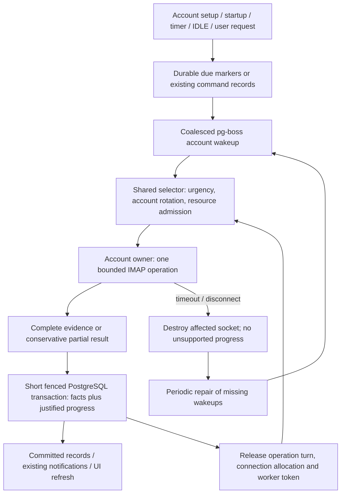

# Maildock IMAP synchronization engine

Status: **revised for staged implementation planning; production acceptance remains open**. Revised 2026-10-12 after Phases 1, 1B, 2 and 3. Receive transport is IMAP only; SMTP sending remains. Gmail uses IMAP/OAuth2; Outlook uses supported IMAP authentication where the account permits it. No production implementation is authorized by this review. Technical recommendations are not user approval; see [decisions](DECISIONS.md), [readiness](IMPLEMENTATION_READINESS.md) and [staged plan](IMPLEMENTATION_PLAN.md).

## 1. Executive summary

Use one receiving coordinator with account-owned IMAP executors, a common admission policy, existing PostgreSQL message records and a few folder progress values. Execute one bounded operation, commit its evidence, return its worker/connection allocation and choose again. Keep a reusable authenticated connection, but never let a history continuation retain its execution turn. New-INBOX discovery is eligible from the first SELECT, independent of historical completion or a browser. Bodies and attachments remain on demand.

Prefer progressive descending UID windows over a full initial inventory. At first SELECT, divide the epoch into historical coverage below the observed UIDNEXT and arrival coverage from that boundary onward. These are two coverage directions, not two engines or bootstrap phases. Separate discovery from bounded reconciliation of known placements. Reuse v1's identity, transaction and confirmed-absence safeguards; replace its separate recent/delta/backfill orchestration and long database-session locks.

The main deliberate simplification is **one data operation per account at a time**, even on servers allowing several connections. An optional second connection watches INBOX. This sacrifices within-account throughput to avoid concurrent history, flag, deletion and user-command writers. Parallelism is across accounts. At capacity one, IDLE, history, arrivals and user actions time-share the same socket. No design can promise immediate progress during a hung server request; bounded abort/reconnect behavior must be proven first.

## 2. Evidence and Thunderbird principles

All five research documents were read: [source map](../../research/thunderbird/01_SOURCE_MAP.md), [lifecycle](../../research/thunderbird/02_SYNC_LIFECYCLE.md), [patterns](../../research/thunderbird/03_DESIGN_PATTERNS.md), [comparison](../../research/thunderbird/04_MAILDOCK_COMPARISON.md), [recommendations](../../research/thunderbird/05_RECOMMENDATIONS.md). T/M IDs below resolve there. Their REST discussion reflects the earlier research scope and is excluded from this design.

**Inspected facts:** Thunderbird checkout HEAD is `5ac95865d39e426e66122ef4f54907ffa474a579`; research commit is `6e1a3665c45a4a3209a4f38af49cfa9040d0def2`. Local stable Maildock `main` is `ba074880768645473af070ecc846e420ced990d5`; its `src`, `tests`, `db` and `patches` match the review base. This revision starts at `8d2a2e8b73b685f7673c7645661be06709d5890e` on `design/imap-sync-engine-final`. No v2 or Gmail experiment code is an implementation baseline.

Evidence retained: [Phase 1](../../experiments/imap-transport/RESULTS.md), [Phase 1 implications](../../experiments/imap-transport/ARCHITECTURE_IMPLICATIONS.md), [Phase 1B](../../experiments/imap-transport/PHASE_1B_RESULTS.md), [hardening decisions](../../experiments/imap-transport/PHASE_1B_DECISIONS.md), [Dovecot results](../../experiments/imap-dovecot/BENCHMARK_RESULTS.md), [Dovecot review](../../experiments/imap-dovecot/ARCHITECTURE_REVIEW.md), [durability](../../experiments/imap-durability/DURABILITY_RESULTS.md), [performance](../../experiments/imap-durability/PERFORMANCE_RESULTS.md), [Phase 3 implications](../../experiments/imap-durability/ARCHITECTURE_IMPLICATIONS.md) and [recommendation](../../experiments/imap-durability/RECOMMENDATION.md). Previous measurements and failures are unchanged. The new history policy supersedes the experiments' saturation acceptance rule; those runs did not validate the new policy.

| Adopt/adapt                       | Actual pinned Thunderbird evidence                                                                                  | Maildock consequence                                                              |
| --------------------------------- | ------------------------------------------------------------------------------------------------------------------- | --------------------------------------------------------------------------------- |
| Metadata before content           | `NormalMessageEndDownload`, `nsImapProtocol.cpp:4136-4150`, transfers ten complete headers; T10/T11/T15             | Commit useful metadata without downloading bodies. Ten is not our network budget. |
| Identity-based reconciliation     | `FindUidsToDelete`, `nsImapMailFolder.cpp:4111-4211`, distinguishes partial and complete evidence; T08              | An omitted delta response is not deletion evidence.                               |
| Reconsider priority between units | `OnDownloadCompleted`, `nsAutoSyncManager.cpp:1300-1380`, chooses a higher-priority sibling after a body group; T18 | Apply this principle to all receiving work, including metadata and repair.        |
| Reconstruct derived work          | `GetNextGroupOfMessages`, `nsAutoSyncState.cpp:204-293`, skips cached bodies; T17                                   | Persist coverage and availability, not every intermediate candidate set.          |
| Budget and reuse connections      | `GetImapConnection`, `nsImapIncomingServer.cpp:727-855`; T04/T05                                                    | Count watchers and content access in the same account budget.                     |
| Notifications request a check     | `HandleIdleResponses`, `nsImapProtocol.cpp:1625-1659`; T12/T13                                                      | IDLE is a hint, backed by polling, not an identity ledger.                        |

These named source bodies were checked directly in the pinned checkout. In particular, `GetMsgHdrsToDownload` at `nsImapMailFolder.cpp:4263-4273` transfers the entire array, and `FolderMsgDumpLoop` at `nsImapProtocol.cpp:4590-4611` continues FETCH work inside the same URL. **Rejected:** copying that unbounded metadata lifecycle, busy-folder affinity as an urgent-work guarantee, app inactivity as server admission, Mork/mbox/proxy threading, count-only deletion, maximum observed UID as coverage, and automatic full offline-body downloads. QRESYNC is not required. Thunderbird is evidence for principles and failure modes, not a proven 50k-arrival SLA.

Protocol assumptions follow [IMAP identity and UID commands, RFC 9051](https://www.rfc-editor.org/rfc/rfc9051.html#section-2.3.1.1) and [CONDSTORE, RFC 7162](https://www.rfc-editor.org/rfc/rfc7162.html#section-3.1). IMAP4rev1 servers remain supported; optional capabilities must be negotiated. No date-order or contiguous-UID assumption is made.

## 3. Minimal architecture and normal lifecycle



There are responsibilities, not seven independent services:

| Responsibility          | Owner and boundary                                                                                                                                            |
| ----------------------- | ------------------------------------------------------------------------------------------------------------------------------------------------------------- |
| Trigger/wakeup          | Always-on worker startup/account enable, timer and optional watcher mark due work. User requests first persist existing command/content intent.               |
| Selection/admission     | One shared policy chooses an operation only when account, worker and DB opportunities exist; job priority alone is insufficient.                              |
| Transport               | Account owner manages credentials via existing account/OAuth services, ImapFlow lifecycle, capability negotiation, SELECT identity and all receiving sockets. |
| Synchronization         | Small IMAP routines: initialize, ingest UID interval, reconcile known UID set, discover folders. No generic provider cursor.                                  |
| Persistence/publication | Existing message/placement/conversation/attachment metadata paths, short transactions, epoch/owner fence, notifications after commit.                         |
| Recovery                | The same timer re-derives due work from progress and existing pending records. Same error categorization/backoff for operation kinds.                         |
| User/content work       | Existing command/content/attachment services submit bounded operations through the same owner; retain their product semantics.                                |

pg-boss provides durable wake delivery/retry and existing command intent infrastructure. Its account wake payload contains an account ID, not a frozen UID list or a chain of history jobs. A handler records/signals eligibility; it does not drain an account or occupy a worker waiting for admission. Only the elected receiving coordinator reads pending work and runs selected units with reusable account clients. Other worker processes route receiving command/content intent to it rather than construct another client. Polling the database supplies cross-process delivery if an in-process signal misses. No claim that pg-boss queue priority itself implements the selector is made.

## 4. Selection, fairness and operation bounds

Three classes suffice:

1. **Current:** due INBOX arrival checks, initial INBOX window, individual user commands and content chunks. Alternate arrival checks and user work when both are pending, round-robin across accounts within each. Coalesce refresh requests; do not enqueue an unbounded copy per EXISTS.
2. **Maintenance:** known-placement flags/membership, active-folder checks, folder discovery and cleanup. A due maintenance unit receives one in every eight contested current/maintenance dispatch opportunities globally; choose accounts round-robin. This fraction is a hypothesis, not a product guarantee.
3. **History:** remaining historical windows and metadata for unopened secondary folders normally use spare capacity. Under sustained current demand, one short unit periodically becomes eligible through the bounded opportunity rule in §14. Failure, backoff, exhausted connections or hard overload can still pause history. Continuous demand alone is not a reason to suppress it forever.

No separate worker fleet per kind. Let W be the total admitted receiving operations across processes. With W >= 2, background admission cannot consume the last worker opportunity: reserve one for current work. At W = 1, bounded time-sharing is the only option. A due arrival check is not postponed by a content continuation: both re-enter current selection. Rotate within an account across due folders; give INBOX initial preference explicitly. Different accounts receive at most one active data operation each; a chatty account cannot fill every worker slot.

Counts alone are insufficient. Initial experimental parameters are K = 128 identities per ingestion/repair unit, 2 seconds desired healthy execution, 10 seconds absolute operation deadline, and 2 seconds maximum DB-operation budget. K sizes work and retained application evidence; it is not a parser-token allocation ceiling. The operation clock covers renewal/preparation, connect/authentication, DONE, selection, searches, fetches, parsing and persistence. A connection setup cap can shorten the remaining deadline, never extend the full turn. DB admission/startup/BEGIN/locks/statements/COMMIT receive the lesser of 2 seconds and that remainder. If no time remains to persist safely, discard/replay. Retirement and uncertainty resolution can delay reuse beyond the budget; a timer is not settlement. Control traffic has separate small headroom. These values remain hypotheses, not SLAs, especially for cold OAuth/provider work and event-loop suspension.

| Operation                           | Bounded work and actual yielding point                                                                                   | Enforcement/proof needed                                                                                                                                                                                                   |
| ----------------------------------- | ------------------------------------------------------------------------------------------------------------------------ | -------------------------------------------------------------------------------------------------------------------------------------------------------------------------------------------------------------------------- |
| Account setup / folder LIST         | One command, streamed maximum 1,000 folder records / 2 MiB, 10-second deadline; commit bounded pages                     | LIST has no universal pagination. Abort oversized response; do not infer removed folders from partial LIST. Extremely large folder sets are an explicit compatibility limit pending measurement.                           |
| SELECT / initial epoch setup        | One SELECT, no `1:*` inventory; 10-second deadline                                                                       | Parser response limits; no connection retained as busy after unit.                                                                                                                                                         |
| Fresh/history ingestion             | One UID interval SEARCH, up to K metadata identities and at most one omitted-UID recheck; total 10 seconds               | 2 MiB aggregate metadata wire/parser budget, 256 KiB per header/structure candidate; abort oversize, shrink/retry. No implicit whole-mailbox BODYSTRUCTURE fetch.                                                          |
| Known UID reconciliation            | Keyset-select up to K current placements; one SEARCH exact UID set, bounded FLAGS fetch and optional omitted-UID recheck | No all-known-UID array; 10 seconds total. 15k deletions require many units.                                                                                                                                                |
| Recent-known flags/membership       | Same routine on top K known INBOX or active-folder UIDs                                                                  | Separate due opportunity, not every arrival callback.                                                                                                                                                                      |
| One user flag / move command        | One identity, existing bounded conflict retry; 10 seconds total                                                          | No batch move under one turn. Side-effect timeout is uncertain outcome, not automatic replay.                                                                                                                              |
| Text/attachment retrieval           | One raw MIME part slice up to 256 KiB per turn, 10 seconds                                                               | Tagged completion before yield, BODY.PEEK, incremental decoding across slices; incomplete cache stays unavailable. Existing whole-download helper is not yet proof of this property.                                       |
| Sent-copy / draft IMAP side effects | One existing APPEND unit with existing byte caps; 10-second abort policy                                                 | APPEND cannot be paused into independent tagged chunks. Preserve uncertain-outcome safeguards; an oversized/slow upload occupies the single socket until completion or abort. SMTP execution is outside receive admission. |
| Epoch garbage collection            | At most K obsolete placements per short DB transaction                                                                   | Epoch switch hides old records immediately; deletion cascades must not turn this into unbounded work.                                                                                                                      |
| DB read/write/renewal               | Keyset read or at most K writes, bounded bytes, short transaction; 2 seconds                                             | `statement_timeout`, lock timeout and cancellation; no transaction held over IMAP.                                                                                                                                         |
| IDLE                                | Passive socket, no data worker or DB connection; renew at most every 4 minutes                                           | DONE has remaining operation deadline; destroy if it will not finish.                                                                                                                                                      |
| Poll/repair tick                    | Keyset pages of 128 account/folder rows, no remote I/O                                                                   | Admit next tick only after returning DB token; incremental sweeps must revisit every account.                                                                                                                              |

The byte caps are compatibility hypotheses. Installed ImapFlow 2.0.6 source and Phases 1–3 establish configurable line/literal/response limits, whole-response buffering, aggregate-input observation and destructive cancellation under a responsive event loop. Byte-derived token/object amplification and current TLS/chunk/allocator overhead must be budgeted separately; 2 MiB of input is not 2 MiB of RSS. Reject compact ESEARCH expansion unless bounded before expansion; disable unvalidated compression/BINARY paths rather than apply a pre-decompression counter. A narrow supported adapter remains required (§14); experimental private hooks are not approved interfaces. Malformed, omitted or oversized identities stay unresolved, with no unsupported frontier advance.

## 5. IMAP connections and ownership

Start from a configured conservative capacity C = 1 unless reliable configuration authorizes more. Use one reusable data socket. At C >= 2, optionally allocate one INBOX IDLE watcher; no extra same-folder data socket. At C = 1, the data socket idles only when there is no selected work, exits via DONE, then serves any operation. It can reselect another folder for user work and return to INBOX afterward. During continuous history, polling and command-boundary checks supply detection even if IDLE never starts. A socket may remain authenticated across turns, but its busy allocation and worker token must be returned after every bounded unit.

All IMAP clients, including lazy content, attachments, sent-copy APPEND and any existing draft remote operation, route through this owner. Do not claim a connection cap while leaving those services free to construct clients. Watchers count in per-account and deployment-wide socket limits; maintain separate global socket cap P so many accounts cannot create unlimited idle sockets. Watchers and inactive cached data sockets are evictable for active work; stop IDLE/DONE or close the socket before reassigning its allocation. Socket affinity is a reuse preference, never permission to bypass account rotation. When P is fully occupied by active background units, the next real boundary returns/evicts a socket for current work; P=1 cannot supply physical headroom. Remote rejection lowers attempted concurrency to one, closes the watcher, and backs off; do not repeatedly probe higher capacity during urgent work. Other clients may consume server slots, so local capacity is not proof of server availability.

For multi-process workers, propose **one receiving-coordinator lease/fence record for the deployment**, acquired/renewed with short PostgreSQL transactions, not a reserved session for every network operation. It contains a fixed coordinator key, owner ID, monotonic owner generation and lease expiry. Only this owner opens receiving sockets and selects operations for all accounts. Its local W/P counters and DB admission therefore enforce deployment-wide limits without distributed per-operation slot tables. Other worker processes may run SMTP and unrelated work, but cannot execute receiving operations. Scale within the elected process across accounts first; distributed receive sharding is deferred unless measurements require it.

Every receiving persistence transaction checks matching generation and nonexpired lease at entry and inside the server COMMIT path (§14), using DB time; serialize authority with lease takeover. Before issuing any command, also check ownership; stop/close all sockets on failed renewal. Initial experiment: renew every 5 seconds, expiry after 30 seconds; admit a unit only when confirmed remaining lease lifetime exceeds its deadline and a clock-error margin, renewing first if necessary. A paused old owner is rejected on resume. A generation-tagged local admission token is valid only for the coordinator's current ownership term; revalidate after any awaited admission.

This routing lease is not a mailbox execution lock held by history: it routes _all_ classes to the same selector. The per-account operation busy flag/worker token is cleared at every yield. Removal of the coordinator lease permits two processes to open C sockets per account each and defeats shared W/P/fairness; removal of fencing lets an expired owner commit old metadata after reset/deletion. No operation carries a DB advisory lock across network I/O.

A DB fence cannot revoke an already-issued remote side effect or instantly close a partitioned socket. On takeover, the new owner may hit the remote cap until abandoned sockets disappear. Reject stale database results, classify remote mutations as uncertain, and wait/back off on connection rejection. **Strict simultaneous remote socket count through arbitrary partitions cannot be guaranteed by a local lease.** This is an explicit limitation, tested before choosing failover parameters; it must not be hidden behind lease expiry.

## 6. Progressive initial synchronization

| Approach                                                               | First useful messages and cost                                                                                                                                              | Assessment                                                                                                                                                                   |
| ---------------------------------------------------------------------- | --------------------------------------------------------------------------------------------------------------------------------------------------------------------------- | ---------------------------------------------------------------------------------------------------------------------------------------------------------------------------- |
| Full UID inventory, then newest-first bounded metadata                 | `UID SEARCH ALL` or full flags enumerates 50k before first metadata; then sort/slice IDs. Simple sparse-UID discovery but large response and non-yielding inventory command | Realistic Thunderbird-like baseline; reject as default because inventory can occupy the only connection. Splitting later FETCH/database batches does not fix it.             |
| Descending numeric UID windows, independent ascending arrival coverage | SELECT gives epoch and boundary; SEARCH only a small high-UID interval, fetch its actual identities, commit and yield. No full inventory or date filter                     | Recommend. Similar identity/progressive-publication principles, with deliberately smaller network turns than Thunderbird. Sparse ranges need the bounded probing rule below. |

For first SELECT in an uninitialized folder, let B be its observed UIDNEXT. Atomically set epoch, `fresh_through = B - 1`, `history_before = B`, and `reconcile_after = 0`. B is a SELECT observation, not an additional persisted cursor. Values below B are assigned to history; setting the fresh frontier does **not** claim historical ingestion because the covered interval `[history_before, fresh_through]` is initially empty. First historical interval is `[max(1, B-K), B-1]`. Persist envelopes, reduced threading headers, INTERNALDATE, size, flags, attachment/MIME descriptors within limits, epoch and UID. Publish the first successful interval immediately; bodies stay absent. The first useful result can be smaller than K or empty; continue without declaring initialization failure.

For a dense 50k INBOX with UIDs 1..50,000 and UIDNEXT 50,001, first fetch is 49,873..50,000. Follow with fresh check opportunities, then 49,745..49,872 when spare capacity exists. UID allocation order approximates most recently added placements; it does not mean sender Date or INTERNALDATE order. Imported old-dated messages with new UIDs appear through arrival discovery; UI ordering remains existing display policy. Never use dates to prove membership.

**Shared interval algorithm:** choose a closed interval inside the unexplored numeric domain. SEARCH it with UID semantics; accept only tagged successful complete results, verified within the interval. Fetch exact returned UIDs, not an open-ended range. Retry/recheck omitted identities. Commit records and move the appropriate boundary only when every searched UID has metadata or a successful same-epoch recheck proves it no longer exists. Successful empty SEARCH proves this interval empty and permits advancement. Do not use `low:*`: reversed ranges/star semantics can accidentally include older messages. If UIDNEXT is absent or invalid, do not invent a boundary; report an unsupported/unresolved selection until a validated fallback is chosen.

**Sparse gaps:** start numeric span K. Following a completely empty interval, double the next span, clamped to epoch domain; after any nonempty interval reset to K. Span is a transient efficiency hint, not durable coverage. SEARCH results still have a hard K-identity/byte/time cap. If widening hits >K identities, discard the incomplete result, close the socket, halve the attempted span and retry without advancing; at span <=K identity count is bounded by UID uniqueness. No unbounded list or durable candidate table. This avoids millions of tiny empty-window jobs in a billion-UID gap, but server search cost and overflow cancellation require measurement. A restart loses only the hint and can repeat logarithmic gap probing. Completed empty intervals survive in the boundary.

Other folders are discovered by LIST, but LIST is not a prerequisite for opening canonical INBOX. Reconcile names/roles via existing mailbox services. Initialize other selectable folders opportunistically, fetch a first window, then rotate their history behind INBOX/current work. Initial-INBOX priority derives from having no current-epoch metadata and E>1, rather than another persisted bootstrap status; after first useful metadata, remaining ingestion is history. Empty successful probes can continue under that preference, one turn at a time. Opening a folder promotes its initial/check/known-message maintenance work, not its whole archive. Poll non-INBOX arrival ranges eventually; do not leave an unopened folder forever unaware of newer UIDs when history is paused.

Restart reloads epoch/frontiers and checks SELECT; the original B is unnecessary for continuation. No re-running a 30-day/200/50 fallback, no phase-completion gate, no MAX(local UID) reconstruction. Empty INBOX starts with B = 1 and history complete; first later UID is still discovered.

## 7. Fresh-INBOX bypass: 50,000 + 10

```mermaid
sequenceDiagram
  participant S as IMAP server
  participant T as Watcher or due timer
  participant A as Shared selector / account owner
  participant P as PostgreSQL
  A->>S: Bounded old interval SEARCH/FETCH
  S->>S: Append UIDs 50001..50010
  S-->>T: EXISTS if delivered / IDLE notification
  T->>P: Mark fresh check due; coalesced wake
  Note over A,S: Old request finishes or is aborted at deadline; no preemption promise
  A->>P: Commit old interval with history progress
  A->>A: Return busy turn and worker token; reconsider current work
  Note over A: Fresh and user categories alternate when both are due
  A->>S: SELECT/refresh observation; SEARCH UID 50001:50010
  S-->>A: Actual UIDs; FETCH exact metadata
  A->>P: Commit 10 placements plus fresh_through = 50010
  Note over P: Metadata queryable; arrival events deduplicated after commit
  A->>A: Yield; next user unit or another account before history
```

The initial SELECT observation was B = 50,001; durable E/F retain the coverage partition without storing B again. During history, SELECT/NOOP response observations, IDLE on the optional watcher, and an independent due timer request fresh discovery. Proposed polling maximum is 15 seconds for INBOX, including when no watcher exists. Each history boundary reconsiders timer due state; EXISTS is not required for correctness. If an event cannot be persisted, do not clear freshness due state; polling restores eligibility. IDLE is not available while a command uses the only socket.

At execution, refresh selected state using SELECT/reselection or a validated fresh UIDNEXT observation. Let H = observed UIDNEXT - 1. Search `[fresh_through+1, min(H, fresh_through+span)]`; no search if H is below the lower bound. H is an observation, not a new checkpoint. Messages appended after H are handled next time. Do not clear a wake that arrived after the operation's captured trigger. A due arrival unit needs no flag/deletion scan before committing these ten messages.

With one connection and a concurrent read/unread action, the active old unit ends first. At the next turn, the current-class alternating policy serves either fresh or user work according to the previous turn; the other receives the next available current turn, with cross-account fairness still applied. There is never a command sent concurrently with IDLE/FETCH on that socket. A user body request yields after its part slice, so the whole attachment does not hold the connection. A stuck old command is destroyed at deadline, which loses its uncommitted interval and incurs reconnect time. Merely committing 128 rows while retaining a FETCH, job callback or busy flag fails this design.

Ten arrivals beyond this small frontier fit one unit. An arbitrarily large new-message backlog or arrival rate exceeding capacity cannot have a fixed latency guarantee. Persistent omitted FETCH identities can prevent coverage advancement; partial successful metadata may be saved without moving the frontier, and unresolved work must be reported. Do not add receipt/staging structures or silently skip bad identities to hide this limitation. Measure this case before approving the simpler conservative replay policy.

## 8. Flags, expunges and moves

New UID discovery, history ingestion and known-placement reconciliation are distinct operation kinds. Arrival checks run frequently. Recent-known INBOX/active-folder flags and membership are maintenance due, initially every 30 seconds. Bulk reconciliation traverses current local placements in ascending UID keyset pages of K, storing `reconcile_after`. At end, wrap to zero and record pass completion; initially request another pass after 5 minutes. Unlike history, maintenance gets protected opportunities, so 15k external deletions cannot force an enormous arrival command but must eventually be visited under finite load.

For a reconciliation page, issue SEARCH for its **exact known UID set**. Only a tagged successful complete response establishes which known UIDs are absent. Fetch FLAGS for present identities. With full FLAGS fetch, a present UID omitted by FETCH requires a successful omitted-UID recheck; if still present, leave the page cursor unchanged and retry. With CHANGEDSINCE, unchanged identities are intentionally omitted and do not constitute a missing-FETCH error. Apply confirmed absence only to these placements; never infer deletion from counts, CHANGEDSINCE or an interrupted request. `\Deleted` is a flag, not proof of expunge; preserve existing product handling without issuing unsolicited EXPUNGE.

Without CONDSTORE, fetch flags for every present UID in the page. With CONDSTORE, baseline design may still use that same bounded flags fetch. An optional optimization uses CHANGEDSINCE on that exact page with the minimum stored per-placement MODSEQ; if any baseline is missing or NOMODSEQ is observed, use full FLAGS. Compare returned MODSEQ to the placement's saved value and reject older flags. There is **no mailbox-wide MODSEQ cursor** to advance after a partial page; per-placement versions suffice. A page with an old unchanged baseline may repeatedly return other changes, which is safe but less efficient. This deliberately avoids scan-start/scan-end global checkpoint state. CHANGEDSINCE never replaces membership SEARCH; equal net counts can hide an expunge plus an arrival.

The account owner serializes authoritative data writers. Watcher FETCH/EXPUNGE signals mark due work rather than mutate records asynchronously. Without MODSEQ, commit only the result belonging to the current operation/owner; no result from an earlier turn may publish late. Local optimistic command overlays remain separate until remote outcome is reconciled. Another client can change a flag after FETCH and before commit; the next maintenance check resolves it, rather than claiming a simultaneous remote snapshot.

External moves converge as source disappearance and destination new UID. Both folders are checked; there is no cross-folder snapshot, nor identity deduplication solely by Message-ID. Maildock's own moves retain existing command records, conditional STORE behavior and destination UID mappings. Do not replay an uncertain MOVE/COPY/APPEND just because a read operation is idempotent; preserve `MessageCommandService`'s existing executing-move uncertainty path. Stable mutateMessage requires MOVE for archive/trash; do not invent a COPY/EXPUNGE fallback. Missing UIDPLUS leaves destination mappings uncertain; no blanket EXPUNGE should be newly introduced by receiving reconciliation.

## 9. Smallest viable durable state

This is a logical state contract, not a schema migration. Reuse existing tables where possible; exactly which columns replace v1 fields is later implementation work. Every field below has a failure justification.

| Durable fact                                                                  | Meaning / concrete failure if removed                                                                                                                                                                                                  |
| ----------------------------------------------------------------------------- | -------------------------------------------------------------------------------------------------------------------------------------------------------------------------------------------------------------------------------------- |
| Account/mailbox/path/selectability and active epoch                           | Existing folder identity and UIDVALIDITY. Without epoch, reused UID 9 after reset updates an unrelated old message.                                                                                                                    |
| Unique placement `(mailbox, UIDVALIDITY, UID)` linked to metadata             | Existing identity key. Duplicate job delivery otherwise creates duplicate messages; Message-ID alone merges distinct placements.                                                                                                       |
| Flags, optional per-placement MODSEQ, MIME descriptors, content availability  | Existing message facts. Without separate content availability, partial downloads appear complete; without flag version checks, older evidence can overwrite newer flags.                                                               |
| `fresh_through` F                                                             | Upper end of verified coverage; new discovery starts F+1. Initially B-1, paired with E=B so coverage is empty. Without it, repeated tail-only checks can lose arrivals after a disconnect.                                             |
| `history_before` E                                                            | Lower end of verified coverage; historical prefix `[1,E)` remains unexplored. Together `[E,F]` is covered (empty if E=F+1). Initially B; 1 means complete. Without it, restarting newest-first history can starve the oldest messages. |
| `reconcile_after` R                                                           | Last visited UID of ascending known-placement pass; zero means start. Without it, repeatedly scanning newest/local first K leaves old deletions forever stale.                                                                         |
| Per-folder due timestamps for fresh, recent-known and bulk repair             | Scheduling hints, never coverage proofs. Without durable due work, a crash after commit/before enqueue can stop continuation. History eligibility derives from E>1, so it needs no separate phase/status.                              |
| Per-folder fresh request generation                                           | Increment/coalesce wake requests; a run captures generation and clears due only if unchanged. Without this CAS, a late IDLE event can be erased by completion of a check that preceded it. Periodic polling remains a fallback.        |
| Monotonic mailbox revision                                                    | Rejects same-owner obsolete evidence after deletion, cursor wrap or equivalent frontier reuse; increments for authoritative writes (§14).                                                                                              |
| Coordinator owner ID, fence generation, expiry                                | One deployment lease record; prevents concurrent pools/selectors and rejects expired writers. See ownership limitations above.                                                                                                         |
| Existing pending command/content/outgoing records and notification uniqueness | Needed for existing user semantics, not new sync staging. Without them an uncertain remote mutation could be replayed or committed arrival alert duplicated.                                                                           |

No new message shadow database, pending UID table, receipt table, range manifest, durable operation phase or global MODSEQ checkpoint. The interval evidence set is bounded transient memory. Backoff uses existing job attempt/error infrastructure and existing operation error reporting: authentication/transport outages cool down the account, while history/repair evidence failures cool down only that folder/kind and must not block user/fresh work in other kinds. Due timestamps may encode retry-not-before for scheduled kinds; a bounded owner-local history cooldown is reconstructible and may retry once early after restart. Repeated unresolved identities are visible errors, not successful completion. Quantities exposed to users as progress must describe verified coverage or availability, not pretend a changing mailbox has a fixed percentage.

Transactions lock the coordinator lease row in a compatible shared mode that conflicts with takeover, then the account lifecycle row and affected mailbox rows briefly in stable order, check owner generation, epoch, enabled status and expected revision/frontier, then upsert metadata/placements, apply absence/flags and advance justified progress in the same transaction. The mandatory deferred authority check runs inside COMMIT (§14). Shared fence checks permit different accounts' commits concurrently; renewal/takeover waits only for short commits. Late stale results fail the fence/CAS. No callback may publish after ownership ends. Database statement/lock deadlines apply to conversation assignment and notification writes too; expensive global notification pruning must not sit inside this transaction. Publication uses existing durable notification events plus queryable committed data; a missed transient UI signal is repaired by refresh/event catch-up.

Owner generation alone does not fence two turns within the same process. Section 14 recommends a monotonic mailbox revision as the durable same-owner CAS fence, in addition to the ephemeral token. Each turn has an ephemeral operation ID/cancellation token; protocol callbacks collect bounded results and cannot write directly. The active turn alone submits persistence after checking that token. On abort invalidate the token before releasing busy state. If a transaction has already started, cancel it and resolve its commit/rollback uncertainty before admitting another data writer for that account; a `Promise.race` timeout by itself is not release evidence. A late same-owner callback must therefore be rejected as well as a late old-generation callback. This needs no durable per-operation receipt. One mailbox revision prevents same-owner ABA; its behavior and the DB lifetime boundary are required fault-injection assertions.

Notification proposal: actual insertions by fresh operations are candidates, with existing Inbox/all-folder preferences applied at consumption, including while initial history is incomplete; history operations never alert. This makes the immutable initial B unnecessary to persist just for classification. Preserve existing command-move, sent-copy and preference exclusions. Fresh UID allocation reflects addition to this mailbox, not proof of first-ever message delivery. After UIDVALIDITY reset, recaptured historical messages use the history operation and do not flood alerts. The baseline consumer skips events older than 120 seconds and advances its checkpoint on browser start; preserve those semantics pending an explicit product change. Offline-arrival classification remains OPEN.

## 10. Recovery and correctness argument

For a stable epoch, UID allocation is monotonic and UIDs are never reused. Initialize E=B and F=B-1: no interval is covered. Each completed descending history interval extends coverage down from E, and each completed ascending fresh interval extends it up from F, preserving contiguous verified coverage `[E,F]`. A successful complete closed-interval SEARCH identifies all existing identities there at that command; absent numeric gaps cannot later fill with smaller UIDs in that epoch. If every SEARCH hit is durably stored or subsequently proven absent, advancing that interval's boundary loses no still-existing searched identity. Fetched records and the boundary commit together. Arrivals later than captured H lie beyond coverage and are discovered subsequently. This is eventual mailbox convergence under successful future service, not an instantaneous snapshot or recovery of mail expunged before any observation.

| Interruption/race                                    | Required response                                                                                                                                                                                                                                |
| ---------------------------------------------------- | ------------------------------------------------------------------------------------------------------------------------------------------------------------------------------------------------------------------------------------------------ |
| Disconnect during SEARCH/FETCH or missing tagged OK  | No coverage/absence claim from partial response. Optionally store complete bounded metadata without advancing, after fencing; otherwise discard and replay.                                                                                      |
| SEARCH hit missing from FETCH                        | Recheck exact omitted IDs. Still present/failed recheck leaves frontier unchanged; confirmed absence resolves that hit. Never advance to maximum returned UID.                                                                                   |
| DB commit status unknown                             | Settle/retire the old DB lifetime and establish old-backend ordering, then reload epoch/revision/progress and placement keys before deciding. Replay same interval conservatively; uniqueness/atomicity handles either outcome.                  |
| Commit before pg-boss ACK or continuation enqueue    | Redelivery selects from current state, not old payload. Repair timer finds E>1 or due work even if ACK/enqueue never happened.                                                                                                                   |
| Duplicate workers/stale lease                        | Only one lease holder may operate; all transactions fence. Late old responses cannot reinsert a placement deleted by a later owner.                                                                                                              |
| UIDVALIDITY change                                   | Short atomic epoch switch resets B/F/E/R from new SELECT, hides old epoch placements immediately and invalidates queued commands/content identities. Cleanup old data in K-sized background pages; never bulk-delete 50k under urgent ownership. |
| Epoch observation uncertain                          | Abort socket, reselect and verify before publishing; old epoch results cannot cross the switch. Do not recycle a UID-based content key.                                                                                                          |
| Discovery/history interruption                       | Resume persisted boundary; no durable searched-but-unfetched queue needed because the same interval can be searched again.                                                                                                                       |
| Flag/deletion pass interruption                      | Resume R; any committed recent-known check is harmless duplicate evidence. Wrap/full periodic passes repair races.                                                                                                                               |
| IDLE gap or lost wake                                | Periodic fresh due check, startup sweep and reselect; no recent-success gate.                                                                                                                                                                    |
| Remote side effect succeeds but response/commit lost | Existing uncertain command/APPEND recovery, reconciliation and user-visible outcome. Do not apply read-replay policy to mutations.                                                                                                               |
| Disabled/deleted account                             | Fence persistence, stop sockets, preserve existing command/account lifecycle rules.                                                                                                                                                              |

Stale resurrection prevention relies on sequential account execution plus fenced ownership, epoch and revision checks, not a tombstone table. Never run historical FETCH evidence concurrently with a deletion writer; an old owner's late response is rejected. A message expunged between fetch and commit may briefly be published and then removed by maintenance, but cannot be restored from an earlier committed turn after confirmed removal. Cross-client real-time perfection is not promised.

## 11. Resource opportunities for users and accounts

Use explicit shared W, P and DB admission limits rather than independent queue concurrency. Maintain current headroom in workers and short DB operations; network I/O holds no DB connection. DB renewal/wakeup control has a small reserved opportunity so a backlog cannot prevent fencing/due recording. For a receiving DB pool D>=3, cap background transactions at D-2, reserving one current and one control opportunity; with D=1/2, serialize/admit transactions with control/current preference and bounded transaction duration, without claiming physical parallelism. Count existing pg-boss/control pools and unrelated worker/API pools separately in the deployment PostgreSQL connection budget; receiving admission cannot guarantee availability against unbounded external DB load. Benchmark pool sizes 1, 2 and 6 and W=1/2/4.

An admitted operation owns one worker opportunity and its account data socket. Content chunks and command units follow the same current policy as new mail. Receive scheduling does not serialize SMTP sending, local draft editing, search of cached metadata or UI rendering. IMAP sent-copy/draft remote operations share the account socket budget while their existing business state remains intact. If all accounts are busy, a new request waits for the next genuine boundary, not for an entire mailbox pass.

Account round-robin uses only eligible work, skips cooldown/unavailable accounts and has a bounded in-memory ready set reconstructed from durable due state. Command requests are read from durable records in pages; excess demand gets existing busy/pending feedback, not an unbounded promise queue. Fairness is execution opportunity under finite admitted load; it does not overcome an account-specific server outage or an overloaded arrival rate. History receives occasional bounded safe opportunities under sustained demand (§14); hard overload can still pause it, and completion is not guaranteed.

## 12. Reuse, replace and preserve

| Stable Maildock module/evidence                                                                  | Proposed treatment                                                                                                                                                                                                |
| ------------------------------------------------------------------------------------------------ | ----------------------------------------------------------------------------------------------------------------------------------------------------------------------------------------------------------------- |
| `src/composition/worker.ts`, `worker-process.ts`, JobRuntime; M11                                | Reuse worker startup/readiness and pg-boss infrastructure; compose one receive selector/repair loop. Browser independence already exists.                                                                         |
| `recent-sync-jobs.ts`, `delta-sync-jobs.ts`, `backfill-sync-jobs.ts` and their services; M02-M07 | Replace separate receive lifecycles, success prerequisites and cross-queue pending checks with operation selection; retain useful interval/absence algorithms.                                                    |
| `idle-watchers.ts`; M04                                                                          | Refactor into account-owned socket budget and wake requests; remove recent-sync-success eligibility.                                                                                                              |
| `mailbox-lock.ts`; M08                                                                           | Replace network-spanning session advisory lock with short lease/fence checks and sequential account execution. No DB session per idle/network operation.                                                          |
| `imap-smtp-mail-provider.ts`, `imap-client-lifecycle.ts`; M03/M05/M06/M10                        | Retain normalization, epoch checks, capabilities, sanitization, async-error guards and conditional user mutations. Extract bounded receiving routines/reusable client ownership; do not rewrite SMTP.             |
| `MessageService.persistBatch`, schema placement uniqueness; M09                                  | Reuse metadata, attachments, conversations, outgoing/command linkage and notification safeguards. Refactor atomic progress input/fence, remove old recent-success notification gate and unbounded ancillary work. |
| `MailboxDiscoveryService`, `MailboxService`                                                      | Reuse roles/selectability/names and folder business rules; explicit INBOX admission instead of alphabetic equal-priority bootstrap.                                                                               |
| `MessageCommandService`, content/attachment services, sent-copy services                         | Preserve command intent, conflict/uncertainty, lazy caching/blob safety and sent-copy semantics; route IMAP execution through admission and chunk content where proven.                                           |
| OAuth/account services, drafts, outgoing SMTP, UI/search                                         | Preserve. No evidence warrants rewriting authentication, sending or local drafts. New-install scope means no v1 migration, not removal of features.                                                               |

Existing test bodies were inspected, including missing-FETCH coverage in `incremental-sync-provider.test.ts:232`, sparse/omitted history in `backfill-sync-provider.test.ts:105-142`, and replay/rollback/confirmed absence in `incremental-sync.integration.test.ts:925-1000`. They inform invariants; none was run here or proves the new policy. `MessageCommandService.run` explicitly treats an already-executing move as uncertain; this behavior must survive.

Compared with v1: remove three orchestration families, date bootstrap gates, whole-mailbox urgent reconciliation and network-spanning DB locks; retain real business persistence. Compared with archived v2 **concepts** described in the research: no T0/T1 bootstrap phases, staging frontiers, receipts, shadow records, multiple transport models or dedicated foreground/background engines. This is not an audit of all archived v2 code, and those documents are unchanged. Two ingestion boundaries plus a reconciliation position remain because their removal has concrete loss/starvation cases.

## 13. Trade-offs, unresolved decisions and skeptical review

The cost of simplicity is serial data execution per account, replay after incomplete evidence, delayed bulk remote-state convergence, optional CONDSTORE with weaker traffic savings, and interval probing inefficiency on unusual sparse/slow servers. Protected current opportunities and occasional history time-sharing trade throughput and waiting; history pauses only when safe admission is unavailable, including hard overload; sustained demand alone invokes §14 protection. Full metadata coverage does not make bodies offline. No finite completion claim applies while the remote mailbox changes without bound or the server repeatedly refuses required data.

Before writing affected production components, settle their named contracts; validate socket destruction, parser/input bounds, MIME decoding/finality, lease fencing, DB settlement, gap probing and missing-response liveness within the isolated stages and before enabling them. These are technical proof obligations, not opportunities to silently add another engine. If ImapFlow cannot supply the bounds, report the conflict and decide a narrowly scoped transport adaptation separately.

Product decisions still needed: acceptable recent/bulk flag-deletion delay; desired freshness/user wait targets for healthy and degraded servers; notification behavior for arrivals accumulated offline or during bootstrap; acceptable metadata size compatibility limits; how uncertain/oversized requests appear to users. Proposed cadences/caps in this document are initial test settings, not approved requirements. Choosing higher data concurrency within one account is deferred unless evidence shows serialization fails an approved target.

| Skeptical check                              | Design answer / outstanding evidence                                                                                                                                                                |
| -------------------------------------------- | --------------------------------------------------------------------------------------------------------------------------------------------------------------------------------------------------- |
| Thunderbird rather than old v2 baseline?     | Direct header-loop, IDLE, deletion and AutoSync source checks; adopted principles and rejected non-yielding metadata are explicit.                                                                  |
| Fewer mechanisms?                            | One owner/selector/repair policy, existing message store, no receipt/staging tables; lease and three boundaries have failure justifications.                                                        |
| New mail while history runs?                 | Eligible at first SELECT, polling/IDLE hints, operation-level yield and protected current opportunities; isolated timing measured; production routing and new history exception remain unvalidated. |
| Capacity one without impossible parallelism? | Single socket, DONE, bounded commands/content, reconnect on timeout; no second data lane.                                                                                                           |
| Every expensive operation bounded?           | Count/bytes/time and release points specified, including LIST, repair, cleanup, content and APPEND limitations; isolated enforcement measured; supported production adapter remains unvalidated.    |
| Crash/gaps/epoch safe?                       | Atomic facts/frontier, conservative replay, explicit epoch switch and fence; fault matrix in validation.                                                                                            |
| User/business behavior retained?             | Commands, notifications, conversations, lazy content, SMTP/drafts/OAuth preserved; compatibility validation required.                                                                               |
| Facts versus promises?                       | Static source facts are labeled; all settings/latency goals are hypotheses. Phases 1–3 supply isolated experiments; no new experiment or production tests were run in this revision.                |

Review with [SYNC_ENGINE_VALIDATION.md](SYNC_ENGINE_VALIDATION.md). Affected production components require the staged pre-component gates; release requires the full compatibility/evidence gate, not merely agreement with this diagram.

## 14. Final revision: Phase 3 contracts and approved history protection

This section specifies the strengthened execution contract. It changes no coverage algorithm and adds no receipt store or second scheduler. Production implementations of these recommendations still require the gates in the companion documents.

### 14.1 Commit authority and its linearization point

Required ordering: acquire a generation with an atomic takeover UPDATE; collect IMAP evidence without a DB reservation; enter a short transaction; lock the lease `FOR SHARE`, account lifecycle row in a compatible shared mode, then mailbox rows `FOR UPDATE` in stable ID order; validate owner/generation/epoch/revision/lifecycle; write facts and justified progress; validate authority again in the server COMMIT path; release locks only at transaction end. Use `clock_timestamp()` for expiry, not transaction-start `now()`. Renewal and takeover UPDATE the lease and conflict with the shared lock. A takeover that waited for an old transaction must re-evaluate expiry and increment generation atomically after obtaining the lock. Failed renewal cannot revive an expired generation.

| Alternative                                                                          | Correctness and cost                                                                                                                                                                       | Recommendation                                                              |
| ------------------------------------------------------------------------------------ | ------------------------------------------------------------------------------------------------------------------------------------------------------------------------------------------ | --------------------------------------------------------------------------- |
| Client pre-COMMIT check, even while holding lease lock                               | Client can stall before sending COMMIT; takeover waits while expired old facts still commit. Fails the reproduced expiry case.                                                             | Reject.                                                                     |
| Server function performs bounded writes and final check; client later commits        | Removes some client interleaving but leaves the last-check/COMMIT gap. A self-committing procedure would still need a defined final authority point and business persistence/driver proof. | Do not assume sufficient; OPEN alternative if independently proven.         |
| Lock transfers authority to transaction until it settles, regardless of lease expiry | Linearizable takeover exclusion, but deliberately allows an expired lease to commit and can obstruct failover.                                                                             | Reject under the stated expiry requirement.                                 |
| Deferred constraint authority check at transaction end, under shared lease lock      | Rejects delayed COMMIT after expiry and serializes against takeover. Small server mechanism; integration must cover every authoritative write.                                             | RECOMMENDED after comparison, not automatically approved by the experiment. |

The recommended **logical commit-authority linearization point L** is the last mandatory deferred check inside PostgreSQL's COMMIT execution, while the lease is locked and unexpired. If expired at L or generation differs, the entire transaction fails. If authorized at L, that transaction is ordered before any takeover, which cannot acquire its conflicting lock until transaction end. This is the meaning of “ownership authorizes commit”; it is not a claim that WAL flush, replica visibility or client acknowledgment occurs before the wall-clock expiry. Backend suspension after L cannot be excluded by an ordinary SQL trigger. A requirement to recheck at the physical durability instant is **OPEN** and is not proved by Phase 3. Engineers must not advertise that stronger guarantee.

Deferred checks can be forced early by `SET CONSTRAINTS`; the receiving executor must prohibit that and prohibit transaction control from business callbacks. Do not rely on an application convention that facts always increment revision: affected write paths must be audited/enforced so placement/flag/deletion/content/command-result writes cannot bypass the commit check. Use transaction-local owner/generation context, fail closed on missing context, and cover source and destination mailbox writes. Due-only producer updates and local optimistic intents are separate from authoritative remote facts. Final trigger placement, permissions and account-disable/epoch locking are a Stage 1 design gate, not DDL supplied here. PostgreSQL documents transaction-end constraint checks and the early-forcing behavior in [CREATE TRIGGER](https://www.postgresql.org/docs/17/sql-createtrigger.html).

### 14.2 Same-owner fencing with one revision

Retain an ephemeral, non-reused turn token to revoke callback execution immediately. Recommend **one monotonic durable mailbox revision** as the smallest database-visible fence in addition to that token. A token alone is sufficient only if all callbacks and every writer are mediated by a single settled lifetime, including discovery, user results and lifecycle changes. Stable Maildock has multiple service writers and delayed/lazy SQL; relying on that global proof is more fragile than one revision.

Capture owner generation, mailbox UUID/path, epoch and revision at admission. The transaction locks/reloads the row and requires that captured revision, then increments it once for every authoritative mailbox operation, including confirmed deletion, flag repair, epoch switch, cursor wrap and accepted user result. A no-op wrap still increments it. Source/destination mutations validate both affected identities/revisions. Wake generation is separate and due-only writes do not increment the evidence revision. Revisions never reset on epoch change or cursor wrap. Recreated mailbox paths receive a new UUID; revision overflow must fail closed, never wrap.

Late FETCH from an invalid token never submits SQL. A result from a completed/cancelled turn fails token validation; if it reaches persistence despite a later committed deletion or wrap, revision CAS fails even when F/E/R values are identical (ABA). An old-epoch result fails epoch/revision. An obsolete DB callback fails its transaction lifetime guard before creating **or executing** lazy SQL. Revision does not cancel I/O, prevent obsolete driver ROLLBACK, or revoke a remote MOVE; those have separate contracts. Under an unknown commit outcome, retire/settle first and reload the new revision before retry. There is no tombstone or turn receipt table.

### 14.3 Database ownership, cancellation and uncertainty

The receiving boundary owns BEGIN/COMMIT/ROLLBACK explicitly on an exclusive reserved client; business routines receive a scoped transaction interface, never the raw client, `.begin`, `.release`, `.end` or unrestricted transaction SQL. Drizzle business query builders may be used only through that scoped connection, without its callback transaction API. Guard SQL construction, execution/await/then, streaming/batch execution and cleanup by the transaction lifetime. No detached database work is allowed. Invalidate the lifetime before cancellation; old success/failure/finally callbacks can perform no SQL afterward.

The absolute DB budget starts before DB admission, covers reserve/connect/BEGIN, lock and statement waits, business writes and COMMIT. Server statement/lock/idle-in-transaction limits supplement it; they cannot settle a withheld COMMIT reply. Cancel the active query where possible, then destroy actual I/O if settlement is not established within the remaining budget. Cancellation acknowledgment alone is not rollback confirmation. Keep exclusivity until confirmed commit/rollback settlement or **retirement of the entire client lifetime**, including queued work. Never release a dead reserved handle into a reused pool slot. A socket close alone does not prevent old driver cleanup.

For production, recommend a receiving-only set of reusable postgres.js clients with `max:1` per DB lane, created from existing configuration and included in total connection accounting. On uncertain cancellation, permanently end the affected lane client with bounded forced shutdown, invalidate all scoped handles, and await retirement before constructing its replacement. This uses the existing dependency's public reserve/end boundary and avoids parsing plaintext BackendKeyData or killing the shared application pool. The installed postgres.js 3.4.9 `src/index.js:234–294` races callback scope with onclose and performs automatic ROLLBACK; `end:365–389` ends/terminates the client. Their production behavior with Drizzle, TLS, startup, lazy queries and forced end remains a mandatory isolated regression gate. Public API availability is not proof of settlement: [postgres.js connection reservation](https://github.com/porsager/postgres#reserving-connections).

A COMMIT sent without definitive outcome is unknown. Keep the account blocked from authoritative retry until the old backend transaction can no longer act; reload epoch, revision, frontiers, placements, intent and notification identity from fresh durable state, then select work again. A reconnected read of old state alone is insufficient if the old server transaction could still commit. Fenced mailbox/lease locking or confirmed backend termination must resolve that ordering. Unresolved server-side retirement is account backoff, not permission to reuse. Read operations replay; remote STORE/MOVE/APPEND use their existing intent/uncertainty semantics. Unrelated web, OAuth, SMTP, auth and pg-boss pools keep their existing transactions. Receiving retirement must not end them. No new dependency or custom PostgreSQL protocol parser is justified.

Mandatory regression: pause old transaction after insertion, cancel/retire it, start new writer, resume old callback while new writer pauses before COMMIT; independent reader must find **32/32 rows and completed frontier**, rather than the retained 0/32 false success. Also execute a previously prepared DELETE after retirement and prove rejection. Source: [late-db-callback.ts](../../../experiments/imap-durability/late-db-callback.ts) and [failure/repair report](../../experiments/imap-durability/DURABILITY_RESULTS.md). Do not copy the experimental store's socket factory into production.

### 14.4 History opportunities in the existing selector

**APPROVED policy; RECOMMENDED mechanism; OPEN numerical settings.** Continuous current demand must not automatically prevent all historical progress when safe opportunities exist.

| Approach                                                                             | Tradeoff                                                                                                                                                                        |
| ------------------------------------------------------------------------------------ | ------------------------------------------------------------------------------------------------------------------------------------------------------------------------------- |
| Continuously age history into higher priority scores                                 | Requires comparisons with every current/maintenance score, ties and cost adjustment; can accidentally promote history over an individual user action.                           |
| Infrequent bounded admission after maximum eligible wait or missed opportunity count | One eligibility predicate and rotating history candidate; preserves existing class ordering except for one deliberate short opportunity. Easier to test in the shared selector. |

Recommend the second approach. Keep a bounded per-account eligible-wait timestamp and missed safe-opportunity count in memory; rotate eligible folders within that account and accounts globally. Time accrues while historical work is runnable but not selected; a count increments at a genuine completed boundary with resources to consider that candidate. A configurable maximum wait **or** opportunity count requests one history unit. It does not reserve a percentage, spawn workers, accumulate credits, or permit repeated history units while current work waits. Reset age/count on actual history admission, not merely selector consideration; a failed history unit enters its normal cooldown. On restart reconstruct candidates from E>1 and start aging after the startup current-work barrier. Fairness through infinitely frequent coordinator restarts is not promised and does not justify another durable field yet.

All normal resource gates still apply: valid owner/lifecycle/epoch, usable account socket or admitted reconnect, W/P/DB opportunity, memory/input headroom, no server/authentication backoff or unresolved DB writer. Before the exception, give each already-persisted startup current candidate its first normal selector opportunity; do not drain history ahead of current demand during recovery. Under sustained service, admit one history unit only when pending INBOX/user ages plus its conservative service budget and bounded current rotation fit the configured current-wait envelope. Cold reconnect or recently slow history must use its conservative deadline cost, not a favorable mean. Use a separately configured short protected-history deadline within the full turn cap when needed to fit the current envelope; shorter work can fail/replay safely. Shrinking K may reduce cost but never weakens completeness or byte checks. Short deadline and observed cost must be validated together; repeated aborts are not historical progress. Afterward release account/busy/worker resources and return to current/maintenance selection; no back-to-back protected history while current waits.

This is an admission policy, not a magic timeout: distinguish `server_backoff`, `socket_exhausted`, `db_unsettled`, `memory_pressure`, `current_wait_envelope` and `no_worker` from `waiting_behind_current`. A busy but healthy continuously serviced deployment can time-share a returning slot. Hard overload means current queues/ages cannot stay inside the configured envelope even without history, resource pressure exceeds caps, or no bounded operation can safely finish; record that reason and re-evaluate after current service/resources recover. Old age never overrides a hard gate. At C=1 and W=1 there is no spare physical lane: one short history command delays current by at most that unit plus bounded rotation in the admitted reference workload. If a conservative history budget cannot fit, zero progress is permitted with explicit evidence of the blocked gate. No completion guarantee exists under arbitrary arrivals, outages or overload. Feasibility and numeric wait/count/budget settings remain OPEN pending deterministic tests; Phase 3's ten-minute zero-history result is retained as the old policy measurement.

### 14.5 Real-server evidence and accounting

Dovecot showed selected-folder STATUS/UIDNEXT can be stale until refresh. Require completed NOOP/refresh/reselection evidence before using H, and validate the resulting epoch; a resolved public `noop()` alone is not proof a NOOP reached the wire. IDLE/EXISTS/flag/EXPUNGE signals only request work. Legal flag-only unsolicited FETCH, including sequence-only responses, must be classified as bounded hints rather than requested metadata, with no invented UID. Requested metadata still requires exact identities and all required fields. A FETCH iterator row does not yield; iterator exhaustion, parsed tagged completion, scope settlement and lock release define the boundary.

Full initial inventory increased first-metadata latency and event-loop work in the measured warmed Dovecot profile: progressive 216–304 ms versus 1.57–2.12 s, with overlapping full-completion ranges. More data connections did not establish consistent freshness improvement. One data lane stays the baseline; a second remains a measured future option. These are not Gmail/Outlook guarantees.

Record separate due-commit, selector-selection, actual wire-admission, tagged-completion, DB outcome and independent message-availability times. A selected unit cancelled before transmission has no wire admission; EXISTS has no message identity/availability claim. Keep bounded histograms/counters per kind and account, a small diagnostic ring, sampled detailed traces and explicit retry/skip reasons. No per-message permanent measurement ledger or mail payload logging. Preserve raw signed APPEND-completion-to-availability differences when metadata precedes the actor callback; do not invent positive timestamps. Retain the approximately 179-second recovery failure and the pre-fix DB results as failures, not new-design passes.

### 14.6 Skeptical completion review

| Required check                                      | Conclusion and proof limit                                                                                                                                                                                     |
| --------------------------------------------------- | -------------------------------------------------------------------------------------------------------------------------------------------------------------------------------------------------------------- |
| 1. Simpler than archived v2?                        | Yes at mechanism level: one owner/selector/store, no T0/T1, receipts, shadow store or second engine; no complete archived-code audit claimed.                                                                  |
| 2. Each durable field prevents a failure?           | F/E coverage, R old-page progress, revision ABA, wake generation late-wake loss, due timestamps lost enqueue, owner generation/expiry takeover. Last-pass completion is diagnostic and can be derived/omitted. |
| 3. Old DB callbacks cannot affect new transactions? | Required scoped lifetime plus complete lane retirement; experimental repair supports it. Production Drizzle/driver gate remains OPEN.                                                                          |
| 4. Commit-time authority fully specified?           | Logical L, DB clock and takeover locking specified. Physical durability-before-expiry is explicitly OPEN, not claimed.                                                                                         |
| 5. Same-owner obsolete results fail safely?         | Token plus monotonic revision; full production writer coverage remains a pre-component gate.                                                                                                                   |
| 6. Recovery current-work-first?                     | Same selector, startup current barrier, no history drain; retained 179 s counterexample supplies regression.                                                                                                   |
| 7. Occasional history under sustained load?         | Approved policy and recommended exception; numerical feasible envelope and production test remain OPEN.                                                                                                        |
| 8. Fresh/user responsiveness?                       | Bounded turns, alternation and rotation; observed reference evidence, new history policy needs retest. No universal SLA.                                                                                       |
| 9. Real commands release resources?                 | Full completion/lock settlement demonstrated; stable whole-download paths need adapter refactor.                                                                                                               |
| 10. Gmail/Outlook quirks?                           | IMAP capability/authentication/membership tests in readiness; no REST. Provider acceptance OPEN.                                                                                                               |
| 11. Queue/notification boundaries?                  | Durable intent/due before wake, ACK independent of work, transactional unique events; actual pg-boss integration NOT RUN in Phase 3.                                                                           |
| 12. Unproven guarantees identified?                 | Yes: poison UIDs, huge gaps, parser hooks, MIME, cleanup, physical expiry, providers and full business persistence.                                                                                            |
| 13. Small independent implementation steps?         | Staged vertical gates and rollback in IMPLEMENTATION_PLAN.md.                                                                                                                                                  |
| 14. Existing functionality preserved?               | Concrete integration map and regression requirements; compatibility is required, not a completed production result.                                                                                            |
