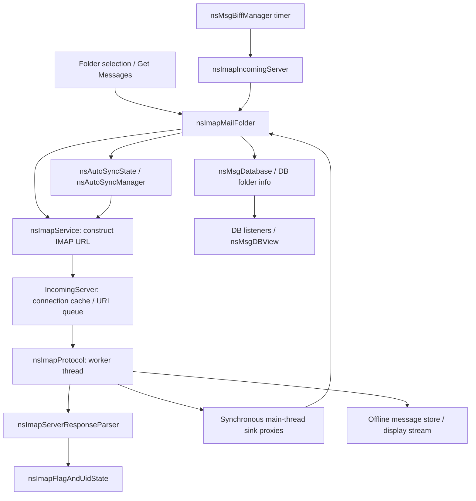

# Thunderbird IMAP synchronization: source map

Research only. Inspected **2026-10-11 (Europe/Warsaw)**. Thunderbird upstream: `https://github.com/thunderbird/thunderbird-desktop`, pinned at **5ac95865d39e426e66122ef4f54907ffa474a579** (upstream `main`, not a released-version performance claim). Maildock stable baseline: **ba074880768645473af070ecc846e420ced990d5**, fetched `origin/main`. Research branch: `research/thunderbird-sync-architecture`.

Thunderbird was shallow-cloned with `--depth 1 --filter=blob:none --sparse` into `D:/Projects/JS/thunderbird-desktop`; sparse paths are `mailnews/` and `mail/`. It is outside Maildock, without a submodule or copied source. Static source and existing test bodies were inspected; Thunderbird was not built, tests were not run, and no live mail accounts were contacted.

Read [lifecycle](02_SYNC_LIFECYCLE.md), [patterns](03_DESIGN_PATTERNS.md), [comparison](04_MAILDOCK_COMPARISON.md), then [recommendations](05_RECOMMENDATIONS.md). **Fact** means directly supported by inspected code; **inference** means a consequence of that code without a measured execution; **proposal** is an unapproved Maildock option. Test presence does not establish a passing result.

## Active component graph

The C++ paths are active: [components.conf registrations](https://github.com/thunderbird/thunderbird-desktop/blob/5ac95865d39e426e66122ef4f54907ffa474a579/mailnews/imap/src/components.conf#L7-L64) and [moz.build compilation lists](https://github.com/thunderbird/thunderbird-desktop/blob/5ac95865d39e426e66122ef4f54907ffa474a579/mailnews/imap/src/moz.build#L5-L38) register and compile the service, protocol, incoming server, folder and AutoSync. UI selection calls [about3Pane's `gViewWrapper.open`](https://github.com/thunderbird/thunderbird-desktop/blob/5ac95865d39e426e66122ef4f54907ffa474a579/mail/base/content/about3Pane.js#L2920-L2940); the wrapper [starts folder update and decides immediate display](https://github.com/thunderbird/thunderbird-desktop/blob/5ac95865d39e426e66122ef4f54907ffa474a579/mail/modules/DBViewWrapper.sys.mjs#L888-L918), through [the helper calling `aFolder.updateFolder`](https://github.com/thunderbird/thunderbird-desktop/blob/5ac95865d39e426e66122ef4f54907ffa474a579/mail/modules/DBViewWrapper.sys.mjs#L99-L120). Another entry is [mailWindowOverlay Get Messages](https://github.com/thunderbird/thunderbird-desktop/blob/5ac95865d39e426e66122ef4f54907ffa474a579/mail/base/content/mailWindowOverlay.js#L1460-L1485). This research concerns that registered C++ IMAP path, not an assumed replacement protocol engine.

## Evidence index

All links below are GitHub permalinks at the pinned SHA. IDs are used in the other documents to avoid ambiguous references.

| ID  | Path and symbols                                                                                                                                                                                                                                                                                                                                                                                                                                                                                                                                                                                                                                                                                                                                                                                                                                 | Responsibility and traced calls                                                                                                                                                                                                                                                                     |
| --- | ------------------------------------------------------------------------------------------------------------------------------------------------------------------------------------------------------------------------------------------------------------------------------------------------------------------------------------------------------------------------------------------------------------------------------------------------------------------------------------------------------------------------------------------------------------------------------------------------------------------------------------------------------------------------------------------------------------------------------------------------------------------------------------------------------------------------------------------------ | --------------------------------------------------------------------------------------------------------------------------------------------------------------------------------------------------------------------------------------------------------------------------------------------------- |
| T01 | [`mailnews/imap/src/nsImapMailFolder.cpp`, `UpdateFolderWithListener`, 627–790](https://github.com/thunderbird/thunderbird-desktop/blob/5ac95865d39e426e66122ef4f54907ffa474a579/mailnews/imap/src/nsImapMailFolder.cpp#L627-L790)                                                                                                                                                                                                                                                                                                                                                                                                                                                                                                                                                                                                               | Open DB; replay offline events if necessary; folder discovery before SELECT; suppress overlapping folder updates with `m_urlRunning`; call service `SelectFolder`.                                                                                                                                  |
| T02 | [`nsImapMailFolder.cpp`, `GetNewMessages`, 2373–2408](https://github.com/thunderbird/thunderbird-desktop/blob/5ac95865d39e426e66122ef4f54907ffa474a579/mailnews/imap/src/nsImapMailFolder.cpp#L2373-L2408); [`mailnews/base/src/nsMsgBiffManager.cpp`, `PerformBiff`, 265–310](https://github.com/thunderbird/thunderbird-desktop/blob/5ac95865d39e426e66122ef4f54907ffa474a579/mailnews/base/src/nsMsgBiffManager.cpp#L265-L310); [`nsImapIncomingServer.cpp`, `PerformBiff`, 970–980](https://github.com/thunderbird/thunderbird-desktop/blob/5ac95865d39e426e66122ef4f54907ffa474a579/mailnews/imap/src/nsImapIncomingServer.cpp#L970-L980)                                                                                                                                                                                                   | Timer/server → root folder → INBOX update first, then eligible non-INBOX folders. This is call order, not a global scheduling guarantee.                                                                                                                                                            |
| T03 | [`mailnews/imap/src/nsImapService.cpp`, `SelectFolder`, 155–202](https://github.com/thunderbird/thunderbird-desktop/blob/5ac95865d39e426e66122ef4f54907ffa474a579/mailnews/imap/src/nsImapService.cpp#L155-L202); [`DiscoverAllFolders`, 1510–1535](https://github.com/thunderbird/thunderbird-desktop/blob/5ac95865d39e426e66122ef4f54907ffa474a579/mailnews/imap/src/nsImapService.cpp#L1510-L1535); [`GetImapConnectionAndLoadUrl`, 1854–1890](https://github.com/thunderbird/thunderbird-desktop/blob/5ac95865d39e426e66122ef4f54907ffa474a579/mailnews/imap/src/nsImapService.cpp#L1854-L1890)                                                                                                                                                                                                                                              | Build action-bearing URLs and pass them to the account's incoming server.                                                                                                                                                                                                                           |
| T04 | [`mailnews/imap/src/nsImapIncomingServer.cpp`, connection dispatch/queue, 493–630](https://github.com/thunderbird/thunderbird-desktop/blob/5ac95865d39e426e66122ef4f54907ffa474a579/mailnews/imap/src/nsImapIncomingServer.cpp#L493-L630); [`GetImapConnection`, 727–855](https://github.com/thunderbird/thunderbird-desktop/blob/5ac95865d39e426e66122ef4f54907ffa474a579/mailnews/imap/src/nsImapIncomingServer.cpp#L727-L855); [`GetMaximumConnectionsNumber`, 362–378](https://github.com/thunderbird/thunderbird-desktop/blob/5ac95865d39e426e66122ef4f54907ffa474a579/mailnews/imap/src/nsImapIncomingServer.cpp#L362-L378)                                                                                                                                                                                                                | Per-server connection cache, append unavailable URLs, consider queue head first. Busy matching connection prevents creation of another connection for that request. Default fallback cap is five; negative configured value becomes one.                                                            |
| T05 | [`mailnews/imap/src/nsImapProtocol.cpp`, `CanHandleUrl`, 2578–2725](https://github.com/thunderbird/thunderbird-desktop/blob/5ac95865d39e426e66122ef4f54907ffa474a579/mailnews/imap/src/nsImapProtocol.cpp#L2578-L2725)                                                                                                                                                                                                                                                                                                                                                                                                                                                                                                                                                                                                                           | Match host/user and selected or pending folder; a busy matching folder sets `hasToWait`. This is the central same-folder contention evidence.                                                                                                                                                       |
| T06 | [`nsImapProtocol.cpp`, `ProcessSelectedStateURL`, 2754–2830](https://github.com/thunderbird/thunderbird-desktop/blob/5ac95865d39e426e66122ef4f54907ffa474a579/mailnews/imap/src/nsImapProtocol.cpp#L2754-L2830) and [SELECT action dispatch, 3006–3022](https://github.com/thunderbird/thunderbird-desktop/blob/5ac95865d39e426e66122ef4f54907ffa474a579/mailnews/imap/src/nsImapProtocol.cpp#L3006-L3022)                                                                                                                                                                                                                                                                                                                                                                                                                                       | SELECT on new/reselected folder; NOOP/CHECK on reused selection; select action invokes `ProcessMailboxUpdate`. A `moreHeadersToDownload` branch exists, but does not prove active incremental scheduling (see T10).                                                                                 |
| T07 | [`nsImapProtocol.cpp`, `ProcessMailboxUpdate`, 4212–4513](https://github.com/thunderbird/thunderbird-desktop/blob/5ac95865d39e426e66122ef4f54907ffa474a579/mailnews/imap/src/nsImapProtocol.cpp#L4212-L4513)                                                                                                                                                                                                                                                                                                                                                                                                                                                                                                                                                                                                                                     | Full UID/flag fetch, conditional delta or high-water fetch → mailbox spec → folder reconciliation → missing-header fetch → completion → optional bodies. Failure resets protocol flag state.                                                                                                        |
| T08 | [`nsImapMailFolder.cpp`, `UpdateImapMailboxInfo` / `HandleUidInvalidation`, 2487–2721](https://github.com/thunderbird/thunderbird-desktop/blob/5ac95865d39e426e66122ef4f54907ffa474a579/mailnews/imap/src/nsImapMailFolder.cpp#L2487-L2721); [`FindUidsToDelete` / `FindUidsToAdd`, 4111–4267](https://github.com/thunderbird/thunderbird-desktop/blob/5ac95865d39e426e66122ef4f54907ffa474a579/mailnews/imap/src/nsImapMailFolder.cpp#L4111-L4267)                                                                                                                                                                                                                                                                                                                                                                                              | Compare local identities to server UID state; distinguish full from partial state; delete confirmed stale placements, fetch missing UIDs, reset UIDVALIDITY-dependent metadata.                                                                                                                     |
| T09 | [`nsImapProtocol.cpp`, `FetchMessage` header fields, 3716–3774](https://github.com/thunderbird/thunderbird-desktop/blob/5ac95865d39e426e66122ef4f54907ffa474a579/mailnews/imap/src/nsImapProtocol.cpp#L3716-L3774); [`FolderMsgDumpLoop`, 4590–4611](https://github.com/thunderbird/thunderbird-desktop/blob/5ac95865d39e426e66122ef4f54907ffa474a579/mailnews/imap/src/nsImapProtocol.cpp#L4590-L4611); [`mailnews/imap/src/nsImapUtils.cpp`, `AllocateImapUidString`, 238–310](https://github.com/thunderbird/thunderbird-desktop/blob/5ac95865d39e426e66122ef4f54907ffa474a579/mailnews/imap/src/nsImapUtils.cpp#L238-L310)                                                                                                                                                                                                                   | Fetch reduced headers unless filtering requires full headers. Compress actual UID sets; split sufficiently long strings with usable flag state. No count/time bound for dense header ranges and no URL-queue yield in dump loop.                                                                    |
| T10 | [`nsImapProtocol.cpp`, `NormalMessageEndDownload`, 4136–4150](https://github.com/thunderbird/thunderbird-desktop/blob/5ac95865d39e426e66122ef4f54907ffa474a579/mailnews/imap/src/nsImapProtocol.cpp#L4136-L4150); [`mailnews/imap/src/nsImapProtocol.h`, `kNumHdrsToXfer`, 84](https://github.com/thunderbird/thunderbird-desktop/blob/5ac95865d39e426e66122ef4f54907ffa474a579/mailnews/imap/src/nsImapProtocol.h#L84); [`nsImapMailFolder.cpp`, `GetMsgHdrsToDownload`, 4263–4273](https://github.com/thunderbird/thunderbird-desktop/blob/5ac95865d39e426e66122ef4f54907ffa474a579/mailnews/imap/src/nsImapMailFolder.cpp#L4263-L4273)                                                                                                                                                                                                        | Header cache hands off ten headers at a time; folder transfers the entire pending UID array, not a newest-first slice or a fixed-size network batch.                                                                                                                                                |
| T11 | [`nsImapMailFolder.cpp`, `ParseMsgHdrs`, 2832–2885](https://github.com/thunderbird/thunderbird-desktop/blob/5ac95865d39e426e66122ef4f54907ffa474a579/mailnews/imap/src/nsImapMailFolder.cpp#L2832-L2885); [`AddNewImapHeaderToDB` / header parse, 2934–3044](https://github.com/thunderbird/thunderbird-desktop/blob/5ac95865d39e426e66122ef4f54907ffa474a579/mailnews/imap/src/nsImapMailFolder.cpp#L2934-L3044); [insertion call, 3120–3140](https://github.com/thunderbird/thunderbird-desktop/blob/5ac95865d39e426e66122ef4f54907ffa474a579/mailnews/imap/src/nsImapMailFolder.cpp#L3120-L3140); [`mailnews/base/src/nsMsgDBView.cpp`, `OnHdrAdded`, 5195–5235](https://github.com/thunderbird/thunderbird-desktop/blob/5ac95865d39e426e66122ef4f54907ffa474a579/mailnews/base/src/nsMsgDBView.cpp#L5195-L5235)                              | Reject already-present header keys; parse → insert/notify → view update. Persist highest observed header UID, with descending-response handling. Destructive filters can prevent ordinary insertion.                                                                                                |
| T12 | [`nsImapProtocol.cpp`, `HandleIdleResponses`, 1625–1659](https://github.com/thunderbird/thunderbird-desktop/blob/5ac95865d39e426e66122ef4f54907ffa474a579/mailnews/imap/src/nsImapProtocol.cpp#L1625-L1659); [IDLE entry, 1581–1610](https://github.com/thunderbird/thunderbird-desktop/blob/5ac95865d39e426e66122ef4f54907ffa474a579/mailnews/imap/src/nsImapProtocol.cpp#L1581-L1610); [`EndIdle`, 7878–7925](https://github.com/thunderbird/thunderbird-desktop/blob/5ac95865d39e426e66122ef4f54907ffa474a579/mailnews/imap/src/nsImapProtocol.cpp#L7878-L7925); [`nsImapMailFolder.cpp`, `OnNewIdleMessages`, 2467–2484](https://github.com/thunderbird/thunderbird-desktop/blob/5ac95865d39e426e66122ef4f54907ffa474a579/mailnews/imap/src/nsImapMailFolder.cpp#L2467-L2484)                                                                | IDLE while no URL is active; untagged response triggers folder update. New URL exits IDLE via DONE. Device/app idle used by AutoSync is a different concept.                                                                                                                                        |
| T13 | [`mailnews/imap/src/nsImapServerResponseParser.cpp`, `PostProcessEndOfLine`, 683–697](https://github.com/thunderbird/thunderbird-desktop/blob/5ac95865d39e426e66122ef4f54907ffa474a579/mailnews/imap/src/nsImapServerResponseParser.cpp#L683-L697); [`numeric_mailbox_data`, 900–919](https://github.com/thunderbird/thunderbird-desktop/blob/5ac95865d39e426e66122ef4f54907ffa474a579/mailnews/imap/src/nsImapServerResponseParser.cpp#L900-L919); [`nsImapMailFolder.cpp`, `SyncFlags` / notifications, 4732–4868](https://github.com/thunderbird/thunderbird-desktop/blob/5ac95865d39e426e66122ef4f54907ffa474a579/mailnews/imap/src/nsImapMailFolder.cpp#L4732-L4868)                                                                                                                                                                        | EXISTS updates count; EXPUNGE removes sequence-indexed state; UID-bearing FETCH flags notify sink. Folder maps Seen/Flagged/custom flags to DB. EXISTS alone does not insert a message or preempt header fetching.                                                                                  |
| T14 | [`nsImapProtocol.cpp`, `UseCondStore`, 8806–8811](https://github.com/thunderbird/thunderbird-desktop/blob/5ac95865d39e426e66122ef4f54907ffa474a579/mailnews/imap/src/nsImapProtocol.cpp#L8806-L8811); [`mailnews/mailnews.js`, prefs, 584–585](https://github.com/thunderbird/thunderbird-desktop/blob/5ac95865d39e426e66122ef4f54907ffa474a579/mailnews/mailnews.js#L584-L585)                                                                                                                                                                                                                                                                                                                                                                                                                                                                  | Requires preference, capability and MODSEQ availability. Preference defaults false. No `QRESYNC` or `VANISHED` matches were found by case-sensitive search in the inspected `mailnews/` and `mail/` source trees. This is bounded negative evidence, not a claim about every Thunderbird extension. |
| T15 | [`nsImapMailFolder.cpp`, `HeaderFetchCompleted`, 5620–5722](https://github.com/thunderbird/thunderbird-desktop/blob/5ac95865d39e426e66122ef4f54907ffa474a579/mailnews/imap/src/nsImapMailFolder.cpp#L5620-L5722); [`SetUrlState`, 6518–6546](https://github.com/thunderbird/thunderbird-desktop/blob/5ac95865d39e426e66122ef4f54907ffa474a579/mailnews/imap/src/nsImapMailFolder.cpp#L6518-L6546); [`nsImapProtocol.cpp`, URL teardown/queue dispatch, 2082–2146](https://github.com/thunderbird/thunderbird-desktop/blob/5ac95865d39e426e66122ef4f54907ffa474a579/mailnews/imap/src/nsImapProtocol.cpp#L2082-L2146)                                                                                                                                                                                                                             | Flush headers, filters/new-mail notifications, optional body work, then URL completion and next queued URL. Header completion is not equivalent to an offline-store completeness guarantee.                                                                                                         |
| T16 | [`mailnews/imap/src/nsAutoSyncManager.cpp`, message/folder strategies, 53–196](https://github.com/thunderbird/thunderbird-desktop/blob/5ac95865d39e426e66122ef4f54907ffa474a579/mailnews/imap/src/nsAutoSyncManager.cpp#L53-L196); [default chained model, 213–220](https://github.com/thunderbird/thunderbird-desktop/blob/5ac95865d39e426e66122ef4f54907ffa474a579/mailnews/imap/src/nsAutoSyncManager.cpp#L213-L220); [`TimerCallback`, 317–410](https://github.com/thunderbird/thunderbird-desktop/blob/5ac95865d39e426e66122ef4f54907ffa474a579/mailnews/imap/src/nsAutoSyncManager.cpp#L317-L410)                                                                                                                                                                                                                                          | Offline body priority: newer/smaller, large messages deferred; open folders and INBOX preferred. Also initiates remote folder checks through regular folder API; local discovery means scanning already-stored headers.                                                                             |
| T17 | [`mailnews/imap/src/nsAutoSyncState.cpp`, `GetNextGroupOfMessages`, 204–293](https://github.com/thunderbird/thunderbird-desktop/blob/5ac95865d39e426e66122ef4f54907ffa474a579/mailnews/imap/src/nsAutoSyncState.cpp#L204-L293); [local scan/update bridge, 301–408](https://github.com/thunderbird/thunderbird-desktop/blob/5ac95865d39e426e66122ef4f54907ffa474a579/mailnews/imap/src/nsAutoSyncState.cpp#L301-L408); [STATUS follow-up/empty-DB repair, 433–526](https://github.com/thunderbird/thunderbird-desktop/blob/5ac95865d39e426e66122ef4f54907ffa474a579/mailnews/imap/src/nsAutoSyncState.cpp#L433-L526); [rollback, 590–640](https://github.com/thunderbird/thunderbird-desktop/blob/5ac95865d39e426e66122ef4f54907ffa474a579/mailnews/imap/src/nsAutoSyncState.cpp#L590-L640)                                                      | Re-sort pending body queue, skip offline bodies, group by bytes with an oversized-message exception. Queues/offsets are in memory. STATUS changes can trigger regular metadata update.                                                                                                              |
| T18 | [`nsAutoSyncManager.cpp`, offline dispatch/errors, 1067–1167](https://github.com/thunderbird/thunderbird-desktop/blob/5ac95865d39e426e66122ef4f54907ffa474a579/mailnews/imap/src/nsAutoSyncManager.cpp#L1067-L1167); [new work/completion reprioritization, 1241–1380](https://github.com/thunderbird/thunderbird-desktop/blob/5ac95865d39e426e66122ef4f54907ffa474a579/mailnews/imap/src/nsAutoSyncManager.cpp#L1241-L1380); [`nsAutoSyncManager.h`, constants, 123–129](https://github.com/thunderbird/thunderbird-desktop/blob/5ac95865d39e426e66122ef4f54907ffa474a579/mailnews/imap/src/nsAutoSyncManager.h#L123-L129)                                                                                                                                                                                                                      | Roughly 2 MB body groups, first non-idle group constrained to 60 KB, scan 250 local headers/cycle; retries and choose higher-priority same-account sibling after group completion. Defaults are evidence, not proposed Maildock values.                                                             |
| T19 | [`nsImapProtocol.cpp`, body chunk loop, 3880–3925](https://github.com/thunderbird/thunderbird-desktop/blob/5ac95865d39e426e66122ef4f54907ffa474a579/mailnews/imap/src/nsImapProtocol.cpp#L3880-L3925); [`PseudoInterruptMsgLoad`, 1444–1485](https://github.com/thunderbird/thunderbird-desktop/blob/5ac95865d39e426e66122ef4f54907ffa474a579/mailnews/imap/src/nsImapProtocol.cpp#L1444-L1485); [`nsImapMailFolder.cpp`, body finalization/abort, 4512–4601](https://github.com/thunderbird/thunderbird-desktop/blob/5ac95865d39e426e66122ef4f54907ffa474a579/mailnews/imap/src/nsImapMailFolder.cpp#L4512-L4601); [`mailnews/base/src/nsMsgDBFolder.cpp`, `EndNewOfflineMessage`, 1509–1552](https://github.com/thunderbird/thunderbird-desktop/blob/5ac95865d39e426e66122ef4f54907ffa474a579/mailnews/base/src/nsMsgDBFolder.cpp#L1509-L1552) | Body-specific chunking and cancellation; finish store before marking offline; abort discards partial message. These paths do not establish header-sync preemption or power-loss atomicity.                                                                                                          |
| T20 | [`nsImapProtocol.cpp`, `RetryUrl`, 2171–2203](https://github.com/thunderbird/thunderbird-desktop/blob/5ac95865d39e426e66122ef4f54907ffa474a579/mailnews/imap/src/nsImapProtocol.cpp#L2171-L2203); [`mailnews/db/msgdb/src/nsMsgDatabase.cpp`, DB open/commit, 1100–1140](https://github.com/thunderbird/thunderbird-desktop/blob/5ac95865d39e426e66122ef4f54907ffa474a579/mailnews/db/msgdb/src/nsMsgDatabase.cpp#L1100-L1140) and [1431–1498](https://github.com/thunderbird/thunderbird-desktop/blob/5ac95865d39e426e66122ef4f54907ffa474a579/mailnews/db/msgdb/src/nsMsgDatabase.cpp#L1431-L1498); [`nsImapMailFolder.cpp`, cached AutoSync time, 1981–1987](https://github.com/thunderbird/thunderbird-desktop/blob/5ac95865d39e426e66122ef4f54907ffa474a579/mailnews/imap/src/nsImapMailFolder.cpp#L1981-L1987)                             | Selected network failures retry URL on replacement connection with one-second delay, bounded by rerunning state; local summary DB uses Mork. Cached last-sync time is not a durable downloaded-UID receipt ledger.                                                                                  |
| T21 | [`nsImapProtocol.cpp`, online move dispatch, 3319–3395](https://github.com/thunderbird/thunderbird-desktop/blob/5ac95865d39e426e66122ef4f54907ffa474a579/mailnews/imap/src/nsImapProtocol.cpp#L3319-L3395); [`nsImapService.cpp`, `StreamMessage`, 869–970](https://github.com/thunderbird/thunderbird-desktop/blob/5ac95865d39e426e66122ef4f54907ffa474a579/mailnews/imap/src/nsImapService.cpp#L869-L970)                                                                                                                                                                                                                                                                                                                                                                                                                                      | MOVE capability versus COPY/STORE/EXPUNGE fallback; local content cache versus remote retrieval. Cross-folder UID identities differ.                                                                                                                                                                |
| T22 | [`mailnews/imap/src/nsSyncRunnableHelpers.cpp`, folder/message proxy methods, 354–403](https://github.com/thunderbird/thunderbird-desktop/blob/5ac95865d39e426e66122ef4f54907ffa474a579/mailnews/imap/src/nsSyncRunnableHelpers.cpp#L354-L403)                                                                                                                                                                                                                                                                                                                                                                                                                                                                                                                                                                                                   | Synchronous proxy boundary for reconciliation, header parsing, flags and body finalization; protocol's network thread must wait for sink work.                                                                                                                                                      |

## Existing tests inspected

| Test permalink                                                                                                                                                                                              | What the inspected body verifies                                                               | What it does not verify                                                  |
| ----------------------------------------------------------------------------------------------------------------------------------------------------------------------------------------------------------- | ---------------------------------------------------------------------------------------------- | ------------------------------------------------------------------------ |
| [`test_imapUnsolicitedXDuringIdle.js`](https://github.com/thunderbird/thunderbird-desktop/blob/5ac95865d39e426e66122ef4f54907ffa474a579/mailnews/imap/test/unit/test_imapUnsolicitedXDuringIdle.js#L66-L83) | Unknown untagged response then EXISTS during IDLE still leads to `msgAdded`.                   | Arrivals during a 50,000-header active FETCH.                            |
| [`test_syncChanges.js`](https://github.com/thunderbird/thunderbird-desktop/blob/5ac95865d39e426e66122ef4f54907ffa474a579/mailnews/imap/test/unit/test_syncChanges.js#L48-L80)                               | Reselection after external deletion empties local DB.                                          | All concurrent deletion patterns / CONDSTORE race proof.                 |
| [`test_imapFlagChange.js`](https://github.com/thunderbird/thunderbird-desktop/blob/5ac95865d39e426e66122ef4f54907ffa474a579/mailnews/imap/test/unit/test_imapFlagChange.js#L64-L140)                        | Other-client flags are stored/cleared after folder switching and refresh; Seen included.       | Latency under history load.                                              |
| [`test_imapTruncatedOfflineBody.js`](https://github.com/thunderbird/thunderbird-desktop/blob/5ac95865d39e426e66122ef4f54907ffa474a579/mailnews/imap/test/unit/test_imapTruncatedOfflineBody.js#L137-L173)   | Complete body gets Offline bit; truncated body does not.                                       | Abrupt OS crash at every DB/store write boundary.                        |
| [`test_missingDateUsesReceived.js`](https://github.com/thunderbird/thunderbird-desktop/blob/5ac95865d39e426e66122ef4f54907ffa474a579/mailnews/imap/test/unit/test_missingDateUsesReceived.js#L14-L71)       | Reduced headers include Received; missing Date falls back to received date.                    | Dates as a bootstrap completeness criterion.                             |
| [`test_imapHighWater.js`](https://github.com/thunderbird/thunderbird-desktop/blob/5ac95865d39e426e66122ef4f54907ffa474a579/mailnews/imap/test/unit/test_imapHighWater.js#L114-L185)                         | Pseudo offline move headers and high local message keys do not break high-water/copy behavior. | Proof that a maximum UID denotes all headers ingested.                   |
| [`test_imapAutoSync.js`](https://github.com/thunderbird/thunderbird-desktop/blob/5ac95865d39e426e66122ef4f54907ffa474a579/mailnews/imap/test/unit/test_imapAutoSync.js#L6-L20)                              | Test explicitly exercises AutoSync events and move/copy queue priority.                        | Header newest-first scheduling; its queue is the body queue.             |
| [`test_imapHdrStreaming.js`](https://github.com/thunderbird/thunderbird-desktop/blob/5ac95865d39e426e66122ef4f54907ffa474a579/mailnews/imap/test/unit/test_imapHdrStreaming.js#L10-L75)                     | Streaming headers from an already-offline message.                                             | Progressive incoming header synchronization despite its suggestive name. |
| [`test_imapHugeFetchIndex.js`](https://github.com/thunderbird/thunderbird-desktop/blob/5ac95865d39e426e66122ef4f54907ffa474a579/mailnews/imap/test/unit/test_imapHugeFetchIndex.js#L6-L47)                  | Malformed huge unsolicited FETCH indices during CAPABILITY are ignored.                        | A real mailbox with a huge sparse UID range.                             |

The shared [xpcshell manifest](https://github.com/thunderbird/thunderbird-desktop/blob/5ac95865d39e426e66122ef4f54907ffa474a579/mailnews/imap/test/unit/xpcshell-shared.toml#L58-L208) includes these tests. They were read, not executed. No inspected test establishes an arrival-latency bound for the required 50,000 + 10 scenario. No CONDSTORE-specific test was located in the inspected IMAP unit directory by searches for `CondStore`, `condstore` and `CHANGEDSINCE`; broader coverage remains unverified.

## Limits of this map

No Gecko checkout or executable timing trace was obtained. TLS/socket internals, complete MIME part routing, every offline move replay case and OS-crash durability remain outside the proven boundary. A continuation flag in T06 and comments in interfaces are not sufficient to describe active header scheduling: T10 transfers all pending header UIDs, and T09 runs them inside the current URL. Additional checks: [synchronous proxy dispatch/wait](https://github.com/thunderbird/thunderbird-desktop/blob/5ac95865d39e426e66122ef4f54907ffa474a579/mailnews/imap/src/nsSyncRunnableHelpers.cpp#L247-L263), [view display deferral predicate](https://github.com/thunderbird/thunderbird-desktop/blob/5ac95865d39e426e66122ef4f54907ffa474a579/mail/modules/DBViewWrapper.sys.mjs#L1026-L1053), and [AutoSync test completion assertions](https://github.com/thunderbird/thunderbird-desktop/blob/5ac95865d39e426e66122ef4f54907ffa474a579/mailnews/imap/test/unit/test_imapAutoSync.js#L54-L117) were inspected. Case-insensitive QRESYNC/VANISHED search found only ordinary English uses of “vanished” in unrelated test text, not an IMAP protocol handler.
