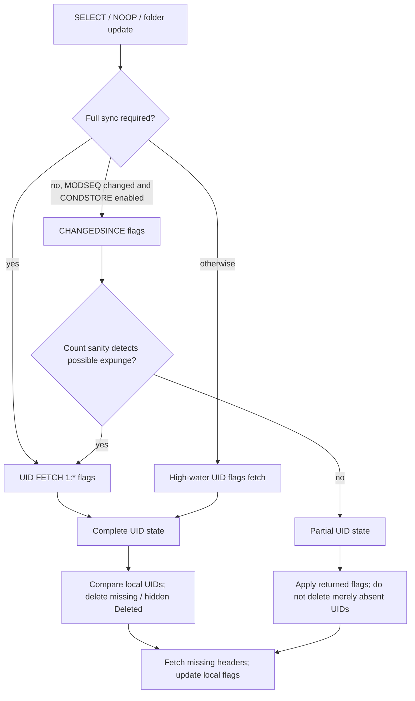
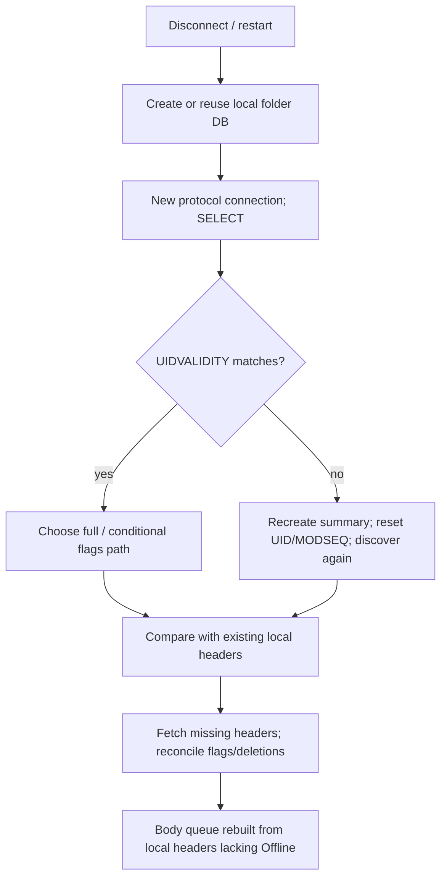

# Actual IMAP synchronization lifecycle

Pinned Thunderbird SHA: **5ac95865d39e426e66122ef4f54907ffa474a579**. Inspection: **2026-10-11**. Evidence IDs T01–T22 resolve to paths, symbols and pinned line ranges in [01_SOURCE_MAP.md](01_SOURCE_MAP.md). Facts below describe inspected source; scenario outcomes marked inference were not benchmarked. Existing tests were inspected, not run.

## Initial account and a 50,000-message INBOX

There is no evidence here of a single account-bootstrap transaction spanning all folders. The registered folder/service/protocol path handles folder discovery and updates. UI selection calls the folder update API; biff's account check requests INBOX before other eligible folders (T01–T03). Other work already running can affect execution order.

```mermaid
sequenceDiagram
  participant Trigger as UI / account mail check
  participant Folder as nsImapMailFolder
  participant Pool as Service / IncomingServer
  participant IMAP as Protocol / server
  participant DB as Local DB / listeners
  Trigger->>Folder: UpdateFolder / GetNewMessages
  Folder->>Pool: Discover folders if needed; SelectFolder URL
  Pool->>IMAP: Reuse/create connection or queue URL
  IMAP->>IMAP: SELECT; obtain UIDVALIDITY, counts, capabilities
  IMAP->>IMAP: UID FETCH flags (initially 1:*)
  IMAP->>Folder: UpdateImapMailboxInfo(server UID state)
  Folder->>DB: Compare local UIDs, delete stale entries, sync flags
  Folder-->>IMAP: All missing header UIDs
  IMAP->>IMAP: UID FETCH reduced/full headers
  loop Cache reaches 10 headers
    IMAP->>Folder: ParseMsgHdrs (synchronous main-thread sink)
    Folder->>DB: Parse and add headers; notify listeners
  end
  IMAP->>Folder: Flush remainder; HeaderFetchCompleted
  Folder-->>IMAP: Optional immediate body UIDs or empty list
  Folder->>Pool: Optional AutoSync body work
  IMAP-->>Trigger: URL completion status
```

**Discovery.** With no previous highest UID, `ProcessMailboxUpdate` selects full `UID FETCH 1:*` flags. The response parser builds UID/flag state. `FindUidsToAdd` compares it against sorted local identities, ignoring invalid UIDs and, depending on the deletion model, messages already marked Deleted. The metadata update is not constrained to a date window (T07–T08).

**Fetching.** `GetMsgHdrsToDownload` moves the entire pending array to the protocol. `FolderMsgDumpLoop` encodes that set and calls `FetchMessage`; dense UIDs may compress to a single large range. The UID string-length break in `AllocateImapUidString` can split sparse sets when full flag state is available. Neither is a fixed message-count or elapsed-time budget. In particular, the `// 20 * 200` comment beside the call does not impose a 200-header batch: the actual initial `msgsToDownload` is the remaining count (T09–T10).

**First visibility.** Complete received headers are transferred to the main-thread folder sink after ten cached headers, with a final remainder flush. Parsing normally calls `AddNewImapHeaderToDB` → database insertion → message-added notifications; `nsMsgDBView::OnHdrAdded` consumes DB additions. **Inference:** an attached view can show messages before the whole header request finishes, after initial flag discovery and the first transferred group. `DBViewWrapper.shouldShowMessagesForFolderImmediately` permits early display except when underlying folders are unavailable or its listener defers display until server connection (links in the source map). Thus DB publication is established, but immediate UI display on every initial-account path is not. There is no measured time-to-first-message here. Incoming filters can move/delete a header, and classification notifications have their own lifecycle (T10–T11, T15).

**Newest messages and dates.** The inspected header path does not sort missing UIDs by message date or reverse them to prefer the newest. It walks server UID state. Server response order can differ; the parser explicitly handles descending returned UIDs when updating the highest recorded UID. Dates affect parsed/display metadata and AutoSync body ordering, not membership discovery. A missing Date uses Received in the inspected regression test. A future/past Date does not exclude a message from this UID-based header path (T08–T11, T16). Do not transfer AutoSync's newer/smaller body strategy to header synchronization.

**Avoiding work.** Existing header keys are excluded during UID reconciliation and checked again during parsing. Reduced header fields avoid full-body traffic; filters can require full headers. Reused selection and highest recorded UID avoid repeated old-header retrieval; CONDSTORE optionally reduces flag traffic. Full UID state and local comparisons still cost work proportional to mailbox size (T06–T11, T14).

**Completion.** Header fetch completion flushes the header cache and performs folder post-processing, notifications and body hand-off. A select URL can then wait for explicitly requested body work, while ordinary AutoSync bodies are scheduled separately. `SetUrlState` clears the folder-running flag and ends associated offline work; protocol teardown releases the URL and asks for queued work. These are operational completion points, not an immutable snapshot of a changing server or proof that all bodies are cached (T07, T15).

## Ten arrivals during a long-running header update

The strongest finding is a limitation: **no general same-folder arrival bypass was found in this production path**. The inspected loop does not cancel history or return to the URL dispatcher after each header transfer.

```mermaid
sequenceDiagram
  participant Server as IMAP server
  participant P as Active INBOX protocol connection
  participant F as Folder / local DB
  participant Q as Account URL dispatcher
  P->>Server: FETCH headers for already-discovered old UIDs
  Server-->>P: Header responses
  P->>F: Publish every 10 complete headers
  Server-->>P: EXISTS may be sent during allowed protocol responses
  Note over P: Parser records count; not a new-header insertion
  Q->>P: Competing request for same folder
  P-->>Q: Busy matching folder: hasToWait
  Note over Q: Request queues; no second matching-folder connection
  P->>P: Finish current dump loop / URL work
  P->>Q: Release URL; try queued work
  Note over P,Q: Later folder update discovers missing new UIDs
```

The diagram's EXISTS delivery timing and the timing of that later update are **inferences**, not an asserted guarantee of a specific server. `numeric_mailbox_data` updates EXISTS count, not the previously selected header UID list. `FolderMsgDumpLoop` does not refresh that list or consult the URL queue between fetches (T09, T13).

When the connection is actually **idling**, `HandleIdleResponses` invokes `OnNewIdleMessages` → `UpdateFolder`. A new URL sends DONE to leave IDLE. The main loop enters IDLE only with no active URL, after a short two-second quiet interval; IDLE is not a concurrent command channel on the same connection (T12). The inspected IDLE test verifies message insertion from EXISTS while idle, not arrivals during a large active fetch.

When a folder update is already running, `UpdateFolderWithListener` has a `!m_urlRunning` guard. A call during that interval does not necessarily enqueue another SELECT. Separately, a requested same-folder URL that reaches connection dispatch sets `hasToWait` on a busy matching connection; `GetImapConnection` then returns no connection for queuing even if the account has spare connection capacity (T01, T04–T05). Thus **arrival detection, pending work, and publication are distinct**; observing a count change does not guarantee immediate ingestion.

At URL completion, the dispatcher tries the queue head. `LoadNextQueuedUrl` stops if it cannot obtain a suitable connection for that head. **Inference:** this can delay later queued URLs whose folders could otherwise use another connection. Immediately dispatched new URLs can still use available suitable connections; this is not a claim that all account operations always follow one global FIFO (T04, T15).

Different folders can use different cached protocol connections. INBOX connections are normally protected from arbitrary reuse, except when the maximum connection count is one. Connections belong to a server/account, not a global application pool. With one connection, history, user operations and folder checks necessarily share that transport. With several, same-folder affinity still matters. A long command blocks its connection and can block all operations when only one connection is usable. Actual remote connection rejection/adaptation was not exhaustively traced; the configured local cache cap is not proof of the server's accepted limit (T04–T05).

Body pseudo-interruption is narrower: `PseudoInterruptMsgLoad` applies to `nsImapMsgFetch` matching folder and window, with checks in the body chunk loop. It is not evidence that incoming mail preempts `nsImapSelectFolder` header reconciliation (T19).

**Unresolved critical timing:** arrivals may occur before flag discovery finishes, after header UIDs are captured, during the last FETCH response, or just before IDLE. Inclusion in the same update depends on those timings and server responses. No inspected source/test proves a bounded next-update delay for all these windows. Biff/next selection/IDLE provide subsequent triggers, but a timing experiment is required before making a latency or no-missed-wakeup promise.

## Flags, deletion and moves



The full/conditional/high-water decisions are explicitly in T07. A high-water fetch augments existing connection state; it must not be mistaken for a fresh complete snapshot after reconnect. Without CONDSTORE, an empty connection flag state requires a full fetch. With it, stored MODSEQ/highest UID may reduce work. The conditional path checks message-count change against new UIDs and falls back to a full flag fetch if it suspects expunges. Counts are a sanity signal, not an identity ledger.

`SyncFlags` maps known returned UIDs to local headers; Seen maps to Read, Flagged to Marked, and custom keywords have their own handling. Parser notifications can also apply UID-bearing unsolicited FETCH flag changes (T13). Complete UID state permits deletion of missing local entries. Partial state permits handling explicitly returned Deleted flags but not deletion simply because a UID is absent from CHANGEDSINCE (T08).

UIDVALIDITY change calls `HandleUidInvalidation`, creates a new summary DB while attempting to preserve selected folder information, and clears highest UID/MODSEQ. It then rediscovers headers. This is an epoch reset, not reuse of old UIDs (T08). Read the implementation rather than interpreting its comment as a transactional all-cache purge guarantee: the normal success path explicitly replaces the summary and clears markers; exhaustive store cleanup behavior was not established.

For user moves, the protocol supports server MOVE and falls back to COPY followed by STORE Deleted and expunge policy when MOVE is unavailable. UIDPLUS permits targeted UID EXPUNGE; some fallback cases use mailbox-wide EXPUNGE. Destination UIDs differ from source UIDs; Thunderbird also manages pseudo headers/offline operations. Other-client moves are observed as source disappearance and destination appearance during respective updates, without a universal cross-folder atomic snapshot (T21, T08).

**Capability distinction:** CONDSTORE is implemented but defaults disabled and additionally requires server capability and usable MODSEQ. UIDNEXT is recorded as an observation; it does not enumerate existing messages. No QRESYNC/VANISHED implementation was found in the searched trees. RFC 7162 describes QRESYNC's vanished-UID machinery, but protocol availability does not demonstrate use by this client. See [RFC 7162](https://www.rfc-editor.org/rfc/rfc7162.html) and [IMAP identity rules in RFC 9051](https://www.rfc-editor.org/rfc/rfc9051.html#section-2.3.1.1) (T14).

## Persistence, reconnect and failure



Local state includes per-folder summary headers, folder identity/name and UIDVALIDITY, highest recorded header UID and MODSEQ properties, counts and cached last-sync time, offline-operation records and finished offline bodies. The DB open path uses Mork; body storage is behind a pluggable store. An IMAP message key is currently often a UID, but helper conversions and pseudo offline keys mean a redesign should keep local and remote identities distinct (T08, T11, T20–T21).

Protocol flag arrays, URL queues, body download arrays/sets, offsets and retry counters are in-memory working state. AutoSync reconstructs missing-body work by scanning local headers and checking `HasMsgOffline`. Its STATUS follow-up also forces a normal update on the first response if a nonempty server folder has an empty local DB, even if cached counts did not change (T17).

The highest observed header UID is updated during header parsing; MODSEQ is stored during mailbox-info/flag handling. These writes do **not** prove atomic checkpointing of a complete header frontier. A descending response can raise highest UID before smaller missing headers arrive. Reconciliation with actual local headers is essential; do not infer bootstrap completeness from MAX(UID) (T08, T11).

Selected network failures mark a URL for rerun and retry on a replacement connection; `RetryUrl` delays one second for that error path. This is not a general durable exponential retry system. Body download errors roll back an in-memory group offset, with a limited retry count; later rediscovery can retry still-missing bodies. Failed mailbox update clears protocol flag state (T07, T17–T20).

On normal body completion, `EndNewOfflineMessage` finishes the new store message before marking Offline. Abort clears Offline and discards the partial store write. The truncated-body regression tests this distinction. OS crash consistency across store token, Offline bit and DB commit is **not proven** by this path or test (T19–T20).

## Offline download and on-demand content

```mermaid
sequenceDiagram
  participant F as Header-completed folder
  participant A as AutoSync manager/state
  participant P as IMAP service/protocol
  participant S as Offline store / DB
  F->>A: Candidate local header keys
  A->>A: Exclude / skip cached bodies; sort pending work
  A->>P: Download next byte-sized group
  P->>S: Stream full message into temporary store
  alt Complete
    P->>S: Finish store; mark Offline
    P->>A: URL completed
    A->>A: Retry policy / choose next highest-priority sibling
  else Error or truncated download
    P->>S: Abort; discard partial; clear Offline
    P->>A: Error; retry group / later repair
  end
```

AutoSync's default chained model prevents simultaneous body groups for sibling folders on the same account while allowing independent account chains; its pending queue can be reprioritized after a group ends. A group has a suggested byte limit, with a single oversized-message exception. App idle gates continued downloads; a small first group may start immediately while the app is active. This is body scheduling, although AutoSync can initiate ordinary remote folder updates via STATUS/update APIs (T16–T18).

On-demand `StreamMessage` checks local offline availability and storage policy before creating remote retrieval work. Full-message retrieval and MIME part/body retrieval live below metadata storage; attachments are part of MIME content, not automatically downloaded just because a header exists. Thunderbird can maintain full offline copies; Maildock's lazy body/attachment policy should preserve its own selective retrieval and PostgreSQL storage. Exhaustive attachment-route tracing remains a limitation (T19, T21).

## Mechanism audit

| Mechanism          | State owner / work per iteration                                             | Yield, errors and restart                                                                                                                  | Coverage / status                                            |
| ------------------ | ---------------------------------------------------------------------------- | ------------------------------------------------------------------------------------------------------------------------------------------ | ------------------------------------------------------------ |
| Metadata discovery | Protocol parser + folder DB; initial full flags may cover all 50,000         | Network command and synchronous sink work; URL completion is dispatcher boundary; reset flag state on failure; durable headers re-compared | Active C++; flag/reselection tests; no 50k arrival bound     |
| Header ingestion   | Protocol cache + folder; ten-header transfer, potentially huge FETCH UID set | DB visibility progresses, transport queue does not yield at each ten; persisted header records survive subject to commit/recovery          | Active; incoming flag/date tests; no benchmark               |
| Arrivals           | Selected connection parser, folder; EXISTS/count or IDLE response            | IDLE wakes normal update; busy same folder waits/suppresses update; later trigger needed                                                   | Active IDLE optional by capability/pref; idle regression     |
| Conditional flags  | Protocol/folder stored MODSEQ; changed flags plus possible full fallback     | Does not provide a complete deletion list; count mismatch can cause full fetch                                                             | Optional, default disabled; dedicated coverage not located   |
| Body queue         | AutoSync manager + state; local scan 250, roughly 2 MB groups                | Reconsider priority after group; retry/rollback in memory; rebuild from offline availability                                               | Active when enabled; AutoSync tests; no hard wall-time bound |
| Local body storage | Folder/pluggable store; one complete message finalization                    | Explicit finish/discard; no proven all-write crash transaction                                                                             | Active, truncated-body test                                  |

The required product property — fresh INBOX messages escaping all historical work with a bounded delay — remains **unproven for Thunderbird and not supplied by its inspected header loop**. The research establishes the reason to design a deliberate Maildock scheduling boundary instead of assuming Thunderbird already provides that property.
