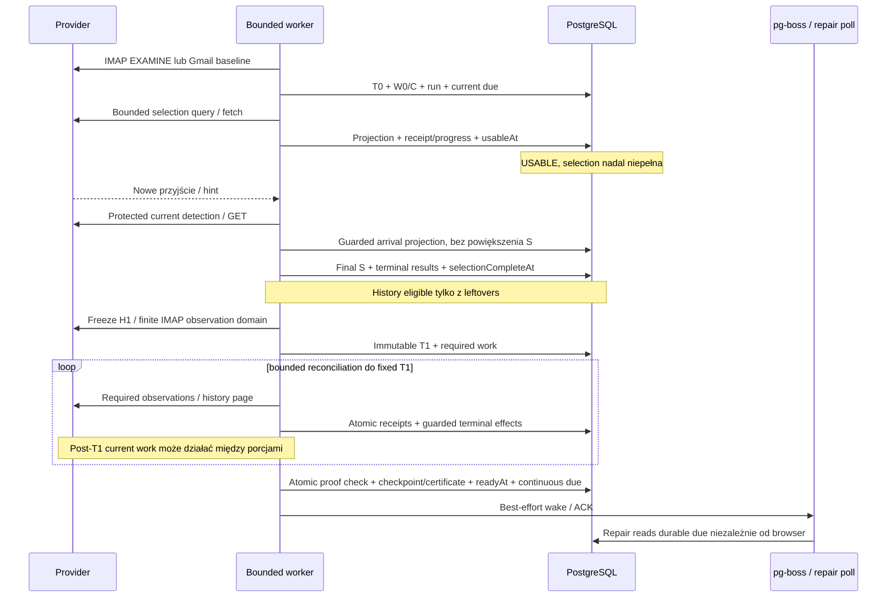
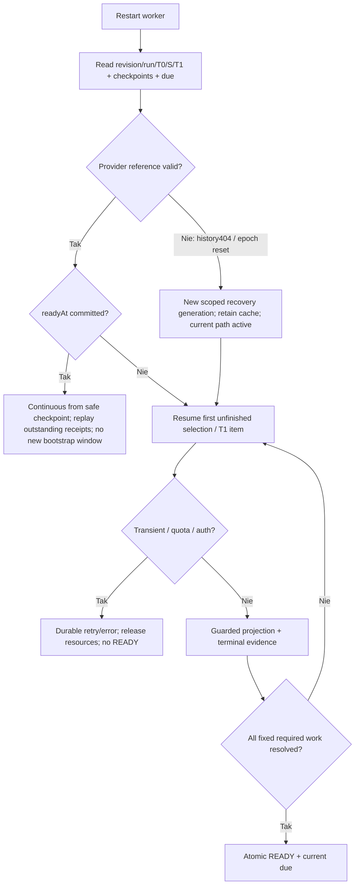
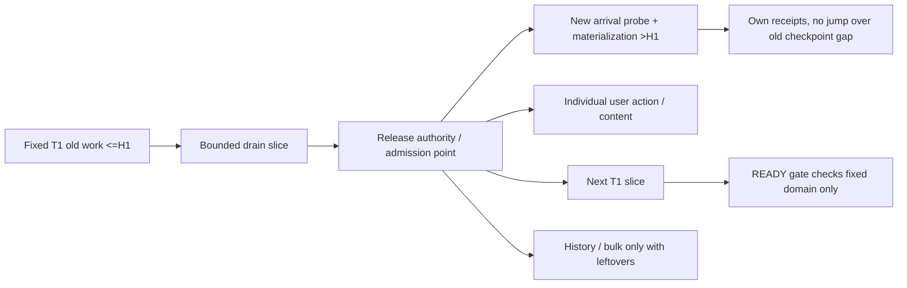

# Bootstrap, USABLE i skończone READY

Data: 2026-10-11. Status: **projekt do akceptacji, nie implementacja**.
Authority: [PRODUCT_CONTRACT v0.10](PRODUCT_CONTRACT.md), IIW/IS/BR/IF/CR/RA/MI. [Audyt C-02/M-02/M-09](INDEPENDENT_REVIEW.md) opisuje wcześniejszy kontrakt; v0.10 rozstrzyga terminalne wyniki, historię przed READY, foreground fairness i fresh-install-only. Nie otwieramy tych decyzji ponownie.

## 1. Milestones i minimalny model

**USABLE**: co najmniej jeden poprawny provisional/selected element INBOX został opublikowany w PostgreSQL wraz z membership/flagami i jest dostępny przez istniejący API snapshot. GET, staging, enqueue, pobrana strona czy connected watcher nie wystarczą. `usableAt` zapisujemy z pierwszą publikacją bootstrapu, aby restart nie zgubił milestone. Pusty INBOX może osiągnąć READY bez USABLE; nie tworzymy placeholder message. [Kontrakt USABLE/BR-T01](PRODUCT_CONTRACT.md), [publication service](../../src/modules/mail/application/mail-publication-service.ts), [0042](../../db/migrations/0042_mail_publication.sql).

**READY** następuje w krótkiej transakcji, która sprawdza:

1. Provider-specific stopping rule selekcji został spełniony, manifest S jest zamrożony i wszystkie jego elementy mają terminalny wynik: poprawna projekcja albo wiarygodnie potwierdzone absence/INBOX removal.
2. Zamrożone T1 ma kompletny dowód rozliczenia zakresu właściwego danemu protokołowi; żaden transient/unknown wybranego elementu ani nierozliczona obowiązkowa zmiana nie został ukryty.
3. Checkpoint lub jawny scoped reconciliation certificate zgadza się z tym dowodem; staging watermark nie jest zamiennikiem.
4. Trwale zapisano eligible current-sync/due work oraz punkt wznowienia po T1; periodic repair może je odnaleźć także bez joba/watcher signal.
5. Revision/run/epoch i publication authority nadal są aktualne; readiness plus handoff są atomowe.

READY nie wymaga globalnego INBOX inventory, body/attachments, account history materialization ani ciszy. `readyAt` jest ukończonym milestone, osobno health/freshness/backoff. Normalne zmiany po T1 nie cofają milestone; reset epoch/invalid baseline podczas jeszcze nieukończonego bootstrapu wymaga nowego dowodu, bez kasowania zachowanego cache. [Kontrakt IIW READY, BR-T02–06, IF-007](PRODUCT_CONTRACT.md).

Historia jest eligible po `selectionCompleteAt`, nie po `readyAt`. Oznacza to terminalne wyniki finalnej selekcji oraz zakończone wymagane fallback discovery, nie pierwsze 20 wierszy. History work nie może przejąć zasobów potrzebnych do current-INBOX, pojedynczych user actions ani trwającego READY work. Stale oczekujący quota/network pozostaje visible i ma termin retry; nie trzymamy połączenia/locka przez backoff. [Kontrakt RI/RA](PRODUCT_CONTRACT.md).

### Stan trwały — logiczny model, bez DDL

Wspólny mały rekord bootstrapu account/INBOX; jeden provider payload i bounded work receipts. Nie projektujemy osobnego status machine dla każdego rodzaju błędu.

| Pole / grupa logiczna | Dlaczego potrzebne; reuse / granica |
| --- | --- |
| account revision + run/generation | odrzuca obsolete response, odróżnia restart tego samego run od resetu; istnieją revision/run w v1 |
| W0/C, T0, immutable selection policy version | restart nie tworzy nowej 30-day window; provider payload E/H0 albo Gmail H0 |
| selection query/range cursor + final S/receipts | crash-safe selekcja i fallback; max200 finalnych, osobny limit kandydatów i błędów |
| `usableAt`, `selectionCompleteAt`, `readyAt` nullable | dwa milestones oraz bramka historii; stany active/complete i coverage wyliczane z faktów, nie kolejne enumy |
| immutable T1 target + reconciliation cursor/required items | skończona bramka, nigdy przesuwana przez post-T1 arrival |
| provider applied checkpoint + intake progress | rozdział opisany w [Checkpoint Design](CHECKPOINT_DESIGN.md); nie duplicate cursor w job payload |
| current due + retry deadline/error category | durable repair wake, health; existing needsWork/nextAttemptAt są seam, nie nowe pollery dla faz |
| history frontier | niezależny od milestones/current checkpoint; restart backfillu bez pełnego importu |

Manifest nie jest drugim message store. Może być bounded provider payload/receipt set; katalog messages/placements nadal istniejący. Gmail `gmail_account_sync_state` / `gmail_sync_work` pokazują możliwość dwóch struktur, IMAP `imap_recent_progress` / `imap_delta_progress` pokazują JSON progress. Wspólny docelowy layout/DDL pozostaje przyszłym etapem. [schema](../../src/shared/infrastructure/database/schema.ts), [0040](../../db/migrations/0040_imap_resumable_slices.sql), [0037](../../db/migrations/0037_gmail_provider_operations.sql). Każda dodatkowa tabela wymaga wykazania crash gap, którego nie pokrywają te logiczne struktury.

## 2. T0 i selekcja: różne protokoły

**IMAP T0** = ukończone EXAMINE INBOX i utrwalone `(E=UIDVALIDITY,H0=UIDNEXT−1,W0)`; opcjonalny M0 tylko jeśli serwer rzeczywiście wspiera persistent MODSEQ. T0 zamraża przydzielanie UID, nie flagi i nie membership snapshot. UIDs <=H0 mogą zniknąć, internal dates mogą być imported/backdated; UIDs >H0 to nowa obserwowana praca tego mailboxa niezależnie od daty. [RFC 9051 §2.3.1.1/6.3.3/6.3.12](https://www.rfc-editor.org/rfc/rfc9051), [RFC 7162](https://www.rfc-editor.org/rfc/rfc7162).

**Gmail T0** = utrwalony account baseline H0 z provider history head odczytanego **przed** discovery, plus W0/C. Obecny `bootstrap()` odczytuje profile.historyId i zapisuje baseline przed labels/inventory; ta kolejność jest do zachowania. H0 nie zamraża messages.list ani dat. S to manifest obserwowanej selekcji według P-02, nie inferred snapshot całego konta. Gmail `message.historyId > H0` może wynikać z flag/label change na starej wiadomości — nie dowodzi post-T0 creation. [kod bootstrap](../../src/modules/mail/application/gmail-sync-service.ts), [Gmail Message](https://developers.google.com/workspace/gmail/api/reference/rest/v1/users.messages).

Na fresh install H0 jest **replay reference**, a nie od razu applied checkpointem. Pierwsza finalizacja sprawdza nullable expected checkpoint, selected baseline observations i wszystkie wymagane effects `(H0,H1]`; dopiero wtedy ustanawia applied H1. Nie ustawiamy applied H0 tylko dlatego, że profile request się udał.

Od utrwalenia T0 eligibility current sync jest niezależna od selection phase. IMAP IDLE/poll i Gmail bounded history detection ruszają bez recentSuccess/READY gate. Gdy provider nie ma dostępu, trwale due/retry zastępuje działającą sesję; nie deklarujemy freshness. Selekcja szczegółowo w [Initial Inbox Design](INITIAL_INBOX_DESIGN.md).

## 3. Gmail: fixed history cut, nie moving final head

### Konstrukcja T1

Po selectionComplete wybierz pierwszą poprawną odpowiedź **unfiltered** `history.list(startHistoryId=H0 lub wcześniejszy bezpieczny C)` i utrwal jej `historyId=H1` wraz z receiptami tej strony. `T1 := H1` pozostaje stałe. Odpowiedź może zawierać nextPageToken — nie oznacza to zakończenia replay. Zwykły profile head odczytany dopiero na końcu nie może zastąpić H1 ani dowodu przetworzonych stron. W v1 candidate jest z finalnej strony; v2 musi dodać fixed target, ponieważ ponowne branie późniejszego head przesuwałoby bramkę. [history.list](https://developers.google.com/workspace/gmail/api/reference/rest/v1/users.history/list), [service history finalization](../../src/modules/mail/application/gmail-sync-service.ts), [ADR 0014](../adr/0014-gmail-account-history-and-progressive-sync.md).

Identyfikatory są decimal text, porównanie BigInt, bez inkrementacji/odejmowania „1” lub Number. History records są chronologiczne, IDs mają luki; record może dotyczyć wielu IDs. Podział rekordu na receipts musi zachować fragment digest/offset, inaczej 501 IDs w jednym record może zgubić końcówkę. [GmailSyncRepository](../../src/modules/mail/infrastructure/gmail-sync-repository.ts), [test 501 IDs](../../tests/gmail-provider.integration.test.ts).

Replay `(C,H1]`:

1. Stage pełne rekordy/fragmenty z IDs oraz maksymalną obowiązkową event version, nie tylko ogólną listę `messages` z duplikatami. Zmiany >H1 są osobną continuous pracą i nie powiększają T1 pending set.
2. Nie kończ po pierwszej stronie tylko dlatego, że jej response head=H1. Dowód discovery to wyczerpanie wyników albo napotkanie rekordu >H1 w uporządkowanym przebiegu (wszystkie wcześniejsze fragmenty zużyte). Endpoint nie ma endHistoryId; discard/stage późniejsze recordy do continuous, nie podnoszenie T1. Przerwane/wadliwe strony => replay od stałego C z dedup, bez advancing checkpoint.
3. GET current labels/metadata dla S oraz IDs wymagających projekcji: additions/current-INBOX, lokalnie znanych memberships i unknown relevance. Exact GET może obserwować stan **nowszy** niż H1; zapisujemy tę wersję i current state zamiast odtwarzać usunięte stare membership. Record <=H1 jest rozliczony, jeśli nowszy potwierdzony stan tego ID subsumuje go; nie cofamy nowszego stanu przy późniejszym replay.
4. Wybrane IDs bez events również wymagają końcowej weryfikacji, jeśli ich wcześniejsza obserwacja nie stanowi poprawnego aktualnego dowodu; deletion history/GET404/GET bez INBOX jest terminalne. Transient, 403, brak label catalog czy niezrozumiały payload nie są absence.
5. Account applied checkpoint H1 może zostać committed dopiero po **wszystkich** objętych nim obowiązkach account projection, również spoza INBOX. READY wymaga co najmniej selected/INBOX coverage, nie musi czekać na historyczne metadata całego konta. Dopuszczalny uproszczony bootstrap: rozliczyć wszystkie event effects do H1 w małych porcjach i wtedy atomowo C=H1 + READY + continuous due. Rozróżnienie event effect od history materialization w [Checkpoint §2](CHECKPOINT_DESIGN.md).

Unfiltered history jest konieczne: `labelId=INBOX` nie jest dowodem pełnego zakresu account-wide ani wszystkich removals. Pełny GET aktualnych labels usuwa ryzyko odtwarzania membership ze starego pojedynczego delta. Full history backfill może nadal być incomplete, ponieważ niezmienione stare messages nigdy nie musiały wystąpić w `(H0,H1]`.

### Continuous i fairness wewnątrz tego samego konta

Trwały background pending <=H1 nie blokuje wykrywania >H1. Przy dużym backlogu niezależny **ahead probe** history od zapamiętanego zaobserwowanego head (intake marker, nie applied checkpoint), a gdy potrzeba mały INBOX query/GET, wykrywa późniejsze arrivals. Zachowuje receipts także na failures; nigdy nie przesuwa account checkpoint nad nierozliczonym gap. Po pełnym rozliczeniu ciągłego zakresu wraca do normalnego C-based replay. Jeden publisher serializuje tylko krótką porcję account, potem oddaje authority/admission. Tego nie zapewnia dotychczasowe `inbox_started_at` sweep ani obecny account pending-command global gate. [Audyt M-02/M-03](INDEPENDENT_REVIEW.md), [gmail-priority-decision](../../src/modules/mail/infrastructure/gmail-priority-decision.ts), [GmailSyncService](../../src/modules/mail/application/gmail-sync-service.ts).

Ahead marker musi być backed by staged evidence: jeżeli pierwsza odpowiedź ma head H2 i jeszcze nieprzeczytane strony `(H1,H2]`, zapisujemy outstanding range; probe od H2 nie zwalnia z tego replay. Dwa logiczne zakresy: stary fixed drain do T1 i suffix continuous. Suffix utrzymuje najstarszy niezakończony start, trwały replay cursor, coverage receipts i najwyższy obserwowany head; kolejne probe ranges dołączają do tego samego suffix envelope, nie tworzą nowego run/job na każde przyjście. Start suffix nie przesuwa się ponad nieprzeczytaną luką, nawet gdy detection head rośnie. Backpressure ogranicza receipts; niepełny range nadal jest discoverable od stałego startu, a expiration wymaga repair. Gdy capacity jest pełna, nowy probe nie może wypierać wymaganej materializacji bez końca, a bulk cleanup korzysta z leftovers. To requirement seam, nie finalny scheduler.

Gwarancja zakończenia wymaga poprawnego uporządkowanego history traversal przed expiration. Nie opieramy jej na messages.list snapshot ani na zatrzymaniu arrivals. Jeśli endpoint/token zmienia się tak, że nie da się potwierdzić przejścia do H1, READY pozostaje pending; kwalifikacja P-05 musi sprawdzić ten wariant. Ciągłe backdated imports mogą destabilizować jeszcze niezamrożoną selection G-B — osobny problem P-02, nie naprawiany samym T1.

## 4. IMAP: finite observation cut, bez udawanego account history

### Baseline bez rozszerzeń — rekomendacja warunkowa P-03

Po selectionComplete ponownie EXAMINE: zapisz `E,H1=UIDNEXT−1` oraz **skończony obowiązkowy zakres**: S, materializowane do tego momentu current keys i przydzielone UID `(H0,H1]`. Zakres last-arrivals jest finite nawet przy ciągłych nowych przyjściach, lecz import może go uczynić dużym. Przy każdym UID range/grupie weryfikuj E. Zidentyfikuj wszystkie żywe UID w `(H0,H1]`, pobierz ich current metadata/flags lub potwierdź absence. Nigdy nie wnioskuj o kompletności z MAX(local UID). Low UID history outside S pozostaje backfill, a nie mandatory pełne INBOX inventory.

Reobserve S i frozen materialized keys w małych grupach: pełny FETCH, zakończony tagged OK, brak sprawdź UID SEARCH/exact FETCH i potwierdź tę samą epokę przed retirement membership. Dowód odnosi się do wierszy tego mailboxa, nie trwałego globalnego usunięcia wiadomości z całego konta. [executeImapSlice: missing/status/removal](../../src/modules/accounts/infrastructure/imap-sync-slice.ts), [RFC 9051 §6.4.4/6.4.8](https://www.rfc-editor.org/rfc/rfc9051).

**T1 dla base IMAP jest wektorem finite observations**: zamrożone E/H1/domain + terminalna obserwacja każdego required key/range w zamykającym przebiegu. Nie jest jednym wall-clock timestampem i nie obejmuje każdego zdarzenia w całym INBOX. Element sprawdzony w chwili tA może zmienić flagi w tB podczas sprawdzania kolejnego elementu. Base IMAP nie oferuje durable change log ani snapshot flag, więc nie można dowieść globalnego stanu wszystkich keys w jednym momencie tB. P-03 wymaga akceptacji tej **provider-specific scope**, albo wybrania wymagania QRESYNC/capability minimum. Nie ukrywamy tej granicy pod nazwą provider checkpoint.

Po terminalnej obserwacji danego key późniejsze zmiany tego key należą do continuous sync, nawet jeśli inny key bootstrapu jeszcze oczekuje. Durable recheck obligation obejmuje cały materializowany scope, nie tylko UID>H1. IDLE flags/expunge są hints; reconnect/no hint naprawia periodic keyset sweep. W base IMAP guarantee to current-state convergence, nie replay każdego przejściowego flag change. Po restarcie można kontynuować zachowane observations przy jednoczesnym current recheck; nierozstrzygnięte items ponawiamy. Nie czekamy na niezmienione STATUS przy końcu wszystkich grup — taki warunek wymagałby ciszy.

UID arrival coverage H1 zatwierdzamy dopiero po rozliczeniu całego `(H0,H1]`, flags/presence certificate osobno. Dalszy UID scan >H1 plus rechecks znanych UID są trwale eligible w tej samej transakcji co READY. Scanning post-H1 może publish wcześniej; jego marker nie oznacza, że gaps <=H1 są applied. Retain per-range pending receipts/coverage, nie podnoszenie wspólnego last UID do największego zobaczonego.

### CONDSTORE/QRESYNC — optymalizacja i silniejszy zakres

Przy persistent MODSEQ można zapisać M0/M1 i wykonać CHANGEDSINCE na frozen known UID set; QRESYNC po prawidłowym ENABLE i poprawnym cached UID context dodaje VANISHED. CONDSTORE sam nie daje całego dziennika expunge. Odpowiedzi mogą zawierać zmiany >M1; nowszy state stosujemy version guarded, nie cofamy. UID horizon + complete required presence check nadal są potrzebne. HIGHESTMODSEQ zaobserwowany z SELECT nie jest dowodem, że wszystkie covered effects opublikowano. [RFC 7162 §3.1/3.2](https://www.rfc-editor.org/rfc/rfc7162).

Nie wymagamy QRESYNC w rekomendowanym baseline i **nie twierdzimy, że jest używane w aktywnej implementacji v1**: slice robi fetch flags per local UID. Przy NOMODSEQ/capability downgrade stosuj base scoped certificate, nie przenoś starego M jako portable cursor. Opcjonalny engine musi dowieść coverage właściwego scope przed applied M1; same received FETCH/VANISHED nie wystarczą. Capability policy i silniejsze wymagania są P-03.

## 5. Same-folder arrivals i zasoby

W IMAP frozen cleanup cursor nigdy nie monopolizuje wyboru pracy INBOX. Między porcjami może wykonać się świeży SELECT/UIDNEXT, bounded arrival SEARCH/FETCH powyżej potwierdzonego arrival frontier lub nad osobnym pending interval. W Gmail history ahead probe/mały INBOX probe działa między porcjami drain i nie czeka na końcową weryfikację 15k old placements. Obie ścieżki chronią provider reads **i** materializację; samo detection timestamp nie spełnia IF.

Publikacje jednego IMAP mailboxa / Gmail konta są serializowane tylko na bounded slice. Pojedyncze commands/content mają własną chronioną możliwość uzyskania tych samych zasobów przed zakończeniem sweep. Bulk deletion/old reconciliation ustępuje. Wspólne request admission musi obejmować IDLE connections, mutation/content, quota użytkownika/projektu/local day, worker i DB pool; obecny v1 admission obejmujący sync queues nie jest dowodem kompletnej ochrony. [RA-01–09](PRODUCT_CONTRACT.md), [gmail-quota](../../src/modules/mail/infrastructure/gmail-quota.ts), [sync-admission](../../src/modules/mail/infrastructure/sync-admission.ts).

Nie projektujemy procentów/poll cadence/pools. Wymaganie wykonawcze: żadnego locka na cały sweep; lock/connection timeout i wielkość porcji muszą mieć mierzone granice. Jeżeli limit sesji nie pozwala stale utrzymywać IDLE oraz wykonywać protected requests, zwalniaj IDLE na request i wracaj do IDLE/poll; nie obiecuj osobnego połączenia każdej kategorii bez capacity. Backoff ma first-class durable deadline. Rezerwacja DB nie może wymagać drugiego checkout z pool=1. [mailbox-lock](../../src/modules/mail/infrastructure/mailbox-lock.ts), [gmail-account-lock](../../src/modules/mail/infrastructure/gmail-account-lock.ts), [audyt M-09](INDEPENDENT_REVIEW.md).

Finite work nie oznacza unconditional wall-clock READY. Pod zdrowym providerem, bez resetu/expiry i przy bounded możliwości wykonania każdej mandatory porcji liczba wymaganych elementów po T1 nie rośnie; post-T1 arrivals nie przesuwają gate. Nie wolno uczynić selected/current bootstrap required items bezterminowo background-only, które nigdy nie dostaną możliwości wykonania. Stary masowy cleanup pozostaje background/leftovers i może opóźnić **account applied checkpoint**; rekomendowany prostszy Gmail READY czeka również na jego skończone event obligations do H1. Nie dodajemy osobnego Gmail scoped applied checkpoint tylko dla wcześniejszej etykiety READY. Ciągły normalny napływ z wolnym budżetem nie przesuwa ani nie uniemożliwia zakończenia tej bramki; sustained foreground workload zużywający całą provider capacity, endless quota/outage/reset nie ma gwarancji completion zgodnie z RA-03/04. Finite T1 usuwa problem moving target, nie ograniczenia fizycznej przepustowości.

## 6. Sekwencje: start, arrivals i restart

## 7. Recovery i terminalne wyniki

| Przypadek | Wynik |
| --- | --- |
| Selected GET404 Gmail | exact message absence; tombstone memberships, preserve canonical/cache; nie history expiry |
| Selected Gmail GET bez INBOX | remove INBOX tylko, retain labels/UUID; resolved, nie retry samej starej membership |
| IMAP selected UID missing | successful explicit lookup + epoch confirmation; retire placement, nie global tombstone account |
| Network/429/403/timeout/invalid payload | unknown/retry, checkpoint bez advance, READY withheld; inne konta nadal eligible |
| Crash po first commit | USABLE zachowane; replay nie emituje drugiej logicznej publikacji arrival |
| Crash po selectionComplete przed T1 | odzyskaj zapisane S, capture T1 raz; brak nowej rolling window |
| Crash po T1 stage/drain | fixed target i remaining receipts; nie podmiana na nowszy head |
| Crash po READY przed enqueue/ACK | durable due daje repair; ACK duplicate bez ponownego bootstrapu |
| Pending local archive/read | remote observation oddzielna od optimistic overlay; nie usuwa accepted intent; command terminality nie warunek całego bootstrapu |
| Gmail H0 expired przed READY | controlled repair, nowy baseline/generation, selected IDs zachowane gdzie poprawne; READY pending do nowego dowodu |
| IMAP E changed | stare locatory nieważne, mailbox-specific re-discovery; nowe UUID equivalence tylko z identity proof |

Retirement i checkpoint proof opisuje [Checkpoint Design](CHECKPOINT_DESIGN.md); nie wymagają resetu DB ani full body redownload.

## 8. Scenariusze akceptacyjne do przyszłej walidacji

Nie tworzymy ani nie uruchamiamy testów w tym zadaniu. Istniejące [IMAP integration](../../tests/imap-resumable-sync.integration.test.ts) przypadki 288–345 pokazują replay i celowe oczekiwanie arrivals do kolejnego cyklu; **nie** wystarczą do nowego same-folder requirement. [Gmail integration](../../tests/gmail-provider.integration.test.ts) testy quota/staging/lock pomagają dobrać fault seams, lecz nie potwierdzają Gmail live paging.

| ID / kontrakt | Próba | Warunek zaliczenia |
| --- | --- | --- |
| B-01 / BR-T01 | 50k INBOX + bardzo mały pierwszy batch | USABLE po commit przed full reconciliation; coverage partial |
| B-02 / BR-T02 | Ciągłe arrivals na tym samym account/INBOX | immutable S/T1; >T1 visible podczas drain; READY bez quiet-check |
| B-03 / BR-T03 | Selected usunięty/przeniesiony między discovery/GET/T1 | terminal absence/removal, bez resurrection/replacement loop |
| B-04 / BR-T04 | Selected transient GET + restart | READY withheld, retry visible, completed others nie tracą postępu |
| B-05 / BR-T05–06 | Selection complete, T1 pending, history enorme | leftovers history działa, foreground/READY nie czeka na full history |
| B-06 / IF-A06/RA-T01 | 15k old removals i nowe mail + read/content w tym samym INBOX | measured bounded starts i materialization niezależne od końca sweep |
| B-07 / CR-T01–04 | Kill przy każdej strzałce DB/ACK na diagramie | brak zgubionych receipts, false READY, duplicates/stale overwrite |
| B-08 / CR-T05–06 | history404/UIDVALIDITY reset w bootstrap/recovery | scoped repair, caches preserved; nowe proof, brak false checkpoint |
| B-09 / RI/RA | shared quota/local day/pool1/IDLE connections exhausted | backoff truthful; brak nested checkout deadlock; foreground nie głodzony przez własny history |
| B-10 / IS-T02 | Gmail repeated/invalid token + backdated imports | receipt cohort zachowany; incomplete selection nie staje się complete od ceiling |
| B-11 / IF-A01 | browser closed + enqueue failure po READY | server repair kontynuuje; stale/error oddzielne od readyAt |

Gates do zatwierdzenia: P-01/P-02 (selection), P-03 (base IMAP scope), P-05 (history traversal proof i fault validation), P-04 (bounded koszt i retry). Zasady READY/USABLE/history priority/checkpoint applied-only są już uzasadnione kontraktem; ich implementacja pozostaje zabroniona w tym etapie.
